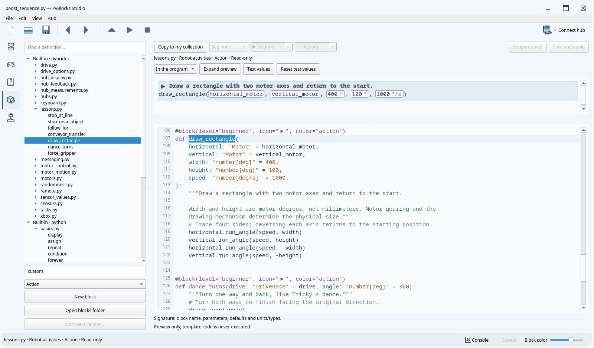

# PyBlocks Studio

**Learn Python by building real programs with blocks.**

PyBlocks Studio is a desktop editor for learning Python and programming LEGO robots
running [Pybricks](https://pybricks.com/). Blocks are an editable view of ordinary
Python: the program stays a `.py` file, and you can switch between blocks and text
as you learn. Your code, documentation and downloaded building resources stay on
your computer.

> **Early alpha — a personal project used with my own children.**
> I am sharing it early to find out whether this approach is useful to other
> families and educators. Expect bugs, changing interfaces and incomplete hardware
> coverage. Public use is at your own risk; keep copies of your programs and
> supervise children when running real robots.


## Why this project exists

I want children to start with Python while getting the help that makes block
editors approachable: discoverable actions, editable parameters and fewer syntax
mistakes. The Beginner library starts small. Intermediate, Advanced and Expert
levels gradually expose more control, and useful robot actions can be explored
through their Python definitions.

The goals are a smooth path from blocks to text, a comfortable desktop workspace,
and useful offline operation. Editing, bundled help, virtual hubs and saved
projects work without an internet connection. External videos, downloads and
uncached building resources need a connection.

## What you can try today

- **Blocks and Python:** drag blocks, edit expressions and parameters, use code
  completion, keep unfinished fragments in Scratch, and undo whole operations.
- **Your own blocks:** inspect built-in definitions or write Python definitions
  with a live preview, editable arguments, icons, colors and learning levels.
- **Robots:** connect to Pybricks hubs over Bluetooth or supported USB connections,
  upload and run programs, read console output, inspect ports, and install or
  restore supported firmware. Target families are SPIKE Prime / Robot Inventor,
  BOOST and Technic. Virtual hubs are available for trying basic programs.
- **Optional lessons:** open activities, track progress, and use 3D building views
  where a model is available. Source credits and links to original building
  instructions are retained. Downloaded models and parts are cached outside the
  repository.
- **English and Russian:** switch the interface and its offline documentation
  together through **View → Language**.



Hardware support varies by model and firmware. The virtual hub is a programming
simulator, not a simulation of the robot's mechanics. Some examples require
controllers, multiple hubs or devices that it cannot simulate. See the
[robotics guide](doc/en/robotics.md) and [example requirements](doc/en/examples.md).

## Try it from source

Clone or download this repository and open a terminal in its directory. Install
[uv](https://docs.astral.sh/uv/getting-started/installation/), then run:

```sh
uv sync --locked --extra qt --extra pybricks --extra gamepad
uv run --locked --extra qt --extra pybricks --extra gamepad pyblocks-qt
```

For the editor and virtual hubs alone, use `--extra qt` in both commands. Keep the
same extras when launching: `uv run` synchronizes the selected dependencies.
Python 3.11+ is supported; uv uses the development version in `.python-version`.
See [installation](doc/en/INSTALL.md) for a regular virtual environment and
connection requirements.

1. Open **File → Examples → first.py**, or start an empty document.
2. Add blocks from the library and edit their parameters. Switch to **Python** to
   edit the same program as text.
3. Choose **Connect hub → Virtual hub** to try a program without hardware, then
   press **F5** to run. For a real robot, select a matching example and connect a
   hub running Pybricks firmware.

The [first steps guide](doc/en/tutorial/first.md) walks through a small program.
The terminal interface is also available with
`uv run --extra tui pyblocks-tui examples/first.py`; the command-line tools start
with `uv run pyblocks inspect examples/first.py`.

## Documentation and feedback

[English guide](doc/en/index.md) · [Руководство на русском](doc/ru/index.md)

- [Editing programs](doc/en/usage.md) and [learning levels](doc/en/learning.md)
- [Robots and controls](doc/en/robotics.md)
- [Lessons, student projects and assembly](doc/en/lessons.md)
- [Creating blocks](doc/en/block-editor.md)
- [Bundled examples and credits](examples/pybricks/README.md)
- [Additional Pybricks projects — external links](examples/pybricks/website/README.md)

Feedback about learning and editing is especially useful: where a child gets
stuck, which action is hard to find, and where blocks make a program harder to
understand. Bug reports should include your operating system, hub and firmware
when relevant, the steps to reproduce, and a small example program.

## Development

```sh
uv sync --all-extras --locked
uv run --all-extras --locked pytest
uv run --all-extras --locked ruff check pyblocks tests tools build_support.py
uv run --all-extras --locked black --check pyblocks tests tools build_support.py
uv run --all-extras --locked python tools/translations.py check
uv run --all-extras --locked python tools/check_docs.py
uv build
```

The [GitHub Actions workflow](.github/workflows/checks.yml) runs these checks on
GitHub's Ubuntu runner, with Qt in offscreen mode and simulated devices. Physical
Bluetooth/USB, flashing and native 3D rendering still need local checks.

See the [architecture](doc/en/architecture.md), [development invariants](doc/en/development.md)
and [design specification](devs/PYBLOCKS_DESIGN_SPEC.md). Examples retain upstream
formatting; lint and formatting checks target the application, tests and tools.

## License and credits

Studio's software is [MIT licensed](LICENSE.txt). Bundled examples retain their
sources and license notices. Website-only Pybricks programs are linked instead
of redistributed. Small community LDraw models use CC BY 2.0 with separate
[attribution and license texts](lessons/pybricks/README.md#ldraw-assembly-instructions).
The LDraw parts library is downloaded into external user storage.

This is an independent project, not an official LEGO or Pybricks product.
[Pybricks](https://pybricks.com/) provides the firmware and robotics APIs that make
it possible; please support their work. LEGO and its product names belong to
their respective owners.
