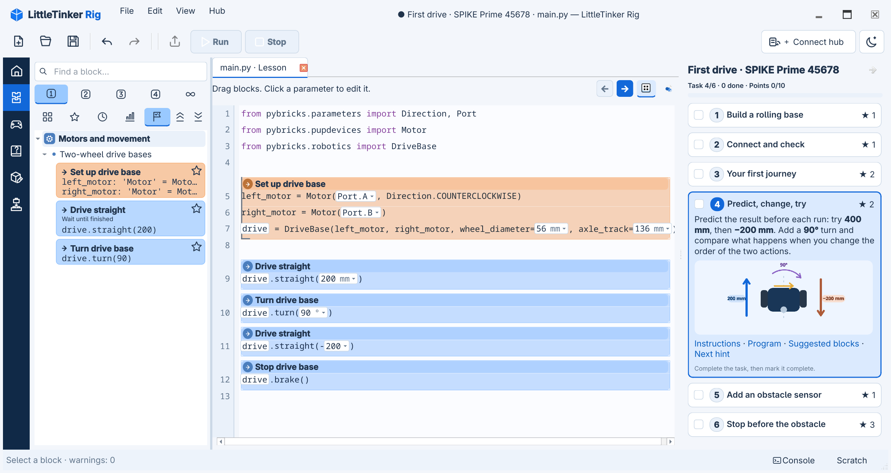

# LittleTinker Rig

**Learn Python by building real programs with blocks.**

LittleTinker Rig is a desktop editor for learning Python and programming LEGO robots
running [Pybricks](https://pybricks.com/). Blocks are an editable view of ordinary
Python: the program stays a `.py` file, and you can switch between blocks and text
as you learn. Your code, documentation and downloaded building resources stay on
your computer.



> **Early alpha — a personal project used with my own children.**
> I am sharing it early to find out whether this approach is useful to other
> families and educators. Expect bugs, changing interfaces and incomplete hardware
> coverage. Public use is at your own risk; keep copies of your programs and
> supervise children when running real robots.

## Why this project exists

I want children to start with Python while getting the help that makes block
editors approachable: discoverable actions, editable parameters and fewer syntax
mistakes. The Beginner library starts small. Intermediate, Advanced and Expert
levels gradually expose more control, and useful robot actions can be explored
through their Python definitions.

The goals are a smooth path from blocks to text, a comfortable desktop workspace,
and useful offline operation. Editing, bundled help, virtual hubs and saved
projects work without an internet connection. External videos, downloads and
uncached building resources need a connection.

## What you can try today

- **Blocks and Python:** drag blocks, edit expressions and parameters, use code
  completion, keep unfinished fragments in Scratch, and undo whole operations.
- **A smaller catalog:** find operation families in eight category branches,
  switch variants with a Python preview, and keep Favorites, Recent, Frequent,
  and the current lesson's blocks separate from the difficulty buttons.
- **Your own blocks:** inspect built-in definitions or write Python definitions
  with a live preview, editable arguments, icons, colors and learning levels.
- **Robots:** connect to Pybricks hubs over Bluetooth or supported USB connections,
  upload and run programs, read console output, inspect ports, and install or
  restore supported firmware. Target families are SPIKE Prime / Robot Inventor,
  BOOST and Technic. USB Serial and beta firmware installation also include
  experimental EV3 support, untested on hardware; EV3 port monitoring is not
  available yet. Virtual hubs are available for trying basic programs.
- **Optional lessons:** open activities, track progress, and use 3D building views
  where a model is available. Source credits and links to original building
  instructions are retained. Downloaded models and parts are cached outside the
  repository.
- **English and Russian:** switch the interface and its offline documentation
  together through **View → Language**.

Follow a robot's assembly in 3D. The view shows the current step, its parts and
instructions; this SPIKE Prime rolling base is still under construction.


Start with the illustrated [first steps tutorial](doc/en/tutorial/first.md): edit
a message and a repeat count, run it on a virtual hub, then see the same program
as Python. No LEGO set is needed for this first activity.


Hardware support varies by model and firmware. The virtual hub is a programming
simulator, not a simulation of the robot's mechanics. Some examples require
controllers, multiple hubs or devices that it cannot simulate. See the
[robotics guide](doc/en/robotics.md) and [example requirements](doc/en/examples.md).

## Try it from source

Install [Git](https://git-scm.com/downloads) and
[uv](https://docs.astral.sh/uv/getting-started/installation/), then clone the
[repository](https://github.com/alepoydes/little-tinker-rig) and install the editor once:

```sh
git clone https://github.com/alepoydes/little-tinker-rig.git
cd little-tinker-rig
uv sync --locked --no-dev --extra qt
```

Then double-click `.venv\Scripts\little-tinker-rig-qt.exe` on Windows, or run
`./.venv/bin/little-tinker-rig-qt` on Linux/macOS. You can make a desktop shortcut
to the Windows executable. Launches do not need `uv` options or a file name.
For a physical hub, install its tools once with
`uv sync --locked --no-dev --extra qt --extra pybricks`, then use the same launcher.
Keep all wanted extras in future `uv sync` commands; sync can remove omitted ones.
See [installation](doc/en/INSTALL.md) for Windows setup, connection requirements
and troubleshooting.

1. On **Home**, open **First Python program** for a short guided activity without
   a physical robot. **New program** opens an empty document; **Open a file…**
   opens existing work. The Home icon returns to this page without closing tabs.
2. Add blocks from the library and edit their parameters. Switch to **Python** to
   edit the same program as text.
3. Choose **Connect hub → Virtual hub** to try a program without hardware, then
   press **F5** to run. For a real robot, select a matching example and connect a
   hub running Pybricks firmware.

Run uses the current program without requiring a filename. Bundled examples open
as autosaved working copies: reopening continues your last attempt. **File →
Examples → Start this example again** creates another; **My attempts** keeps earlier
work accessible. Save As retains the example association and local modules.

The [first steps tutorial](doc/en/tutorial/first.md) walks through the editor and
a small program.
The command-line tools start with
`./.venv/bin/little-tinker-rig inspect examples/first.py` on Linux/macOS, or
`.\.venv\Scripts\little-tinker-rig.exe inspect examples/first.py` on Windows.

## Documentation and feedback

[English guide](doc/en/index.md) · [Руководство на русском](doc/ru/index.md)

- [Editing programs](doc/en/usage.md) and [learning levels](doc/en/learning.md)
- [Robots and controls](doc/en/robotics.md)
- [Lessons, student projects and assembly](doc/en/lessons.md)
- [Creating blocks](doc/en/block-editor.md)
- [Bundled examples and credits](examples/pybricks/README.md)
- [Additional Pybricks projects — external links](examples/pybricks/website/README.md)
- [Changelog](CHANGELOG.md)

Feedback about learning and editing is especially useful: where a child gets
stuck, which action is hard to find, and where blocks make a program harder to
understand. [Bug reports](https://github.com/alepoydes/little-tinker-rig/issues)
should include your operating system, hub and firmware
when relevant, the steps to reproduce, and a small example program.

## Development

```sh
uv sync --all-extras --locked
uv run --all-extras --locked pytest
uv run --all-extras --locked ruff check little_tinker_rig tests tools build_support.py
uv run --all-extras --locked black --check little_tinker_rig tests tools build_support.py
uv run --all-extras --locked python tools/translations.py check
uv run --all-extras --locked python tools/check_docs.py
uv build
```

The [GitHub Actions workflow](.github/workflows/checks.yml) runs full checks on
Ubuntu and an installation, launcher and virtual-hub smoke check on Windows.
Physical Bluetooth/USB, flashing and native 3D rendering still need local checks.
See [USB connection help](doc/en/usb.md) for serial-port permissions and troubleshooting.

See the [project rules](AGENTS.md), [architecture](doc/en/architecture.md), [development invariants](doc/en/development.md)
and [design specification](devs/DESIGN_SPEC.md). Examples retain upstream
formatting; lint and formatting checks target the application, tests and tools.

Qt is the primary interface. The [Textual terminal workspace](doc/en/tui.md)
focuses on Python source editing and Pybricks tools: program upload/run, console
input/output, firmware installation and port monitoring. It has no block editor,
Scratch or lesson views, and does not require Qt. Start it with
`./.venv/bin/little-tinker-rig-tui` after installing the `tui` extra; add
`pybricks` during installation for real hubs. See the [TUI guide](doc/en/tui.md).

## License and credits

LittleTinker Rig's software is [MIT licensed](LICENSE.txt). Bundled examples retain their
sources and license notices. Website-only Pybricks programs are linked instead
of redistributed. Small community LDraw models use CC BY 2.0 with separate
[attribution and license texts](lessons/pybricks/README.md#ldraw-assembly-instructions).
The LDraw parts library is downloaded into external user storage.

This is an independent project, not an official LEGO or Pybricks product.
LEGO and its product names belong to their respective owners.

## With heartfelt thanks

LittleTinker Rig is a small family project made possible by an extraordinary
amount of work shared by others. Behind every moving motor, helpful completion
and tiny LEGO pin on screen are people who wrote code, documented hardware,
created models and patiently helped someone learn. We are deeply grateful.

- **[Pybricks](https://pybricks.com/)** and its team and community: thank you for
  giving these robots such a wonderful Python home. Your firmware, robotics APIs,
  documentation, examples and [development tools](https://github.com/pybricks/pybricksdev)
  are the foundation of our work. You make it possible for us to spend our time
  helping children explore and create. Please support Pybricks and its continued
  development.
- **[LDraw](https://www.ldraw.org/)** and everyone who authors, measures, reviews
  and maintains its parts: thank you for the remarkable care behind this shared
  library. A single connector can represent hours of someone's patient work.
  Our assembly view exists because so many people chose to share that work.
- **The builders who share models and instructions**, especially
  **[Philippe “Philo” Hurbain](https://www.philohome.com/)**, whose robot models and
  assembly steps are included here: thank you for making these builds available
  for others to study and enjoy. See the
  [model credits](lessons/pybricks/README.md#ldraw-assembly-instructions) for the
  original designs, authors and sources. Our thanks also go to the LEGO designers
  whose creations give children and adults so much to discover.
- **The teachers, robot builders and programmers sharing their experiments**:
  thank you for turning working code into something another person can learn
  from. The [example credits](examples/pybricks/README.md) and
  [community sources](examples/pybricks/community/SOURCES.md) acknowledge the
  people whose programs and ideas helped shape this collection.
- **[Python](https://www.python.org/) and [MicroPython](https://micropython.org/)**:
  thank you for a language and ecosystem that welcome beginners while leaving
  room to grow, on a desktop and inside a robot.
- **[Qt for Python / PySide6](https://doc.qt.io/qtforpython-6/)** and
  **[Jedi](https://jedi.readthedocs.io/en/latest/)**: thank you for the foundations
  of our desktop interface and the code assistance that helps learners find
  their way. **[Textual](https://github.com/Textualize/textual)** provides the
  interface for our experimental terminal editor.
- **[ModernGL](https://moderngl.readthedocs.io/en/latest/)** and
  **[NumPy](https://numpy.org/)**: thank you for making our interactive 3D assembly
  view possible.
- **[pygame-ce](https://pyga.me/)** and the **[SDL](https://www.libsdl.org/)**
  library it builds on: thank you for the gamepad support that helps put robot
  control into children's hands. **[Bleak](https://github.com/hbldh/bleak)**,
  **[PyUSB](https://pyusb.github.io/pyusb/)** and
  **[pySerial](https://pyserial.readthedocs.io/)** help us connect to their hubs.

We also thank the maintainers of platformdirs, Babel, uv, Ruff, Black, pytest,
setuptools and the many dependencies beneath them. Packaging, translations,
testing and maintenance are often invisible, but this project depends on them
every day. To everyone sharing code, models, documentation, bug reports or a
patient answer: thank you for helping make a small family's idea possible.
