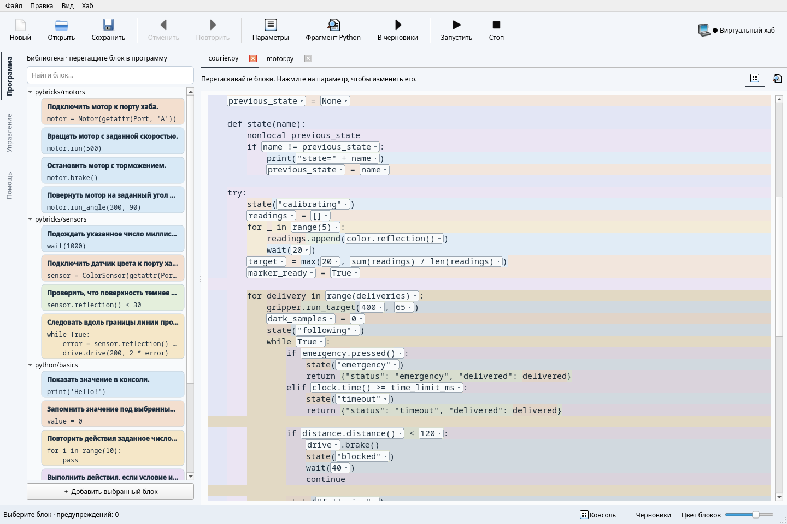

# PyBlocks Studio

Структурный редактор обычного Python для обучения и робототехники.
Файл `.py` остаётся программой; блоки и подсказки строятся по его структуре.

Общее ядро обслуживает CLI, терминальный интерфейс Textual и настольный PySide6.
Library содержит Python- и Pybricks-сниппеты, Scratch хранит незаконченный код,
а история отменяет целые операции. Робототехника и тяжёлые интерфейсы необязательны.

В Qt можно открыть несколько файлов во вкладках, переключать структурный и
обычный Python-режимы, менять параметры прямо в блоках. Интерфейс и встроенная
помощь доступны на русском и английском: **Вид → Язык**. Есть скрываемая консоль
и экранный Xbox-контроллер с назначением моторов. Виртуальные профили
Inventor/Prime, BOOST и Technic позволяют учиться без оборудования; подключение
настоящих хабов рассчитано на прошивку Pybricks.

## Быстрый запуск

```sh
uv sync --extra qt
uv run --extra qt pyblocks-qt examples/first.py
```

В терминале: `uv run --extra tui pyblocks-tui examples/first.py`.
Без интерфейса: `uv run pyblocks inspect examples/first.py`.



Для первого запуска программы нажмите «Подключить хаб» → «Виртуальный хаб»,
выберите модель и нажмите F5. В терминале:

```sh
uv run pyblocks run examples/motor.py --transport virtual --model boost
```

Практический пример — [робот-курьер](doc/robotics.md#робот-курьер): движение по
линии, остановка перед препятствием, захват груза и аварийная кнопка.
Откройте `examples/courier.py`, подключите виртуальный Inventor и назначьте
порту F мотор захвата.

## Документация

- [Установка](doc/INSTALL.md)
- [Первое знакомство без опыта программирования](doc/tutorial/first.md)
- [Редактор и CLI](doc/usage.md)
- [Робот, джойстик и геймпад](doc/robotics.md)
- [Авторские библиотеки сниппетов](doc/snippets.md)
- [API для разработчиков](doc/api.md)
- [Архитектура и принятые решения](doc/architecture.md)
- [Разработка и инварианты](doc/development.md)
- [English documentation](doc/en/tutorial/first.md)
- [Спецификация](devs/PYBLOCKS_DESIGN_SPEC.md)

## Разработка

Требуется [uv](https://docs.astral.sh/uv/).

```sh
uv sync --all-extras --locked
uv run --all-extras pytest
uv run ruff check .
uv run black --check .
uv run python tools/translations.py check
uv build
```

`uv.lock` фиксирует версии. Для работы только с ядром: `uv sync`.
Отдельные интерфейсы: `uv sync --extra tui` или `uv sync --extra qt`.
Подключение к роботам: `uv sync --extra pybricks`.
Геймпад: `uv sync --extra gamepad`.

Пакет находится в `pyblocks/`, документация — в `doc/`,
примеры — в `examples/`, тесты — в `tests/`.
