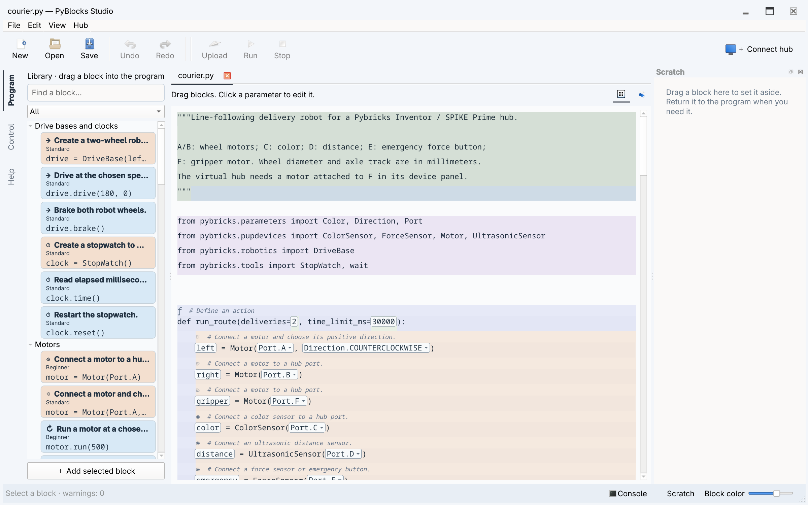

# PyBlocks Studio

A structural editor for ordinary Python, built for learning and robotics.
The `.py` file remains the program; blocks and editing hints are derived from it.

One core serves the command-line interface, Textual terminal editor, and PySide6
desktop application. The library provides Python and Pybricks templates, Scratch
keeps unfinished fragments, and undo restores whole operations. Robotics and the
graphical interfaces are optional dependencies.

The desktop editor supports document tabs, Blocks / Python views, inline parameter
editing, and a visible Scratch ribbon with drag-and-drop. English is the default
language; **View → Language → Русский** switches both the interface and its offline
guide to Russian. Existing language preferences are preserved. Block reference
pages collect all templates in a group, with direct links from the editor. Library
levels (Beginner, Standard, Expert, All) combine with search. Drags keep a four-line
colored preview, an origin marker and an insertion row; Escape cancels the gesture.

Virtual Inventor/Prime, BOOST, and Technic profiles support learning without a
robot. Physical connections target hubs running Pybricks firmware. The window
also includes a console and an Xbox-style controller with motor assignments. Upload
without running, run stored programs, and install Pybricks or restore compatible
LEGO firmware through the desktop [firmware dialog](doc/en/robotics.md#installing-and-restoring-firmware).

## Quick start

```sh
uv sync --extra qt
uv run --extra qt pyblocks-qt examples/first.py
```

Terminal editor: `uv run --extra tui pyblocks-tui examples/first.py`.
Command line: `uv run pyblocks inspect examples/first.py`.



To run a program, choose **Connect hub → Virtual hub**, select a model, and press
**F5**. From the terminal:

```sh
uv run pyblocks run examples/motor.py --transport virtual --model boost
```

The [delivery robot](doc/en/robotics.md#delivery-robot) example combines line
following, obstacle detection, a gripper, and an emergency button. Open
`examples/courier.py`, connect a virtual Inventor, and assign a gripper motor to F.

## Documentation

- [English guide](doc/en/index.md) · [Руководство на русском](doc/ru/index.md)
- [Installation](doc/en/INSTALL.md)
- [First steps](doc/en/tutorial/first.md)
- [Editing and command-line tools](doc/en/usage.md)
- [Robots and controls](doc/en/robotics.md)
- [Authoring snippet libraries](doc/en/snippets.md)
- [Developer API](doc/en/api.md)
- [Architecture](doc/en/architecture.md)
- [Development and invariants](doc/en/development.md)
- [Design specification](devs/PYBLOCKS_DESIGN_SPEC.md)
- [Studio interaction design](devs/UX_DESIGN.md)

## Development

Install [uv](https://docs.astral.sh/uv/), then:

```sh
uv sync --all-extras --locked
uv run --all-extras pytest
uv run ruff check .
uv run black --check .
uv run python tools/translations.py check
uv run python tools/check_docs.py
uv build
```

`uv.lock` pins dependencies. For the core alone, use `uv sync`. Select interfaces
with `--extra tui` or `--extra qt`, physical connections with `--extra pybricks`,
and gamepads with `--extra gamepad`.

Source is in `pyblocks/`, localized documentation in `doc/en/` and `doc/ru/`,
examples in `examples/`, and tests in `tests/`. Code comments, docstrings, design
notes, and commit descriptions use English. Russian UI translations are maintained
in gettext catalogs; the runtime needs only the Python standard library for them.
