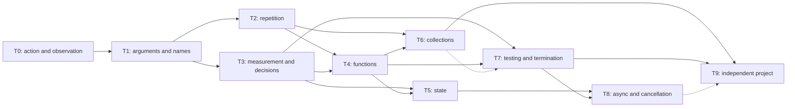

# Pybricks, SPIKE, and MINDSTORMS block catalogs and Python learning

Research date: **October 16, 2026**. Status: research input for LittleTinker Rig
library and lesson design. Proposals here do not change implemented editor contracts.
Developer documentation is maintained in English only. End-user localization
applies to the GUI, block descriptions, and lab/lesson content.

The purpose is to identify the operations needed for complete projects, explain
why apparently similar blocks exist separately, and connect the library to a
learning progression. The comparison unit is an **operation or a family of related
operations**, not an individual picture or every dropdown choice. The P/S/M
catalogs contain 140 entries; EV3 is summarized separately. This is not a count
of unique interface blocks.

Navigation:

- Catalogs: [Pybricks](#3-pybricks-code), [SPIKE](#4-spike-app-word-blocks),
  [Robot Inventor](#5-mindstorms-robot-inventor),
  [EV3](#6-mindstorms-ev3-a-separate-design).
- [Why similar blocks exist separately](#7-why-similar-blocks-exist-separately).
- [Teaching in the source environments](#8-teaching-in-the-source-environments).
- [Our learning progression and projects](#9-proposed-littletinker-rig-learning-progression),
  [Python-specific transfer](#10-teaching-python-explicitly).
- [Current project coverage](#11-current-littletinker-rig-coverage),
  [proposed library organization](#12-proposed-library-organization),
  [criteria before implementation](#13-readiness-criteria-before-implementation).
- [Catalog reduction and personal navigation](#14-catalog-reduction-and-personal-navigation-proposal).

## 1. Scope and evidence

| Environment | Scope | Evidence boundary |
|---|---|---|
| Pybricks Code | Public web build on the research date, Learn tutorials, API documentation labeled v4.1.0 | Categories and operations checked against block definitions shipped with the editor. A Python API method does not by itself establish a separate palette block |
| SPIKE App | SPIKE 3 generation Word Blocks; public web build containing version `3.6.1` | Registered operations and labels inspected. Availability depends on hub, extension, and execution mode; a leftover translation string is insufficient evidence |
| SPIKE Legacy | Historical differences documented by LEGO | Kept separate from SPIKE 3, rather than presented as one simultaneously available set |
| MINDSTORMS Robot Inventor, 51515 | Historical Scratch-style environment, common families, and distinctive capabilities | Official materials establish product capabilities and selected examples. The complete final application palette and every model extension menu have not been recovered; gaps are marked |
| MINDSTORMS EV3 | Brief appendix on the older EV3 Software/Lab | A separate environment using data wires. EV3 Classroom must not automatically be treated as the same catalog |

Robot Inventor is a historical reference: LEGO announced discontinuation of its
application on October 1, 2026. Current support directs owners of its hub to SPIKE
App. This does not establish compatibility with every old extension or project.
[LEGO announcement on Google Play](https://play.google.com/store/apps/details?hl=en-GB&id=com.lego.retail.mindstorms),
[current LEGO support](https://www.lego.com/en-us/service/help-topics/article/about-mindstorms-robot-inventor).

**Reading the tables.** Names identify recognizable operations; semicolons separate
related variants. The rationale column contains our engineering and educational
interpretation, not claims about the original designers' intentions. Python
equivalents describe semantic transfer, not necessarily identical generated code.

Roles: **A** — action; **V** — value/expression; **F** — flow control;
**D** — definition or configuration; **E** — event starting a stack. Reading a
sensor can cost time and depend on the outside world: V does not imply a pure
mathematical function.

Primary evidence for palette contents:

- [Pybricks Code](https://code.pybricks.com/):
  [main.65257393.js](https://code.pybricks.com/static/js/main.65257393.js) and
  [editor definitions in 4852.a2897ee8.chunk.js](https://code.pybricks.com/static/js/4852.a2897ee8.chunk.js).
- [SPIKE App](https://spike.legoeducation.com/):
  [index.dbbcd12a.js](https://spike.legoeducation.com/static/js/index.dbbcd12a.js).

Build identifiers record the inspected snapshot. These assets were read as
product evidence; LittleTinker Rig does not depend on them, and they are not
included in this repository. Dynamically created user blocks, internal test
operations, and hidden compatibility blocks are not counted as separate teaching
features. Hardware execution was not tested in this research.

The historical Robot Inventor App overview and LEGO's Google Play announcement
were available through search-index snapshots; direct checks of those two URLs
returned 404. They establish historical capabilities and the announcement, not
current application availability. Current LEGO support and the cited teaching
PDFs remain directly accessible. Original links identify the sources; a permanent
archival copy has not been verified.

## 2. Five independent ways to classify blocks

| Dimension | Question answered | Example |
|---|---|---|
| Catalog category | Where do I find it? | Motors; measurements; functions |
| Syntactic role | Where can it fit? | Statement; expression; loop body; definition |
| Learning concept | What must the learner understand? | Parameter; repetition; state; feedback |
| Execution requirements | Where does it work? | Port sensor; IMU; connected application; internet |
| Prerequisite knowledge | When should it be introduced? | A returning function requires understanding calls and expressions |

Category color does not replace shape or role. Resetting a stopwatch and reading
elapsed milliseconds belong to one subject but fit different positions in a
program. Difficulty is also independent: motors matter both in the first lesson
and when studying a controller.

In Scratch-style environments, an event hat starts a stack, ordinary commands
extend it, C-shaped blocks contain bodies, and expressions supply arguments or
conditions. Pybricks additionally gives equipment setup a distinct connection.
In LittleTinker Rig, these distinctions should explain actual Python syntax:
expressions, statements, indentation, and definitions.

## 3. Pybricks Code

### 3.1. Categories and organizing principle

The inspected build has eight top-level sections in this order:

| Section | Contents and internal groupings |
|---|---|
| **Setup** | Hub, motors, drive base, sensors, lights, remote, stopwatch, external data |
| **Output** | Motors; Drive Base; Car; light and display; printing; communication; sound |
| **Input** | Motor and drive-base measurements; buttons; sensors; IMU; remote; time; communication |
| **Flow** | Decisions, waiting, repetition, and loop control |
| **Tasks** | Start stacks, concurrent tasks, definitions, calls, returns |
| **Data** | Numbers and mathematics; logic; geometry; text and sequences |
| **Variables** | Names and assignment; imports; function and object access |
| **Other** | Comments; stopping the program; hub shutdown and stop-button configuration |

The environment first describes the robot, then addresses named objects. Motor
direction and port are specified once. The tutorial explicitly asks learners to
change ports and examine how many program locations need updating. This provides
an early introduction to configuration and device abstraction.
[Essential coding tools](https://pybricks.com/learn/making-programs/basic-blocks/).

### 3.2. Setup: describing equipment

The public build establishes the following operations. Configured device
capabilities determine subsequent Input/Output choices.

| ID | Block / variants | Role and behavior | Distinction and rationale |
|---|---|---|---|
| P01 | Hub Setup: Prime, Inventor, Essential, Technic, City, Move; separate historical hubs | D: creates a hub object | Hubs have different capabilities. Mounting orientation and available equipment belong to configuration |
| P02 | Motor Setup | D: name, port, positive direction | A positive angle can mean raising a gripper regardless of mirrored mounting. Equivalent: `motor = Motor(...)` |
| P03 | Simple/DC/PF Motor Setup | D: motors without ordinary position control | A motor without an encoder cannot promise angle measurement; the distinction prevents false interchangeability |
| P04 | Drive Base Setup | D: two motors, wheel diameter, axle track | Introduces a composite mechanism and physical units. Robot travel is different from shaft rotation |
| P05 | Car Setup | D: steering motor and propulsion | Steering geometry and calibration differ from a differential two-wheel drive |
| P06 | Color / ColorDistance / Ultrasonic / Force / Infrared / Tilt Sensor Setup | D: sensor type and port | Different instruments answer related measurement questions. EV3/NXT variants remain platform-specific |
| P07 | Light / Color Light Matrix Setup | D: external light devices | Distinguishes a connected module from the hub's built-in status light or display |
| P08 | Remote / Xbox Controller Setup | D: control input source | Human commands become input data; connecting a device and processing its buttons are separate operations |
| P09 | Stopwatch Setup | D: an independent stopwatch | Several duration measurements can have independent origins |
| P10 | App Data / smart sensor; BLE radio configuration | D: external data format or radio communication | Camera processing on a phone is not an onboard hub sensor. Format and channel form a contract between programs |

### 3.3. Output: actions and mechanism settings

| ID | Block / variants | Role and behavior | Distinction and rationale |
|---|---|---|---|
| P11 | Motor Run: continuously; by angle; to target angle; until stalled | A: `run`, `run_angle`, `run_target`, `run_until_stalled` | Relative motion, a coordinate, and a mechanical reference solve different problems. Seeking an end stop can establish a physical origin |
| P12 | Motor Duty | A: sets duty cycle with `dc(duty)` | This is an actuation command; equal duty under different loads does not guarantee equal speed |
| P13 | Motor Stop: coast / brake / hold | A: free coast, passive braking, or active holding | Holding a raised mechanism and allowing a wheel to roll freely require different physical behavior |
| P14 | Motor Configure: speed, acceleration, torque, voltage limits; completion tolerances | A: changes control settings | Settings affect later commands. Tolerances define when a maneuver is sufficiently complete |
| P15 | Motor Track Target | A: updates a position target | A rapidly changing target needs different behavior from a self-contained smooth maneuver |
| P16 | Drive Base Move: straight; turn by/to angle; arc by angle/distance; displacement `dx, dy` | A: finite maneuver | One object coordinates the wheels. An arc separates radius from travel; wheel rotation and robot heading are different quantities |
| P17 | Drive Base Start | A: sets linear speed and turn rate | The next statement runs while the robot moves. Useful for feedback control and sensor-driven behavior |
| P18 | Drive Base Stop | A: ends movement | Completes an action started earlier; the program should make ownership of stopping clear |
| P19 | Drive Base Configure / Use Gyro | A: speed, acceleration, turning settings; gyro use | Separates the route from motion quality. A gyro does not remove all mechanical errors |
| P20 | Car Drive: power/speed; Car Steer | A: propulsion and steering | Supports a steering mechanism; it is not a mechanical substitute for DriveBase's two-wheel arrangement |
| P21 | Light On / Off; color and brightness | A: hub indicator, sensor illumination, or external light | Visible output communicates state and supports diagnosis without a computer |
| P22 | Light Matrix: character; number; pixel; off; external color matrix | A: spatial output | Coordinates and brightness bridge a ready-made symbol and an image represented as data |
| P23 | Speaker Beep | A: tone frequency and duration | Sound marks completion or a state; duration connects output to timing |
| P24 | Print: multiple values, separator | A: sends values to the console | An observation tool. Time/value pairs support measurement experiments |
| P25 | BLE Broadcast | A: transmits radio data | Inter-hub communication differs from a local function call; format, freshness, and missing data matter |

Motor behavior was checked against the
[Motor API](https://docs.pybricks.com/en/latest/pupdevices/motor.html), drive behavior
against the [DriveBase API](https://docs.pybricks.com/en/latest/robotics.html) and
[navigation tutorial](https://pybricks.com/learn/making-programs/basic-robot-navigation/),
and output against the
[sound and light tutorial](https://pybricks.com/learn/making-programs/sound-light/).
The inspected Motor Run menu has no separate `run_time` option: the Python method
must not be counted as a corresponding palette card. Hidden legacy Drive Base
definitions are also not additional current categories.

### 3.4. Input: observation and reference frames

| ID | Block / variants | Role and behavior | Distinction and rationale |
|---|---|---|---|
| P26 | Motor Measure: angle; speed; load; stalled | V: number or `bool` | A motor is also a sensor. Commanded speed and measured speed are different |
| P27 | Motor Reset Angle | A: changes the coordinate origin | Resetting a reading does not move the shaft; distinguish it from physical homing |
| P28 | Drive Base Measure / Reset | V/A: distance, angle, other motion quantities; reset | Odometry estimates movement relative to an origin, not an absolute map of the room |
| P29 | Distance | V: measured distance | Units and unreliable or absent reflections depend on the instrument |
| P30 | Color; Reflection; Ambient light | V: color category or light intensity | A named color and a reflection threshold offer different ways to detect a line; lighting affects measurements |
| P31 | Force; Pressed / Released | V: force or device-specific logical state | Quantitative readings distinguish weak contact from a stronger press |
| P32 | Buttons pressed / selected button pressed | V: hub, remote, or controller button state | Conditions can be combined. Reading a held button does not count individual presses |
| P33 | Tilt; side up; IMU rotation / angular velocity / acceleration | V: hub position or movement | Angle, change of angle, and acceleration are different quantities; axis directions must be explained |
| P34 | IMU heading / reset heading / status / configure | V/A: heading, readiness, and reference | Zero heading is a chosen reference, not necessarily geographic north |
| P35 | Stopwatch Time / Reset / Pause / Resume | V/A: reads and controls a stopwatch | Pausing the clock does not pause the program; accumulated duration differs from a delay |
| P36 | Battery Measure: voltage/current | V: power-supply state | Useful for load experiments and diagnosis, without being a prerequisite for basic lessons |
| P37 | BLE Observe | V: received data | A read may lack a current value; reception is not a guaranteed request/reply exchange |
| P38 | Joystick Value; controller buttons; rumble | V/A: axes, buttons, controller feedback | An analog axis requires scaling and a dead zone; rumble is output to the same device |
| P39 | App Data Get Values: one/all | V: connected-application data | Index and format matter. Smart-sensor image processing runs on the external device |
| P40 | Read Input; Sound Input; Temperature | V: keyboard/input, sound, or temperature on suitable platforms | Separate input sources, not a guaranteed sensor set on every modern hub |

The [Measuring sensor values tutorial](https://pybricks.com/learn/sensors/measuring-sensor-values/)
starts with displaying readings and investigating materials and sensor range
before controlling motion. For smart sensors, see
[phone integration](https://pybricks.com/learn/smart-sensors/getting-started/).

### 3.5. Flow, Tasks, and termination

| ID | Block / variants | Role and behavior | Distinction and rationale |
|---|---|---|---|
| P41 | Start | F: begins a sequence | Multiple start stacks introduce concurrent execution; canvas placement does not establish ordering between them |
| P42 | Wait Time | F: waits a duration in milliseconds | A time delay does not verify that a goal was reached; `1000` means one second |
| P43 | Wait Until | F: reevaluates a condition until true | An initially true condition needs no wait. Python requires repeated expression evaluation |
| P44 | Wait Forever | F: keeps the program running | Distinguishes completion of the final command from desired program termination; matters for device lifecycle |
| P45 | Repeat Times | F: finite repetition | Introduces repeated algorithms and body boundaries; transfers to `for ... in range(...)` |
| P46 | Conditional Repeat: while/until | F: repeats while/until a condition holds | The condition is checked before each body; zero iterations are possible. `until c` transfers to `while not c` |
| P47 | For Each | F: iterates over elements | Repetition becomes data traversal rather than only counting |
| P48 | Break / Continue | F: exits a loop / skips the remaining iteration | Different control boundaries; neither inherently terminates the whole program |
| P49 | If / Else If / Else | F: selects a branch | Makes a decision now, not a continuously active rule |
| P50 | Task definition / caller / arguments / return | D/A/V: named subprogram | Definition is different from invocation. Parameters enable reuse; a result can participate in an expression |
| P51 | Multitask: all | F: starts branches and waits for every branch | An explicit join: the next command follows the entire composite action |
| P52 | Multitask: race | F: finishes with the first completed branch and cancels the rest | Expresses movement until a sensor or timeout; cancellation requires understanding remaining effects |
| P53 | Stop program; shutdown hub; stop button configuration | A/F: termination, power, stop input | Returning from a function, ending a program, and powering down are different lifecycle levels |
| P54 | Comment | D: explanation, not executable work | Records rationale, units, and assumptions about the mechanism |

Behavioral sources:
[waiting and repetition](https://pybricks.com/learn/flow-basics/waiting-repeating/),
[tasks and functions](https://pybricks.com/learn/flow-basics/tasks-functions/),
[multitasking](https://pybricks.com/learn/flow-basics/multitasking/),
[races and cancellation](https://pybricks.com/learn/flow-basics/advanced-multitasking/),
[responding to measurements](https://pybricks.com/learn/sensors/responding-sensor-values/).
In particular, cancelling an awaited motor maneuver and resetting a previously
set light color are not equivalent; persistent output states need deliberate cleanup.

### 3.6. Data and Variables

| ID | Block / variants | Role and behavior | Distinction and rationale |
|---|---|---|---|
| P55 | Number; quantity with units; text; color; `True`/`False`; `None` | V: initial values | Units retain physical meaning. `None` represents absence, not zero |
| P56 | Arithmetic; mathematical functions; formula | V: calculation | Sensor measurements can determine action arguments; formulas reduce deeply nested expressions |
| P57 | Random Integer | V: random integer | Variation and experiments; random output is not inherently an implementation defect |
| P58 | Compare; Double Compare | V: comparison or range test | `low < x < high` expresses a region; exact equality often fits noisy measurements poorly |
| P59 | And / Or / Not; Is None; membership | V: logic, absence, membership | Expresses alternative stopping reasons and distinguishes unavailable data from false conditions |
| P60 | Conditional Value; Double Conditional Value | V: selects a value | `a if c else b` can supply speed directly; it is different from choosing between command sequences |
| P61 | List: empty/populated; text sequence | V: constructs data | Routes or measurements become values that can be passed to functions |
| P62 | Length; Get item: index/first/last/random | V: inspects a sequence | Python indexing starts at zero; the final item has index `-1` |
| P63 | Set/add/insert/remove item; reverse; unpack | A/V: changes, traverses, or decomposes sequences | Mutation and creating another sequence differ; unpacking names parts of a result |
| P64 | Range | V: an iteration range | The upper bound is excluded; a range is not a materialized list of every number |
| P65 | Vector | V: geometric vector | Coordinates connect calculations to direction and IMU axes |
| P66 | Set variable / read variable | A/V: assignment and name lookup | A stored measurement does not automatically follow subsequent sensor changes |
| P67 | Import; imported function call; object method/attribute access | D/A/V: access beyond the supplied domain cards | Provides an exit into Python's modules and objects; teach these concepts separately |

Logical variants are described in
[Combining sensor values](https://pybricks.com/learn/sensors/combining-values-with-logic/).
Other entries were checked against palette definitions. Advanced menus, imports,
and dynamic calls should not all appear alongside a learner's first motor command.

## 4. SPIKE App: Word Blocks

### 4.1. Categories

The base palette separates **Motors, Movement, Light, Sound, Events, Control,
Sensors, Operators, Variables, My Blocks**. Extensions include **More Motors,
More Movement, More Sensors, Music, Weather, Display, Line Graph, Bar Graph**.
Icon Blocks are a separate simplified programming mode, not a pictorial translation
of every Word Block.

The following functional catalog covers registered Word Block operations in the
inspected SPIKE build. Related operations are grouped and significant variants
listed. An extension is not necessarily useful for every hub or autonomous mode.
Interface actions such as making a graph fullscreen do not command physical hardware.

### 4.2. Motors and movement

| ID | Category and operations | Behavior and parameters | Distinction and rationale |
|---|---|---|---|
| S01 | Motors: run for | A: port, direction, amount, seconds/rotations/degrees | A finite action fits a sequence; the unit determines what bounds the action |
| S02 | Motors: go to position | A: shaft position and direction, including shortest path | Position within a revolution differs from accumulated rotation; useful for levers and pointers |
| S03 | Motors: start; stop | A: begin continuous rotation / stop | Subsequent statements can read a sensor while the motor runs |
| S04 | Motors: set speed; position; speed | A/V: speed setting and readings | Setting and measurement differ; percentages do not have one universal conversion to degrees/second across motors |
| S05 | More Motors: go to relative position; set relative position; relative position | A/V: accumulated coordinate and its reset | Supports multi-turn mechanisms. Resetting a number does not move the mechanism to zero |
| S06 | More Motors: start at power; power | A/V: duty command and value | Supports experiments comparing load, speed regulation, and power |
| S07 | More Motors: stop method; acceleration | A: coast/brake/hold and acceleration | Residual holding and startup behavior matter even with identical final angles |
| S08 | Movement: set movement motors | A: selects the drive pair | Two motors form one drive; their ports need not be repeated in every command |
| S09 | Movement: set speed; set distance per rotation | A: pair speed and travel scale | Conversion from rotations to centimeters requires wheel and gearing information |
| S10 | Movement: move forward/backward for | A: finite straight travel | SPIKE 3 supports linear units as well as time and rotation |
| S11 | Movement: steer for; start steering; stop moving | A: finite or ongoing steered movement | Steering describes wheel coordination, not a guaranteed body angle. Angular units must not be assumed to mean robot heading change |
| S12 | More Movement: start dual speed | A: separate left/right speeds | Tank control directly exposes each wheel, useful for a custom controller |
| S13 | More Movement: acceleration; stop method | A: drive profile and stopping behavior | Tunes the complete drive without rewriting its route |

Composition evidence: `flippermotor`, `flippermoremotor`, `flippermove`, and
`flippermoremove` in the public build. Unit changes and category changes were
checked against
[SPIKE App Word Block Updates](https://legoeducation.atlassian.net/wiki/spaces/LPP/pages/36817141835/LEGO%2BEducation%2BSPIKE%2BApp%2BWord%2BBlock%2BUpdates).

### 4.3. Light and sound

| ID | Category and operations | Behavior and parameters | Distinction and rationale |
|---|---|---|---|
| S14 | Light: image; image for time; off | A: persistent or timed 5×5 image | An image can represent a state or an action with duration |
| S15 | Light: write; pixel; brightness | A: text, coordinates, brightness | Progresses from ready-made pictures to data and coordinates |
| S16 | Light: rotate; orientation | A: rotates presentation or selects display orientation | Compensates for hub mounting; rotating an image does not rotate the robot |
| S17 | Light: center button; distance sensor lights | A: indicator and sensor illumination | Output can appear directly on a mechanism, beyond a display |
| S18 | Light: external 3×3 color matrix | A: image, duration, pixel/color/brightness, off, rotation/orientation | The external color matrix has a port; the built-in 5×5 display is a different device |
| S19 | Sound: start sound; play until done; stop sounds | A: starts a sound resource with/without waiting | Allows overlap with motion or deliberate sequencing |
| S20 | Sound: beep; beep for time | A: tone and duration | A tone differs from a recorded sound resource; distinguish hub sound from application multimedia |
| S21 | Sound: effects change/set/clear; volume change/set/read | A/V: effects and volume | Changing by an amount and setting an absolute value are different state operations |

Composition evidence: `flipperlight`, `flippersound`, and `sound_*`. Sound resources
and playback location require checking for the selected execution mode. Hearing
sound on a computer does not establish autonomous playback on the hub.

### 4.4. Events and control

| ID | Category and operations | Behavior and parameters | Distinction and rationale |
|---|---|---|---|
| S22 | Events: when program starts | E: starts a stack | Multiple stacks introduce an event-based model rather than one instruction list |
| S23 | Events: when color; distance; force/press | E: sensor-triggered reaction | Hides observation machinery but not the questions of retriggering and sustained signals |
| S24 | Events: when tilted; orientation; gesture; hub button | E: position, motion, or button reaction | The hub itself becomes an input device |
| S25 | Events: when condition; timer greater than | E: arbitrary condition or elapsed time | Generalizes sensor events; not equivalent to a one-time `if` |
| S26 | Events: broadcast; when received; broadcast and wait | A/E/F: signals other stacks with/without waiting for handlers | Coordinates parts of one project; the name does not imply Bluetooth delivery to another hub |
| S27 | Control: wait | F: delay in seconds | The argument scale differs from Pybricks Wait Time |
| S28 | Control: repeat; forever | F: finite or infinite loop | Reuses a sequence without copying it |
| S29 | Control: if; if/else | F: selects a branch | Checks the condition when reached; does not subscribe to later changes |
| S30 | Control: wait until; repeat until | F: waits / executes a body until a condition | One only waits; the other keeps performing the chosen algorithm |
| S31 | Control: stop; stop other stacks | F: ends a chosen execution scope | Current stack, other stacks, and the whole program are different boundaries |

Composition evidence: `flipperevents`, `event_*`, `control_*`, and `flippercontrol`.
Exact event contracts—edge versus level, reentry, initially true conditions—cannot
be inferred from the label “when.” They need separate verification before semantic
transfer to Python, not a silent substitution with a loop.

### 4.5. Sensors

| ID | Category and operations | Behavior and parameters | Distinction and rationale |
|---|---|---|---|
| S32 | Sensors: color; is color | V: color or selected-color predicate | A ready-made predicate shortens the first reaction; later expose reading followed by comparison |
| S33 | Sensors: reflected light; reflectivity comparison | V: reflection and threshold comparison | A measured boundary between surfaces may suit line detection better than a color name |
| S34 | Sensors: pressure; pressed/released/hard pressed | V: force with units and state | A discrete state interprets a continuous measurement; thresholds affect behavior |
| S35 | Sensors: distance; distance comparison | V: distance and comparison | A ready-made threshold question reduces the first program's complexity |
| S36 | Sensors: tilt/orientation/motion predicates; yaw/pitch/roll | V: position, gesture, angles | An orientation category and a numeric angle offer different precision |
| S37 | Sensors: reset yaw; hub button | A/V: new heading origin and button state | Reset differs from physical turning; a held button differs from a new press |
| S38 | Sensors: timer; reset timer | V/A: elapsed time and reset | Measuring execution time differs from inserting a delay |
| S39 | More Sensors: raw color; acceleration; angular velocity | V: color components and axis measurements | Moves from supplied classification toward custom data analysis |
| S40 | More Sensors: orientation; set orientation; motion | V/A: state and reference frame | Connects mounting to calculations; state codes need explanation |

Composition evidence: `flippersensors` and `flippermoresensors`. Ports, units, and
supported measurements belong in cards and help; the word “sensor” alone does
not establish a portable contract.

### 4.6. Expressions, data, and custom blocks

| ID | Category and operations | Behavior and parameters | Distinction and rationale |
|---|---|---|---|
| S41 | Operators: `+`, `−`, `×`, `/`; remainder; round; mathematical function | V: arithmetic and functions | Expressions supply arguments; choose the operator for the intended calculation |
| S42 | Operators: random | V: random value within bounds | Useful for games and trials; bounds and result type matter during transfer |
| S43 | Operators: `<`, `=`, `>`; between; and/or/not | V: comparison, ranges, logic | Combines multiple reasons for one decision |
| S44 | Operators: join; letter; length; contains | V: string operations | Text is data. Indexing, number/string conversion, and comparison must not be transferred silently from Scratch |
| S45 | Variables: create/read; set; change | D/V/A: names, values, assignment, update | Incrementing a counter differs from repeatedly assigning a constant |
| S46 | Lists: add; delete; clear; insert; replace | A: sequence mutation | Data can represent an editable route, log, or result collection |
| S47 | Lists: item; item index; length; contains | V: reading and searching | Lookup by position and search differ; order and missing items require explanation |
| S48 | My Blocks: define; parameters; call | D/A: user procedure | Names a composite action and parameterizes it. A returning expression must not be attributed to ordinary Scratch-style My Blocks without evidence |

Composition evidence: `operator_*`, `data_*`, and the SPIKE procedure editor.
LEGO demonstrates the practical purpose of My Blocks in
[My Code, Our Program](https://education.lego.com/en-us/lessons/prime-competition-ready/my-code-our-program/):
learners create, reorder, and explain composite actions to teammates.

### 4.7. Extensions and application dependencies

| ID | Extension and operations | Behavior | Distinction and rationale |
|---|---|---|---|
| S49 | Music: note; drum; rest; instrument; set/change/read tempo | A/V: musical sequence in beats and tempo | Beats differ from seconds; music provides a useful data-and-timing exercise |
| S50 | Weather: location; temperature; precipitation; pressure; wind; condition | A/V: location and weather data | Input can come from a network service rather than a physical sensor |
| S51 | Weather: forecast time; set/change/reset forecast | A/V: selects forecast time | Data time differs from execution time; a forecast is not a local observation |
| S52 | Display: write; image; next image; timed variants; show/hide/fullscreen | A: application-screen output | Different from the hub matrix; useful for experiment interfaces and reporting |
| S53 | Line Graph: plot; clear line/all; show/hide; reset/read time; last/min/max/average | A/V: measurement series and summary values | Reveals dynamics and noise lost by showing one value |
| S54 | Bar Graph: set/change/read bar; clear; show/hide | A/V: compares individual accumulated quantities | Comparing counters differs from displaying a time series |

The SPIKE build establishes these extension operations. Each lesson must verify
availability in its execution mode. Camera, internet, a computer graph, and
autonomous hub execution impose different requirements.

### 4.8. Legacy differences that need explicit treatment

LEGO documents these SPIKE 3 changes: power control moved to More Motors; some
movement duplicates were merged; centimeters/inches remain for straight travel
but not the turning variant; stall detection is always enabled; the former
variable monitor is replaced with Display output; loudness measurement and text
on the external 3×3 matrix were removed. IMU measurement delay and hub-face
interpretation also changed.
[Official change list](https://legoeducation.atlassian.net/wiki/spaces/LPP/pages/36817141835/LEGO%2BEducation%2BSPIKE%2BApp%2BWord%2BBlock%2BUpdates).

Design implication: the catalog must account for executor version and capability.
An old tutorial video or retained translation string does not establish that a
block is available in the current environment.

## 5. MINDSTORMS Robot Inventor

### 5.1. Shared palette and comparison limits

Robot Inventor used the same broad catalog structure: motors, paired movement,
light, sound, events, control, sensors, operators, variables, and My Blocks.
The Prime Lessons authors published a historical interface snapshot in
[Introduction to Hub and Software, page 13](https://primelessons.org/en/ProgrammingLessons/IntroductiontoHubandSoftware.pdf).
This is interface evidence in an original 2023 teaching resource, not a specification
of the final Robot Inventor release. Current SPIKE command names must not
automatically be presented as an exact Robot Inventor inventory.

The following table records **common functional families** without duplicating
their descriptions. It does not assert identical menus, units, defaults, or
termination behavior.

| ID | Historical category | Operations at family level | Behavior and distinction |
|---|---|---|---|
| M01 | Motors | Finite rotation; positioning; start; stop; speed; position | Individual mechanism control; compare S01–S07. More Motors adds settings |
| M02 | Movement | Pair selection; travel/turning; continuous movement; stop; distance scale | Coordinated wheels; compare S08–S13. More Movement exposes more direct control |
| M03 | Light | Hub matrix; text/image; indicators | State communication; compare S14–S17. Animations and expressions matter for robot characters |
| M04 | Sound | Start; play and wait; stop; volume/effects | Sound participates in a scenario; compare S19–S21. Multimedia is not automatically autonomous |
| M05 | Events | Start; sensor/button/hub-motion triggers; messages | Reaction stacks; compare S22–S26. Exact transfer requires checking handler lifecycle |
| M06 | Control | Delay; finite/infinite repetition; conditions; conditional waiting; stopping | Execution order; compare S27–S31 |
| M07 | Sensors | Color/reflection; distance; hub motion; buttons; time | Decision inputs; compare S32–S40. SPIKE Prime's force sensor is not automatically included in 51515 |
| M08 | Operators | Arithmetic; randomness; comparisons; logic; text | Values for arguments and conditions; compare S41–S44 |
| M09 | Variables | Variable, assignment, update; lists and list operations | Storage and data organization; compare S45–S47 |
| M10 | My Blocks | Definition, parameters, invocation | User-defined composite actions; compare S48 |
| M11 | Music; Weather Manager | Musical actions and external weather data | Compare S49–S51; application/service dependencies remain relevant |

Evidence level for M01–M11: the historical snapshot confirms categories; the
functional correspondence is analytical. The complete operation-level inventory
of the final Robot Inventor release remains unverified and is not an implementation
compatibility specification.

### 5.2. Distinctive capabilities

The official description establishes five models, guided activities, customizable
remote control, and machine learning.
[Historical Robot Inventor App overview](https://www.lego.com/en-us/themes/mindstorms/app).
Model action menus depend on downloaded content. The following entries describe
their purpose without inventing exact block labels.

| ID | Family | Capability | Educational rationale |
|---|---|---|---|
| M12 | Model Blocks: **Charlie** | Character movements, gestures, dance, expressive reactions | Learners first compose meaningful actions; individual motor coordination can be exposed later |
| M13 | Model Blocks: **Blast** | Mobile-character and manipulator behavior | A composite operation depends on a specific build and starting pose, linking mechanics to code |
| M14 | Model Blocks: **Tricky** | Sports-robot behavior and attachments | Provides an external measurable outcome such as moving an object or reaching a target; initial conditions matter |
| M15 | Model Blocks: **Gelo** | Quadruped motion | A gait coordinates mechanism phases; a simple movement command can encapsulate a substantial algorithm |
| M16 | Model Blocks: **M.V.P.** | Modular vehicle and attachment actions | A platform supports different tasks; mechanism configuration should be separate from the scenario |
| M17 | Remote control canvas | Configurable on-screen controls | The operator interface is part of the project; learners define mappings from controls to commands |
| M18 | Game controllers | Input from compatible game controllers | Discrete presses and analog displacement differ. The historical catalog names DualShock 4 and Xbox One |
| M19 | Machine Learning | Image or sound classification using an external camera/microphone | Prediction differs from an exact measurement; examples, classification errors, and unseen inputs belong in the lesson |

The five models' purposes are supported by
[official Coding Lessons, page 1](https://www.lego.com/cdn/cs/set/assets/bltc9296535fd59c120/LEGO_MINDSTORMS_Coding_Lessons_EN.pdf).
Historical controller extension names come from the Prime Lessons snapshot; they
do not establish support for a particular current controller. Exact M12–M19
signatures require archived help or an available application installation if
compatibility is needed. Their teaching principles can still inform ordinary
Python functions for our own mechanisms.

### 5.3. What to adopt

The most useful Robot Inventor idea is a **vocabulary of actions for a particular
model**. “Pick up → transport → release” enables a complete project before a learner
masters every motor-control detail. A Python course should provide an explicit
path into that vocabulary's implementation:

1. Call a supplied function and observe its result.
2. Change its arguments while preserving the rest of the program.
3. Open its definition and identify sequences, loops, and conditions.
4. Create another function using the same principles.
5. Transfer the algorithm to a different model through clear configuration and parameters.

A gait block should describe its required build, motor roles, initial pose,
completion, and stopping behavior. It is not a universal movement command for
every robot. A clear contract is more useful than many opaque near-duplicate moves.

## 6. MINDSTORMS EV3: a separate design

Older EV3 Software/Lab groups blocks into **Action, Flow, Sensor, Data, Advanced**,
with **My Blocks** created separately. Data wires carry values. The following
inventory follows the
[official EV3 help](https://ev3-help-online.api.education.lego.com/Retail/en-us/index.html).

| Group | Blocks | Behavior and distinctive purpose |
|---|---|---|
| Action | Medium/Large Motor; Move Steering; Move Tank; Display; Sound; Brick Status Light | Motion and output. Steering and Tank provide direction-oriented versus individual-wheel interfaces |
| Flow | Start; Wait; Loop; Switch; Loop Interrupt | Start, wait, repeat, select, exit. Sensor waiting combines measurement with flow control |
| Sensor | Color; Touch; Ultrasonic; Infrared; Gyro; Motor Rotation; Timer; Brick Buttons; NXT Sound | Measurements and comparisons; both motor feedback and external sensors are observation |
| Data | Variable; Constant; Array Operations; Logic; Math; Round; Compare; Range; Text; Random | Creates, stores, and transforms wired values |
| Advanced | File Access; Messaging; Bluetooth Connection; Comment; Keep Awake; Raw Sensor Value; Stop; Invert Motor; Unregulated Motor | Files, communication, lifecycle, lower-level settings and measurements |
| My Blocks | Custom block creation with inputs/outputs | Reusable subprograms with explicit data interfaces |

For Python, the useful principle is showing **where arguments come from and where
results go**, while distinguishing measurement, comparison, and waiting. Data
wires need not be reproduced: nested expressions, assignments, function parameters,
and `return` already express those relationships.

## 7. Why similar blocks exist separately

These are design conclusions from the catalogs, APIs, and teaching examples.
Each distinction suggests an experiment that can explain it better than a long
reference entry.

| Distinction | Practical reason | Learning experiment and Python transfer |
|---|---|---|
| Complete an action / start an action | Sequential missions and continuous control need different return times | Print after a movement call: during or after movement? Explain blocking calls and device state |
| Power / speed | An actuation command does not guarantee speed under load | Compare two loads; `dc()` and `run()` have different contracts |
| Time / angle / distance | Different completion measures | Change the wheel. Must duration, scale, or diameter change? |
| Move by / move to an angle | Displacement and coordinates behave differently on repetition | Call each operation twice from a nonzero position |
| Reset / find an end stop | A numeric zero does not create a physical reference | Move the shaft manually, reset its reading, then perform homing separately |
| Coast / brake / hold | Free motion, braking, and loaded holding differ | Attempt to move a stopped mechanism; explain state remaining after the call |
| Read / predicate / wait / event | A value, question, delay, and handler start are different operations | Display, compare, wait on, and count transitions of the same signal |
| If / while | One decision differs from an ongoing process | Change a sensor after `if` finishes; explain why the earlier decision does not change |
| Set / change | Absolute assignment differs from accumulation | Compare `count = 1` and `count += 1` across three iterations |
| Procedure / returning function | Actions and computations compose differently | `move_square()` changes the world; `threshold(dark, light)` returns a number |
| Local message / radio packet | Local coordination and inter-device communication have different failure modes | Reorder local calls; then discuss missing and stale remote data |
| All / race | Either every component must finish or the first completion should end the operation | Movement plus music versus movement until a button or timeout; determine cleanup |
| Named color / reflection / raw components | Different levels of interpretation | Compare surfaces under new lighting; introduce calibration and thresholds |
| Symbol / pixel / matrix | Different levels of output detail | Start with a signal, change coordinates, then represent an image as data |
| Number / list / graph | A current value does not preserve history | Record a series and find an outlier; distinguish data from its presentation |
| Model action / primitive commands | Early meaningful results and later algorithm modification | Open a gripper function and replace its completion condition while preserving the call |

More blocks are not inherently better. A separate card is justified by a distinct
execution contract, a different kind of value, or a substantial benefit when
introducing a concept. Port, color, and numeric variants usually belong in parameters.

## 8. Teaching in the source environments

### 8.1. Pybricks: observable actions to composite behavior

The published Learn progression is:

| Step | Operations introduced | Learning mechanism |
|---|---|---|
| Prepare and run | Setup, Start, run/stop | Connects the program to a physical device |
| Move and observe | Motors, drive base, light, sound, Print | Changes one parameter and compares a prediction with the result |
| Control sequences | Wait, Repeat, Task, Multitask | Introduces repetition, reuse, and coordination |
| Investigate sensors | Reading, printing, stopwatch | Collects data and explores instrument range and limitations first |
| React and combine | Compare, Wait Until, If, While, And/Or | Builds a condition from a measurement, then composes behavior |

Functions and multitasking appear before the detailed treatment of variables
and lists. This suits robotic missions but is not a mandatory order for teaching
a language. Chapters 6–12 in the overview are partly marked as work in progress;
they must not all be treated as published lessons. Smart-sensor lessons are
published separately.
[Learn contents and status](https://pybricks.com/learn/).

Our interpretation: adopt prediction, observation, deliberate mistakes, and
configuration changes. Teaching Python requires explicit discussion of names,
calls, and expressions earlier than teaching block manipulation alone.

### 8.2. SPIKE: engage, investigate, explain, transfer, evaluate

LEGO describes the **5E** model: Engage, Explore, Explain, Elaborate, Evaluate.
Themed units culminate in meaningful projects.
[Themed units and 5E](https://education.lego.com/en-us/teacher-resources/lego-education-spike-prime/lesson-planning/lego-education-spike-prime-lesson-planning-themed-units/).

Competition Ready progresses through driving, interaction with objects and lines,
a combined mission, a more advanced base, custom My Blocks, and final challenges.
My Blocks help a team assemble and rearrange program components; the lesson has
a purpose beyond surveying procedure syntax.
[Competition Ready sequence](https://education.lego.com/en-us/lessons/prime-competition-ready/).

The broader **Foundations of Physical Computing** course moves from robot
components and first actions through design improvement, debugging, and testing
to sensors, variables, lists, logic, compound conditions, and final projects.
There is therefore no single universal SPIKE block-learning order.
[Teacher Guide, outline on pages 4–5](https://assets.education.lego.com/v3/assets/blt293eea581807678a/blt1b4345f429fde833/64d3828c455bf62b71f9b840/Foundation_of_Physical_Computing_Course_SPIKE_3_2022.pdf?locale=en-gb).

Our interpretation: a lesson needs a problem and an outcome criterion; categories
help locate tools. Progress should reflect understanding, not dragging every card.
Manufacturer documents describe an instructional method; they do not independently
prove the effectiveness of our future implementation.

### 8.3. Robot Inventor: character, action, personal scenario

Official materials offer five models, more than 50 activities, block programming,
and Python. These are model-centered routes, not a public comprehensive sequence
of Python concepts.
[Official LEGO 2020 catalog, page 18](https://www.lego.com/cdn/cs/set/assets/blt5cbf86d94acbe4b0/2020LateHolidayUS.pdf).

A supplementary LEGO activity first asks learners to trace a command sequence,
then create a route with a limited command count, and construct facial expressions
from cells.
[Coding Lessons, pages 2–4](https://www.lego.com/cdn/cs/set/assets/bltc9296535fd59c120/LEGO_MINDSTORMS_Coding_Lessons_EN.pdf).
Its “squares” travel unit belongs to a paper exercise; it does not establish that
the robot application's movement menu has that unit.

Our interpretation: adopt recognizable goals and gradually remove scaffolding.
The transition from reproducing an example to modifying, explaining, and creating
should be explicit. A nearby Python editor alone does not ensure that transfer.

## 9. Proposed LittleTinker Rig learning progression

### 9.1. Principles

This section proposes a course; it does not describe already implemented behavior.

1. **Python is visible from the first action.** Labels aid reading, while function
   names, arguments, colons, and indentation remain actual Python.
2. **One main new idea per step.** Reuse the robot and hardware so mechanical
   novelty does not obscure programming.
3. **Three levels of scaffolding:** complete example, partial example, independent
   problem. All lead to the same ordinary Python program.
4. **Reading and debugging belong in every step.** Reproducing a working example
   is insufficient: learners predict changes and explain defects.
5. **Composite behaviors can be opened.** They provide an early goal and later
   become material for studying functions, conditions, and loops.
6. **Language concepts transfer beyond robotics.** Include non-robot exercises
   for conditions, lists, and functions; explain MicroPython and hub limits separately.
7. **Progress describes concepts.** Understanding a condition is more meaningful
   than having used fifteen green blocks.

### 9.2. Sequence and prerequisites

T0–T9 are stages, not ages or fixed lesson counts. Basic use of an object name
appears early; scope rules and object mutability appear when needed.

| Stage | Prerequisites | Minimum operations and new Python | Project / experiment | Evidence of independent understanding |
|---|---|---|---|---|
| **T0. Run and observe** | None | Configured example, `print`, one finite call, run/stop | Move a motor and print a message | Predicts two actions' order, finds output, stops execution |
| **T1. Arguments, names, sequences** | T0 | Number, string, device name, parameter assignment, calls with arguments | Change angle, speed, direction, and port configuration | Distinguishes a name from string text and updates configuration once |
| **T2. Repetition** | T1 | `for`, `range`, indented body; nesting after simple loops | Square, blinking, repeated gripper motion | Fixes body-boundary errors; predicts zero, one, and four repetitions |
| **T3. Measurement and decisions** | T1; T2 for measurement series | Returning call, `bool`, comparison, `if/else`, `while`, polling delay | Barrier or line stop | Distinguishes one reading from polling; handles an initially true condition |
| **T4. Composite actions** | T2–T3 | `def`, parameters, calls; then `return` and local names | A movement function and a threshold calculation | Writes two calls with different arguments; explains return and why a definition does not run its body |
| **T5. State and events** | T3–T4 | Assignment, `+=`, previous value, `and/or/not`, mode state | Count distinct presses; switch operating mode | A held button causes one transition; identifies where previous state is stored |
| **T6. Data instead of copied code** | T2, T4 | List/tuple, index, `len`, iteration, unpacking; then dictionary | Data-driven route and measurement log | Extends a route by changing data; solves an equivalent numeric problem without hardware |
| **T7. Quality and termination** | T3–T4; T6 for series analysis | Stopwatch, limits, `break`, `try/finally`, expected-error handling | Timed travel, calibration, repeated trials | Checks ordinary and missing-signal outcomes; identifies responsibility for stopping |
| **T8. Concurrent execution** | T4–T5, T7 | `async def`, `await`, `multitask`, all/race, cancellation | Movement with indication; sensor-or-timeout stop | Predicts continuation time and detects competing control of one motor |
| **T9. Independent project and transfer** | Relevant branches of T0–T8 | Modules, public APIs, function contracts; classes when useful | An independent mission or device | Plans, writes, tests, explains, and edits the `.py` source without a supplied card |

Prerequisites for individual learning routes:



Concurrency is not mandatory for every final project. Light, sound, movement,
and sensors can provide alternative subjects for some exercises. Missing signals
and understandable termination are taught before complex multitasking.

### 9.3. Connecting the catalog to first introduction

| Stage | Reference families | What our library/lesson should expose |
|---|---|---|
| T0–T1 | P01–P04, P11, P24; S01, S08–S10 | Concrete device configuration, finite calls, output, simple arguments |
| T2 | P42, P45; S27–S28 | Repetition and waiting, with actual `for` syntax visible |
| T3 | P29–P33, P43, P46, P49, P58; S29–S30, S32–S38 | Measurement expression, comparison, condition, polling loop |
| T4 | P50, P60; S48; M12–M16 | Function definition and invocation; composite actions with accessible source |
| T5 | P59, P66; S22–S26, S45 | State and transition detection; events explained through execution |
| T6 | P61–P64; S44, S46–S47, S53 | Collections, history, and data presentation |
| T7 | P13–P15, P19, P27–P28, P34–P35, P48; S05–S07, S13 | Result measurement, bounds, and correct termination |
| T8 | P41, P51–P52; motivations from S19, S26 | Explicit concurrent work and its completion in Python |
| T9 and subject branches | P10, P20, P25, P37–P40, P65, P67; S49–S54; M17–M19 | Communication, complex mechanisms, external data, with declared dependencies |

Early use of a supplied function does not require teaching every construct in
its body immediately. Learners first understand its contract, then later inspect
its implementation. A ready-made line follower can provide an early demonstration;
T3 must subsequently expose readings, comparisons, and repetition.

### 9.4. Lesson template

| Part | Learner activity | Author's responsibility |
|---|---|---|
| Goal | Recognizable problem, such as stopping before an obstacle | Observable outcome and valid experiment conditions |
| Prediction | Explain what should happen before running | One question about the new concept |
| Investigation | Run a small example and change one parameter | Equipment, initial state, readings to record |
| Explanation | Identify corresponding Python statements | Terms, units, body boundaries, evaluation time |
| Modification | Solve a related problem with less scaffolding | The decision the learner must now make independently |
| Error | Repair a plausible defect | For example, a stale measurement or incorrect indentation |
| Transfer | Apply the same concept to another problem | A non-robot exercise or different device |
| Assessment | Demonstrate a result and explain its cause | Observable criteria beyond successful execution |

Lessons should not become API-name memorization tests. The essential skills are
choosing a construct, predicting execution, and explaining results.

### 9.5. Four continuing projects

| Project | First version | Successive extensions | Transfer check |
|---|---|---|---|
| **Courier** | Two finite movements | Repetition → `square(side)` → route list → multiple missions | Print/draw the route without a robot while retaining functions and data |
| **Barrier** | Raise and lower a motor | Waiting → sensor → open/closed states → timeout | Process a supplied measurement sequence and explain transitions |
| **Line investigator** | Print reflection | Measure light/dark surfaces → threshold → stop → custom controller → log | Write a decision function and check values on both sides of the threshold |
| **Sorter** | Supplied transfer action | Decompose into functions → classify → count → bound waiting | Check unknown input and explain the selected response |

Each project needs at least ordinary, boundary, and missing-event/data outcomes.
These are learning experiments; they do not require permanent automated application
tests for every lesson card.

## 10. Teaching Python explicitly

### 10.1. Semantics that translation must not hide

| Habit from a block environment | Python concept to explain |
|---|---|
| A field accepts whichever number/text is convenient | Types matter; `int(...)` and `str(...)` should be intentional |
| Items are numbered from one | Python uses zero-based indexing; `range` excludes its upper bound |
| Comparison resembles assignment | `=` binds a name; `==` compares |
| A sensor value looks continuously updated | A call reads when executed; a variable retains that result |
| Repeat Until appears to be a language keyword | Python uses `while not condition`; checking before the body matters |
| My Block looks like a macro | Calls evaluate arguments and execute a function under scope rules |
| An event hat looks like a normal definition | A definition alone does not subscribe a function to events; dispatch or polling must exist |
| Two stacks mean everything happens simultaneously | Cooperative tasks yield at waiting points; a shared motor remains one resource |
| A list is merely a box of values | Two names can refer to one mutable object; copying and mutation differ |
| Simulator success proves robot accuracy | Runtime and physical-model limits require separate real-world experiments |

Semantic references:
[Python 3.13 control flow and functions](https://docs.python.org/3.13/tutorial/controlflow.html),
[data structures](https://docs.python.org/3.13/tutorial/datastructures.html),
[Pybricks tasks](https://docs.pybricks.com/en/latest/tools/index.html).
These establish language behavior rather than a ready-made children's course.

### 10.2. Example: why a measurement must be repeated

These fragments assume an existing `sensor` and `wait` from `pybricks.tools`.
They are reading exercises, not complete robot programs.

Deliberate defect: `distance` is read once. Moving an object later does not change
the variable.

```python
distance = sensor.distance()
while distance > 100:
    wait(20)
```

Reading again on every condition check:

```python
while sensor.distance() > 100:
    wait(20)
```

A “wait for condition” teaching card must therefore expose reevaluation. Passing
an ordinary `bool` to `wait_until(sensor.distance() < 100)` evaluates the condition
before entering the function. Deferred evaluation would require a predicate
function, which is a separate concept and must not be introduced invisibly.

### 10.3. Example: from a rectangle action to a function

Assume `robot` is an existing `DriveBase`. Learners first use a supplied call,
then read its definition, then write a related shape themselves.

```python
def rectangle(robot, width, height):
    for _ in range(2):
        robot.straight(width)
        robot.turn(90)
        robot.straight(height)
        robot.turn(90)


rectangle(robot, 200, 100)
rectangle(robot, 100, 100)
```

The contract, parameters, repetition, and two distinct calls are visible together.
An early lesson can collapse the body; a later lesson asks for a path prediction
and a definition change. The saved text remains the same Python throughout.

## 11. Current LittleTinker Rig coverage

The current library snapshot contains **253 snippets in 23 module groups**.
Levels add 20 beginner, 64 intermediate, 69 advanced, and 100 expert snippets;
cumulative palette sizes are 20, 84, 153, and 253. These are our template counts,
not directly comparable to functional-family rows in the preceding catalogs.

Counts come from `builtin_snippets()` and `snippet_groups()` in
[core/snippets.py](../little_tinker_rig/core/snippets.py).
Roles are action: 147, state: 26, loop: 9, control: 20, value: 48, definition: 3.
[core/presentation.py](../little_tinker_rig/core/presentation.py) determines role
colors; [qt/library.py](../little_tinker_rig/qt/library.py) creates catalog headings
from module groups.

**The catalog is grouped, but currently by library module.** It has no separate
semantic navigation such as “Program control” or “Measurements.” Card color and
catalog grouping come from different mechanisms. There is no category field
directly representing the proposed organization below.

| Capability | Current state | Research conclusion |
|---|---|---|
| Finite actions and setup | Motors, DriveBase, time/angle/distance movement exist | The first lessons already have a foundation; visual imitation does not justify rewriting it |
| Composite project actions | Line behaviors, conveyor, rectangle, dance, gripper exist | Similar in purpose to Model Blocks; each needs an explicit learning role and path into its implementation |
| Python values, loops, conditions, functions, collections | Already represented | A coherent progression matters more than adding hundreds of operations |
| Pybricks measurements and settings | Extensive coverage across several modules | Improve task-oriented discovery and distinguish basic observation from detailed tuning |
| Concurrent tasks | Expert-level async/await and all/race templates exist | Add lessons about return time, cancellation, and shared devices |
| Levels and lessons | Four levels, context and lesson filters exist | Useful foundation; difficulty does not replace prerequisite relationships |
| Semantic categories | Role colors exist, separate subject navigation does not | Avoid requiring learners to know Python module names to locate actions |
| Events and model libraries | General events and gait libraries are deferred | Establish learning purpose and execution contracts before copying event hats |
| Cloud, camera, rich multimedia | Deferred; some input and communication already exist | Separate branches after the language core, not prerequisites for a complete first project |

The current learning route and simulator limitations are documented in
[From first actions to Python](../doc/en/learning.md).
Simulation does not establish physical accuracy of acceleration, end-stop contact,
tires, or collisions. Lessons must distinguish algorithm checks from mechanical tests.

## 12. Proposed library organization

### 12.1. Main sections

| Learner-facing section | Contents | Concepts |
|---|---|---|
| **Program** | Sequence, printing, waiting, repetition, conditions, loop exit; advanced tasks and cancellation | Execution order, control, and lifecycle |
| **Values and calculations** | Numbers, strings, comparison, logic, formulas, randomness | Expressions, types, results |
| **Variables and collections** | Assignment, lists, dictionaries, indexing, iteration | Names, state, and data organization |
| **Functions** | Definition, parameters, invocation, return | Decomposition and contracts |
| **Motors and movement** | Motor, drive base, and steering car setup, actions, settings, stopping | Actuation, objects, and physical units |
| **Sensors and input** | Sensor setup and measurements, buttons, stopwatch, remotes | Observation, conditions, events |
| **Light and sound** | Indicators, matrix, tones | Observable output |
| **Devices and communication** | Hub setup and status, connections, radio, application data | Resources and communication contracts |

These eight sections are stable task-oriented destinations, not Python module
names. A lesson or selected model supplies a separate contextual view containing
its composite actions, such as gripping or following a line. Those actions remain
searchable and available through the complete catalog; model-specific exercises
should not fill the general beginner palette. Functions defined in the current
program belong in a contextual subsection of Functions.

This is a design hypothesis to evaluate with tasks. A stopwatch should be found
through time, measurement, or timeout terminology without becoming three independent
templates. One operation has one implementation and can have several discovery paths.

Subject, syntactic role, and difficulty should remain separate. No metadata schema
is approved here: first establish the usefulness of this information in a small
lesson set, then choose the smallest justified change to existing collection contracts.

### 12.2. Card information

A compact card shows a clear title, the real Python call/construct, important
arguments with units, and any result. Expanded help should cover:

- required configuration and execution location;
- completion time and what remains active after return;
- return value and changed state/devices;
- missing data and expected failures;
- minimal example, a meaningful boundary case, and a related lesson;
- API source and version/profile limitations.

For example, “travel 200 mm” needs a configured drive, finite completion, a stop
mode, and geometric parameters. “Start moving at 100 mm/s” returns while the drive
is active and requires a later stop. Similar colors and icons must not erase that
distinction.

In learning mode, emphasize operations **recommended for the current task** rather
than the first N entries of a large catalog. Changing levels must preserve access
to existing source according to the editor's current rules.

### 12.3. A minimum teaching subset

The first connected route should cover device configuration, printing, finite
action, ongoing action and stopping, waiting, repetition, measurement, comparison,
`if`, `while`, assignment, function definition, parameterized calls, `return`,
lists, and iteration. Many are already implemented.

This is not a proposal to expose every item to a beginner immediately. T0–T2 use
a small subset, and T3–T6 add the remainder progressively. Expert features must
not become prerequisites for a simple complete project.

## 13. Readiness criteria before implementation

This research supports choosing the catalog and learning structure. Before
changing contracts and interfaces, define a concrete first subset—for example,
T0–T4 on one drive base with a color sensor—and check the following.

| Criterion | Sufficient evidence |
|---|---|
| Project completeness | The subset supports a courier, barrier, and line stop, including termination |
| Learning coherence | Every new construct has a prerequisite, experiment, and independent task |
| Discovery | Operations can be found by task without knowing Pybricks module names |
| Distinctions | Learners explain start/complete, read/wait, and set/change |
| Transparency | A supplied action opens as readable Python with one function definition |
| Transfer | Learners edit the same algorithm as text and solve an equivalent non-robot problem |
| Execution | Units, completion, and hardware support are checked on the selected profile; physical claims are tested separately |

Unresolved evidence must remain explicit:

- The exact final Robot Inventor operation inventory, especially Model Blocks,
  controllers, and ML. Historical families are described; full compatibility is
  not claimed.
- Event retriggering and handler concurrency in specific SPIKE/Robot Inventor
  versions. Semantic transfer requires a reproducible experiment.
- Availability of external extensions during autonomous execution and connection loss.
- Compatibility of newer Pybricks operations with the firmware selected by this project.
- Actual learner comprehension of names, the initial palette, and the T0–T9 order.
  Lessons with learners establish this, not card counts.

The next design priority is **categories and contracts for existing operations →
a few complete learning routes → specific missing capabilities**. Add model actions
and external services in response to needs demonstrated by those projects.

## 14. Catalog reduction and personal navigation proposal

This section is a concrete design proposal, not implemented behavior or an
approved change to the snippet format. Counts refer to the repository snapshot
in section 11. Reducing visible choices and changing an operation's behavior
are separate decisions.

### 14.1. What causes the current overload

There are **253 templates**, of which **147 have the action presentation role**;
147 is not the total catalog size. The current 23 headings follow source modules.
For example, related motor choices span `motors`, `motor_motion`, and
`motor_control`, while stopwatch operations share a module with drive bases.

Several cards expose the same API operation with a different subset of optional
arguments. This makes API coverage look like a larger set of concepts than it is.
The beginner palette has 20 cards, including six composite activities from
`pybricks/lessons` and a separate remote-driving activity. These belong to
different builds; a learner does not need all of them for a first project.

Keep four distinct measures: source templates, operation families, available
catalog cards, and choices shown for the current lesson. A target for one is not
a quota for the others. Do not select a final catalog size before checking that
the teaching projects remain complete.

### 14.2. First consolidation candidates

The following six families currently occupy **23 cards**. They are candidates
for six catalog entries with explicit variants, a reduction of 17 visible entries
in this subset. Their source forms and behavior are not all interchangeable.

| Proposed entry | Current cards | Existing variants to account for | Required visible distinction |
|---|---:|---|---|
| Turn motor by angle | 4 | `turn_motor`; three `motor_run_angle_*` templates | Relative angle, speed, waiting, final stop mode |
| Move motor to position | 6 | `motor_target`, `target_background`, `target_coast`; three `motor_run_target_*` templates | Absolute target; waiting versus continuing immediately; final stop mode |
| Run motor for time | 2 | `motor_time`; `motor_run_time_speed_time_wait` | Milliseconds, speed, waiting |
| Run motor until stalled | 5 | `until_stalled`, `stall_hold`, `stall_limited`; two `motor_run_until_stalled_*` templates | Physical stop, duty limit, final stop mode, returned angle |
| Stop motor | 3 | `stop_motor`, `coast_motor`, `motor_hold` | Brake, coast, and active hold; hold requires a compatible motor |
| Drive a distance | 3 | `straight`; two `drive_straight_*` templates | Millimeters, waiting, final stop mode |

Definitions are in [motors.py](../little_tinker_rig/snippets/pybricks/motors.py),
[motor_motion.py](../little_tinker_rig/snippets/pybricks/motor_motion.py),
[drive.py](../little_tinker_rig/snippets/pybricks/drive.py), and
[drive_options.py](../little_tinker_rig/snippets/pybricks/drive_options.py).
The two target templates that differ in keyword order are especially strong
candidates for a single catalog choice. Preserve existing argument evaluation
order when recognizing saved source: argument expressions can have side effects.

Show essential arguments first. Optional settings can expand in the same card;
an active non-default setting must remain visible when the editor is collapsed.
In particular, a command that continues immediately must not look identical to
one that waits. Show the actual resulting Python call before insertion.

Review the remaining inventory with the following dispositions:

| Disposition | Criterion | Example |
|---|---|---|
| Keep as a core operation | A distinct concept or useful project action | Read a measurement; compare; repeat; define a function |
| Consolidate as variants | Same purpose with optional arguments or explicit modes | Motor motion options; controller limit setters |
| Move to a lesson/model view | Assumes a particular build or teaches a composite algorithm | Conveyor transfer; gripper; remote driving |
| Place in advanced discovery | Requires concepts beyond the basic route | PID tuning; raw input polling; iterators and generators |
| Remove a redundant catalog entry | Another entry expresses the same operation and its required options | Duplicate keyword-order variants |

Preserve meaningful distinctions: read settings versus change settings, reset
coordinates versus move to zero, expression versus assignment, finite motion
versus continuous control, relative angle versus absolute position. A universal
card with many unrelated modes can be harder to learn than several small cards.
Changing a variant must recheck result type, insertion context, and hardware
capabilities. Different units must never acquire the same unlabeled field.

Existing saved Python and helper definitions must retain their behavior. Catalog
consolidation does not authorize automatic source rewriting or deleting recognition
patterns. A complete audit must map each existing identity to its proposed family
or destination before implementation; this six-family table is the first subset.

### 14.3. Stable categories and personal views

Use the eight subject categories in section 12.1, with a stable order. Personal
views are alternative ways to reach the same cards, not three expanded lists
prepended to every category. Display one selected view at a time.

| View | Proposed behavior |
|---|---|
| Favorites | User-controlled links, added with a star or context action; manual order; persistent until removed |
| Recent | Last 12 distinct operation families; using one again moves it to the front without adding another row |
| Frequent | Up to 12 families ranked by successful insertions during the last 30 days; ties use latest use and then stable catalog order |
| For this lesson/model | Relevant basic operations and composite actions, ordered by the lesson author |
| Categories | Stable subject navigation, independent of personal usage |

The limits and 30-day window are initial design choices to evaluate, not established
learning results. Favorites should not have a small automatic eviction limit.
Frequent needs an honest empty state before usage exists; do not label supplied
recommendations as the learner's own frequent choices.

A family occurs once within a view and once in global search results. It may
belong to both Favorites and Recent without disappearing from its subject category.
Do not hide it globally merely because another view contains a link. Statistics
aggregate across argument variants; a saved parameter preset would be a separate
feature and is outside this proposal. Ordinary cards keep documented defaults
and contextual device binding rather than silently reusing an old project's ports.

Freeze the displayed order during selection, editing, and dragging. Refresh
usage-based order when entering the view again. Personalization must not continually
rearrange the stable categories that learners are trying to remember.

### 14.4. Usage and persistence semantics

- Count one successful explicit insertion from the catalog, regardless of whether
  it uses dragging, double-click, or the insertion button, in a document or Scratch.
- Do not count hovers, searches, cancelled or rejected drops, opening a file,
  recognition of existing code, execution of a program, or automatic helper insertion.
- Undo does not erase an actual use; redo does not add a second use. Moving or
  copying existing source is not a new catalog choice.
- Keep bounded per-day counts for the frequency window and a distinct recent list.
  Store personalization locally for the current application user; do not write it
  into programs or send it to a service. Provide clear history and reset statistics.
- Store references by stable catalog identity, never translated titles. Preserve
  links when changing language or upgrading a collection; retain unavailable
  favorites as clearly unavailable links so reinstalling a collection can restore them.
- Built-in and installed collection cards can be shared across this user's projects.
  Current-document functions need project/document scope: identical function names
  in two files must not share statistics or favorites accidentally. Their persistence
  requires an identity decision before extending this feature to them.

Use existing application settings where appropriate. Catalog metadata remains
the source for descriptions and code; personal views store references and usage,
not duplicate block definitions. Both document and Scratch insertion paths need
the same success semantics; a view refresh is not an insertion event.

### 14.5. Search and learning context

Search across the catalog, not only the currently open category. Match localized
titles, English API names, curated synonyms, and then descriptions. Rank exact
titles and API names above incidental words inside a long code example. Each
result shows its subject and relevant variant; a favorite star is a badge on
that result, not an additional result. For example, searching for “stop” should
expose motor and drive stopping with their physical meanings intact.

Respect insertion type and lesson scope in every view, including personal ones.
When the level or lesson filter hides matches, say so and offer the existing
explicit way to broaden the palette. Remember hidden favorites rather than
discarding them. Do not hide disconnected-device operations merely because the
learner is designing a program offline. Known hardware incompatibilities need
an explanation; unknown hardware is not proof of incompatibility.

The initial lesson should show only the operations needed for its experiment,
while the complete categories remain an intentional navigation choice. Validate
the palette by asking learners to find a finite motor move, stop a drive, read a
distance, wait for a condition, and define a reusable action. Also check that they
can explain waiting, units, and return values after selecting a variant. The
acceptance evidence is successful discovery and understanding, not a reduced count
by itself.

As an implementation-independent precedent, Blockly distinguishes category
toolboxes from a single always-visible block list and supports categories whose
contents depend on the current workspace.
[Blockly toolbox documentation](https://docs.blockly.com/guides/configure/toolboxes/toolbox/),
[dynamic categories](https://docs.blockly.com/guides/configure/toolboxes/dynamic/).
This supports the feasibility of separate stable and contextual views; it does
not establish an optimal category count or justify adopting Blockly in this project.

Recommended delivery order: complete the identity-to-family audit and contracts;
implement stable categories, consolidated entries, and search; add Favorites and
Recent; then add Frequent using the same successful-insertion tracking. Evaluate
these changes with the first connected learning route before extending the catalog.
