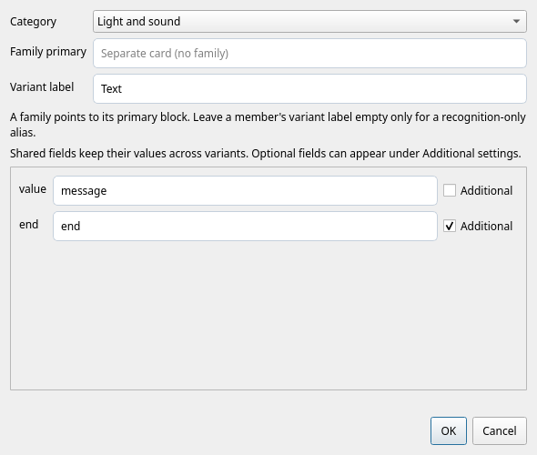

# Block Editor

When vertical space is limited, for example with Console open, the preview and
source appear side by side. Taller workspaces place the preview above the source.

Open **Block Editor** in the workspace rail, or press **Ctrl+Alt+3**. The library's
context menu and each block's help section also offer **Open definition**.
Definitions are ordinary Python function templates, edited as text. The editor
parses them; it never executes their defaults, imports, or bodies.

## Inspect and create

Collections, modules and blocks appear on the left. Search includes descriptions.
Built-in definitions are read-only examples. **Copy to my collection** copies the
selected function, including its decorators, imports and reachable helper functions.
The copy has its own identity; it does not replace the built-in block.

Choose a **Group / module**, such as `custom` or `robots/motors`, and a starter:
**Action**, **Expression**, or **Multi-command action**. **New block** adds a
function to that module. Copies use the same group field. Name collisions receive
a numeric suffix. Functions in one module form one help
page. Edit the function name, signature, docstring and body directly in Python.

In the program, **Edit → Create block from selection** starts a definition from
the selected structural block or selected Python text. The program stays intact.
Declare parameters explicitly in the new signature and use them in its body;
this action does not guess which constants should become parameters.
The draft includes imports needed by the selection. Local aliases take precedence
over imports from its enclosing program, including when selecting code in Scratch.

## Preview above the source

The preview uses the same renderer as the program, initially showing at most four
source lines. **Expand preview** reveals the rest. Drag the horizontal splitter
to resize the preview and source editor. Typing does not resize these areas.
**In the library** switches to the actual library card.

Moving the cursor into a decorated function selects its block. Ordinary helpers and blank lines between functions
retain the previous selection. Click a parameter in the program preview to jump
to its declaration and highlight its uses; click the description to reach the
docstring. Public declaration fields jump to their declarations too. Decorator,
signature, parameter and annotation highlighting and context hints
explain the definition's structure. Python completion follows scope, imports and
object methods. **Ctrl+Space** requests suggestions; **Ctrl+Shift+Space** shows
the current call signature or documentation. The same editor serves program files.

**Test values** substitutes Python expressions only in the program preview.
It does not change definition defaults or execute these expressions. The library
card continues to show the defaults readers will get on insertion. **Reset test
values** restores the defaults. Invalid source or test expressions keep the last
valid preview and show an error; click a source error to jump to its line.

## Save, recover and share

**Save and apply**, or **Ctrl+S**, validates the module and collection, then updates
the working library and help. The level, icon and color controls edit literal
properties in the decorator. These are ordinary text edits with normal Undo;
there is no separate copy of block metadata. Descriptions, defaults, type contracts
and public names stay in the same Python source. Imports may be module-level or
inside functions, and undecorated helpers may be shared by several blocks.
A placeholder default such as `motor=motor` is valid here; it is not evaluated.
See [the template format](snippets.md) for supported Python patterns.

The **Catalog properties…** icon beside the level, icon and color controls opens
category and family settings. Choose a category, optionally enter the complete
primary block identity, and give the form a variant label. Leave the family empty
for a separate card; an unlabeled family member is a compatibility alias.
Shared field keys connect equivalent parameters with different names across
variants. **Additional** is available only for parameters with defaults and puts
them in the compact editing dialog's additional section.

Accepting edits the decorator once, with ordinary text Undo. **Save and apply**
checks the complete collection, including primary references. Copying a built-in
variant creates an independent card with its category retained; join it to a family
in your own collection explicitly when needed.

Edits are retained as drafts after a short pause, including invalid Python, and
recovered on reopening the module. Switching modules preserves their text undo
histories during the session. **Reopen saved** discards the current module draft
with confirmation. Invalid drafts never replace the active library. External
changes to the same module or collection settings prevent an accidental overwrite.
Legacy modules are converted into a source draft; obsolete manifest levels are
removed only when that draft is saved.

The personal collection lives in the operating system's user data directory:
`~/.local/share/little-tinker-rig/blocks/` on Linux by default, respecting
`XDG_DATA_HOME`. **Open blocks folder** opens it. Existing personal blocks are
available to every document and frontend automatically; this implicit connection
is not written into each program's workspace. Explicit external collections can
still be connected per project. The folder is created only when first needed.
Built-in collections remain in the installed application and are read-only.
Personal drafts remain under the collection's `.drafts/` directory.

Icon and color fields are editable lists. Symbols have suggested meanings; colors
show swatches and semantic roles. Custom symbols and `#RRGGBB` colors are accepted.
The decorator stores literal symbols and stable role keys such as `action`,
independently of the interface language. Source edits and selectors update each
other and the preview, with ordinary text Undo.

**Start next version…** archives the saved collection before advancing its version.
Save or discard all module drafts first, then enter a greater `MAJOR.MINOR.PATCH`
version. The previous definitions, helpers and manifest snapshot remain under
`history/<version>/`. Begin a new version *before* changing published definitions;
ordinary Save does not create a snapshot. Historical definitions open read-only.
Use **Upgrade block** in a program to review a diff before applying a compatible
upgrade; Cancel leaves the program unchanged and Undo restores an accepted change.

Saving definitions never rewrites open programs or Scratch, commits their Python
drafts, or changes their undo history. Recognition uses the new definitions;
old source that no longer matches remains ordinary Python. Program changes and
version upgrades are separate, explicit actions. Hub upload/run is unavailable
while editing definitions.

Right-click an inserted block and choose **Open definition** to navigate directly
here. A recognized historical block opens its original file and version read-only,
not the current implementation with the same identity. Copy it to a user collection
to make an editable variant.

The catalog properties dialog also edits a short title and a group path of up to two segments (for example, `Individual motors / Motion`). Set the path on the family primary. Titles and group names are English source text with user-interface translations; full descriptions remain in the docstring.

**Offer as a measurement** writes `readout=True` in an expression's decorator.
Use it for readings that do not start motion, wait for an event, consume input, or
change device state. Matching receiver-method readouts appear in parameter
suggestions with their required imports. A numeric return type alone does not
qualify an action as a readout. Existing definitions without this property still
work and remain available in the catalog.
