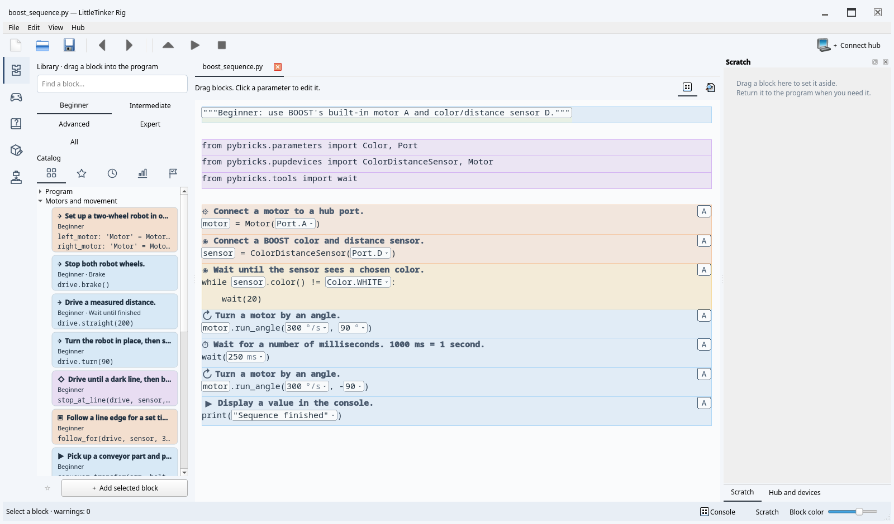

# From first actions to Python

The library starts at **Beginner** and grows through **Intermediate**, **Advanced**,
and **Expert**. **All** is a filter, not another level. Levels accumulate and your
choice is saved. Existing `Standard` settings and collection metadata migrate to
`Intermediate`. A level filters new choices; it never restricts existing source.

Beginner contains 19 family cards, including both SPIKE and BOOST sensor setup
variants. Use the separate level and view buttons described in the
[library guide](usage.md#finding-and-reusing-blocks). At other levels, groups start collapsed so children
can explore one topic at a time. Searching opens matching groups; clearing the
search restores their previous expansion. Each help group describes its blocks
together, with their introduction levels and complete Python source.

## Beginner: connect, act, wait

| Category | Available actions |
|---|---|
| Program | Console output; repeat a number of times; wait for time or a color |
| Motors and movement | Connect a motor; finite motor moves; set up a two-wheel robot; drive, turn and brake; line following, conveyor, drawing, dance, gripper, and remote driving actions |
| Sensors and input | Connect a SPIKE or BOOST color sensor |

Start with one motor and a finite movement. Change an angle from `90` to `-90`,
put two movements in sequence, and repeat them. Next add a sensor wait. Try
`examples/sequence.py` on Inventor/Prime or Technic, or `examples/boost_sequence.py`
on BOOST. The virtual sensor reports white at reflection 50 or above and black
below 50; physical sensors distinguish more colors.

Then use **Set up drive base** under **Motors and movement → Two-wheel drive bases**.
Select different left/right ports and the wheel diameter and axle track in
millimeters. The default reverses
the left motor for a mirrored chassis. Add a distance move and a turn. Expanding
the setup reveals ordinary motor constructors and `DriveBase`, so directions
and individual motors can be edited later.

The prepared line follower exposes time, speed, target reflection and correction
gain. It brakes when its time expires, leaving the next action reachable. Change
the sign of gain to follow the other edge. `examples/line_mission.py` demonstrates
this with motors A/B and a SPIKE color sensor C. For BOOST, replace the sensor
setup with a `ColorDistanceSensor` on D. The simpler stop-at-line activity stays
still when its condition is already satisfied. **Stop / F6** interrupts a program
waiting for a line that never arrives.

For the remote activity, turn on a physical LEGO Powered Up remote. Left +/-
drives forward/backward, right +/- turns, releasing buttons brakes, and the
center button finishes the block. This uses a direct hub-to-remote connection,
not LittleTinker Rig's screen joystick. Bluetooth pairing is not modeled by the simulator.

These activities follow the progression from parameter changes and sequences to
sensor-guided behavior in [BOOST](https://www.lego.com/en-au/product/boost-creative-toolbox-17101)
and [SPIKE line activities](https://education.lego.com/en-us/lessons/prime-competition-ready/training-camp-3-react-to-lines/).
A complete behavior can be useful before its loop and arithmetic are taught.
The [LEGO set examples](examples.md) show these actions inside complete programs
adapted from Pybricks, with their original hardware behavior preserved.

## Intermediate: sense, decide, name

Read motor and sensor values, start continuous movement, wait for a condition,
and choose a response with `if`/`else`. Add variables, arithmetic, Boolean
expressions, range loops, functions and calls. Create a stopwatch to measure an
activity. Use ultrasonic or force sensors when available. Ultrasonic distance is
in millimeters; BOOST distance is a relative percentage.

Choose the matching hub setup before using the status light, button, or tilt
blocks. Only Prime/Inventor has a built-in display and speaker. The center hub
button normally stops the program; Prime/Inventor's side buttons can be used for
interactions while keeping that stop behavior.

Suggested exercises: build a color alarm; choose one of two motor actions; count
repetitions; define a named action and call it twice. Unpack a prepared behavior
to inspect its conditions and measurements. Expansion changes editing structure,
not the Python algorithm or saved source. The expanded/collapsed view is temporary;
after a source edit the editor recognizes the current templates again.

Random integers use `urandom`, available on Inventor/Prime and Technic, but not
BOOST. Both real and virtual profiles retain this firmware distinction.

## Advanced: combine data and control

Advanced adds lists, dictionaries, indexing, collection iteration, slices,
comprehensions, numeric helpers and conditional expressions. It also exposes
drive speed/acceleration settings, arcs, resetting odometry, gyro heading, and
individual remote-controller operations. The original open-ended proportional
line follower is available for algorithm experiments.

`examples/robot_route.py` combines a list of distances with a named function and
prints approximately `90 270` on every virtual profile. Vary the route and add
more actions to the function. Keep polling loops responsive with a short wait.

The `Car` blocks use Pybricks' steering calibration and propulsion API. They
require a real mechanism with steering end stops. Calibration is not simulated.
`Car` and `DriveBase` are different mechanical models, not interchangeable names
for the same object. See the [Pybricks robotics reference](https://docs.pybricks.com/en/stable/robotics.html).

## Expert: handle failure and extend Python

Expert adds explicit exception handling, guaranteed Python cleanup, raising
errors, assertions, and raw motor duty control. `examples/data_pipeline.py`
validates and transforms values, collects successful results, and reports their
count. It prints `[0, 8] 3` on desktop Python and all virtual hub profiles.

Use Python view for APIs and constructs that are clearer as source. Valid code
remains editable even without a library card. A physical hub runs MicroPython
with its available modules, not unrestricted desktop Python.

## Simulation and intentionally deferred features

Motor/sensor activities, timed following, drive arcs/settings and odometry are
tested using virtual devices. The model uses constant speeds rather than tire,
acceleration, steering-stop, or collision physics. Feedback blocks report light,
icon/number, and tone commands in the console; they do not play physical audio.
Hub button/tilt/heading inputs remain at their default state in the interactive
simulator; tests can provide scripted states.

Physical LEGO remote pairing and `Car` calibration require hardware. Control-loop
tests script remote button states while using virtual motors, including release,
center-button exit and connection failure. They do not verify Bluetooth hardware.

General event scheduling, gait libraries, cloud and media services are deferred.
Shared helper definitions are managed automatically;
the bundled activities keep their existing inline behavior. New behaviors use short
ordinary Python templates and the existing automatic imports, with no new runtime
dependency.
