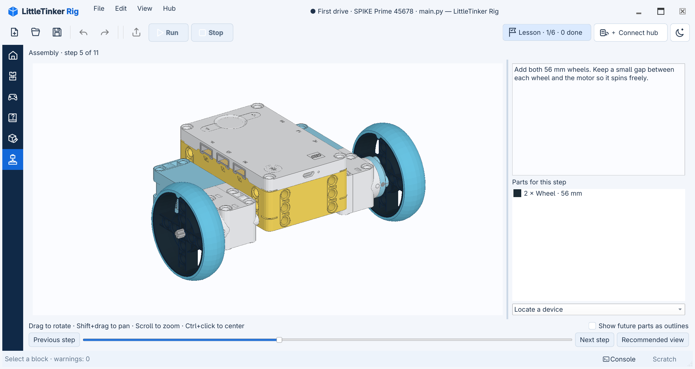

# Lessons and student projects

Lessons are optional. **Home → First Python program** opens a three-task
introduction with no physical robot. Change a text variable, change a loop count,
then run on a virtual hub and inspect Console; each task has a small diagram.
**Home → First robot drive**
starts the SPIKE Prime build and driving lesson. The project cards show equipment
requirements and can be filtered; reopening one resumes the latest attempt.

**File → Lessons → Guided lessons → First drive · SPIKE Prime 45678** opens
your latest attempt at that lesson, or creates one if this is the first time.
**File → Lessons → Start new attempt** explicitly creates another attempt. Ordinary
Python editing and the workspace controls stay the same. Opening or reopening a
new lesson shows its complete instructions in **Help** from the top. Resuming an
attempt opens the selected task's section in that same document.

The right-side **Task panel** shows every task with its step number, checkbox,
title, and points. The matching sections in **Help** use blue numbered circles,
and the instruction index uses the same circles as links. First drive includes diagrams
of the rolling base, travel directions, and obstacle distance in both the task
cards and full instructions.
Use **Assembly** for the actual part-by-part model; the diagrams explain the
connections and measurements. In a narrow window, the step instructions retain
enough width to read beside the model.
The selected task expands to show its goal, completion guidance, links and hints;
other tasks stay compact. It appears only while a lesson project is active.
Clicking a task title selects it, updates suggested blocks, and opens its section
in **Help**. An active block parameter is applied first; invalid input keeps the
current task selected so it can be fixed. The title does not mark a task complete.
A checkbox only records completion and does not navigate. **Instructions** opens
the lesson's full localized Markdown in **Help**, positioned at that task's
section; it does not open another window or add a task page to the Help tree.
**This lesson** has one
document entry; clicking it returns to the top. An inline task list jumps between
sections. The always-visible **Find in document** field searches with highlighted
matches, next/previous controls, and a match count; Ctrl+F focuses it. Opening
another page or section keeps the query and highlights; the count starts at 0
until you choose a result with Next or Previous. Reading or scrolling a section
does not change the selected task or its recommended blocks.
Changing the interface language keeps the same task section open, including when
the translated instruction uses a different section address.
Task-linked Markdown material follows its translated link, and Back and Recent
pages keep the material available after a language change. Recent pages uses
the translated task-link label for the material instead of its filename.
**Program**, **Assembly**,
**Controls**, and links to **Hub and devices** open the relevant file or panel. **Next hint**
reveals help on that card. The panel is available in every workspace.
Lesson connection links open the connection choices, or show the current hub
details if one is already connected; they never disconnect a hub.
Use its collapse icon or **View → Task panel** to hide it. A progress control
such as **Lesson · 1/6 · 0 done** beside the hub connection opens it again. On narrow
windows the panel opens over the workspace, so it does not shrink the editor.
In Program, the block catalog temporarily hides while the task panel is open,
leaving the code readable. Collapse the panel or click outside it to bring the
catalog back.
In Help, the page list temporarily hides and the instructions fit beside the
open task panel; closing the panel restores the page list.
Escape, a click outside it, or following a destination link hides it temporarily;
resizing to a wide window restores the saved expanded preference. Scratch and
the task panel share the right-hand dock area; the Console can stay open below
the editor.

Check a task's box after doing it. Its points are counted once and removed if you
clear the box. The panel identifies learner-reported completion; a connection
task needs fresh readings from the port monitor before it can be checked and is
then labeled as verified. The app does not claim to verify physical assembly or
whether a program achieved its real-world goal. Visiting a task or following a
link never marks it complete. **Open starter program**, when offered, creates one
named student file on first use and opens that same file thereafter. It preserves
your current program and never reapplies the template over your edits.

**For this task** shows recommended blocks regardless of the chosen difficulty.
The ordinary catalog, level buttons, Scratch, expressions, and Python editor
remain available throughout the lesson.
Selecting or hovering over an input does not filter the library. Right-click the
input and choose **Find value blocks** to search for compatible expressions, or
**Find creation blocks** to find a declaration for a missing variable. The back
button above the catalog restores the previous view and search. Escape in the
editor returns selection to the enclosing statement.
Ordinary **File → New** creates a program outside the lesson, with the normal library.

## Pybricks projects

**File → Lessons → Explore projects → Pybricks · BOOST / Robot Inventor / SPIKE Prime / Technic**
offers 24 projects for exploration. They have English/Russian activity goals,
port tables, experiments and recommended blocks. A project can contain several runnable variants and shared
modules. **Program** and program links select the indicated student copy;
reopening it preserves edits. The progress control says **Project** for these
activities. Task goals identify the relevant program and action for each variant.

Programs, dependencies, descriptions, licenses and progress are saved together.
Blast 51515, R2-D2 75253, X-treme Off-Roader 42099 and Liebherr 42100 include
community LDraw models with authored steps. Select **Open 3D building instructions**
in the preparation description, or **Assembly** in the task panel. The panel
reopens from its progress button and selects the lesson robot even if another
model was opened separately.
Author credits, licenses and official LEGO PDF links
remain available. Steps follow the MPD rather than PDF page numbers. Other lessons
retain their building links. PDFs, photos and videos open in your browser and
require internet or a separately saved copy. For keyboard
projects, open **Console**, focus **Hub input** and enable **Send keys immediately**.
Only that field sends keys; Escape returns to line input. In line mode, Enter
sends the text and a carriage return. The input row appears after a physical
Bluetooth/USB hub connects and stays disabled while its port monitor runs. It
is not a terminal or REPL emulator.

Imported lesson text comes from the [MIT-licensed Projects repository](https://github.com/pybricks/pybricks-projects/blob/master/LICENSE).
The 42100 activity uses existing LittleTinker Rig MIT programs and original guidance.
The four community models have separate CC BY 2.0 attribution and licenses in
their `robot` directories; their part geometry remains in the external library.
Additional [website projects](https://pybricks.com/project/) remain links because
[the website terms](https://pybricks.com/legal/#pybricks-website-site-content)
require permission to reproduce that content. Source attribution is included in
every activity. EV3 is not included.

## Save and resume

**Save** writes a portable `.ltr` archive containing ordinary Python programs,
Scratch, a copy of the lesson materials and robot arrangement, editor view state,
hints, task points, and progress. Invalid unfinished Python can be saved too.
Opening the lesson template resumes the latest local attempt; open a saved `.ltr`
to continue that portable archive. **File → Lessons → My lesson attempts** opens
an earlier attempt, while **Start new attempt** creates another. Use **File → New
program in lesson project** for another program in the same project.
Program tabs from a lesson show **· Lesson** after the filename, so a lesson's
`main.py` stays distinguishable from an ordinary file with the same name.

Downloaded part libraries are referenced by version and checksum. **File → Export
lesson project with resources…** creates a separate offline copy containing only
the required parts, colors and attribution. It includes current unfinished code
and Scratch, and keeps the original project's save path. User-authored model files
remain in the project; they are never placed only in a disposable cache.
You can cancel export preparation while parts are collected. Canceling before the
final write leaves an existing export file unchanged.

Working files and crash recovery live in the platform's user data directory,
under `little-tinker-rig/projects` and `little-tinker-rig/recovery`, never in the
installation or lesson directory. The latest template attempt is saved locally
after edits and retained on normal close. Explicit **Save** writes or updates a
portable archive; local persistence does not silently update that archive.
A changed archive is not overwritten without a conflict decision. An abnormal
close also offers a recovery checkpoint. Archive contents can be extracted with
a ZIP tool.

## Assembly

**File → Open robot instructions…** opens a `robot.json` description independently
of a lesson. Assembly remains available from the left sidebar. The model selector
appears only when both independent instructions and the lesson robot are open.
It uses the model names; a single model needs no selector.
Standalone assembly remembers its last model, step and camera in application
settings; each lesson keeps its own assembly progress inside its project.

The bundled training base contains 20 parts and 11 assembly steps. Steps 1–7 build
the rolling base; 8–11 add its distance sensor. Left motor: **A**, right motor: **B**,
distance sensor: **D**. Wheel diameter: **56 mm**, axle track: **136 mm**.
Its mounting geometry is checked digitally; physical fit and calibration need
verification on a real set.



- Left drag rotates, Shift+left drag or right/middle drag pans, and the wheel zooms.
  Zooming in holds the outer edges of the selected parts near the viewport boundary,
  gradually bringing their center into view. Without a selection it protects the
  current construction or isolated subassembly; future parts are ignored.
  Once the selection grows larger than the window its edges can extend outside.
  Zooming out preserves the resulting center, and manual panning remains unrestricted.
- Previous parts are muted, current parts keep their colors, future parts are
  hidden unless their outlines are enabled.
- Click a part to identify it. The step's parts list includes quantity, color
  swatches and authored lengths; tooltips retain LDraw part names and numbers.
  Selecting a row highlights all copies added in that step, in their actual
  positions, including through other parts. Selecting and clearing a selection
  preserve the camera. Ctrl+click a part or list row to center it without changing
  the zoom or viewing angle; rotation then uses this new center.
  Click the row again, press Escape,
  click the model background or change step to clear selection.
- **Recommended view** frames the current assembly. A subassembly selector can
  isolate an assembled group in imported models; **View: Whole robot** restores
  the full construction. Inspection never advances the assembly step.
- **Locate a device** highlights the device and marks its expected hub port.
  Only devices installed by the current step are listed. Expected wiring is
  instructional; the Python program remains authoritative.

The viewer loads local LDraw/MPD files in a worker, shares repeated part meshes,
and uses Qt OpenGL with ModernGL. No TopoVEC dependency is required. An unavailable
OpenGL context leaves the step text and parts list usable. The viewer does not
simulate physics, infer assembly order, or route flexible cables.

## External parts and offline use

Opening **Assembly** downloads the pinned official LDraw archive if it is missing
from the shared user cache. Opening a lesson or editing a program does not start
this download. If the archive is already cached, assembly reuses it and shows
**Preparing 3D model…** while building the view. **Cancel loading** stops either
stage. After a failed or cancelled download, retry or choose **Open parts ZIP…**
with a matching local copy.
The written instructions for the selected step stay visible if loading fails or is
cancelled.
The first-drive archive is about 139 MiB. It is downloaded once for all projects.

On Linux the default cache is `~/.cache/little-tinker-rig/ldraw/`; other platforms use
their standard cache directory. Archives are stored under their SHA-256, checked
before use, and installed atomically. The viewer reads only referenced ZIP members
into memory without extracting thousands of files. No geometry is downloaded
during rendering, camera movement or step changes.

Prepared model geometry is cached in the `scenes/` subdirectory and reused after
restarting LittleTinker Rig, including across working copies of the same lesson. The first
open builds this cache; subsequent opens read it directly. Changes to the model,
referenced parts, colors or geometry converter trigger a rebuild. Camera settings
and lesson progress remain separate. The graphics card still receives the geometry
when the viewer opens.

Deleting only `scenes/` rebuilds geometry from the model and cached parts without
downloading them again. An unreadable or unwritable scene cache does not prevent
opening a valid model.

The official `complete.zip` URL changes with library releases. A checksum mismatch
never substitutes new geometry silently: use the matching local archive or an
offline export. Future pinned release archives can use the same library reference
format. Clearing the cache requires downloading the referenced version again;
an offline export is the way to keep a project independent of the download server.

## Author a lesson

A `.pylesson` is a ZIP archive with `lesson.json` at its root. A lesson directory
has the same layout and can be placed in the development `lessons/` tree.
Use stable stage and block identities:

```json
{
  "format": 1,
  "id": "my-first-drive",
  "title": {"en": "First drive", "ru": "Первая поездка"},
  "instructions": {"en": "en.md", "ru": "ru.md"},
  "robot": "robot/robot.json",
  "stages": [{
    "id": "drive",
    "title": {"en": "Drive", "ru": "Поездка"},
    "description": {"en": "en.md#drive", "ru": "ru.md#drive"},
    "panel": {"en": "en/panel/drive.md", "ru": "ru/panel/drive.md"},
    "mode": "program",
    "points": 2,
    "blocks": ["pybricks/drive/create_robot", "pybricks/drive/straight"],
    "hints": [{"en": "Set distance to 200.", "ru": "Укажи расстояние 200."}]
  }]
}
```

English is the fallback. Author one full `instructions` Markdown file per
language for a lesson. Each stage's `description` points to a section in that
file, such as `en.md#drive`. A preceding `<a name="drive"></a>` gives the
section a stable identity across translations. Clicking a task's Instructions
link opens the whole document in Help at that section; the compact Help Back
control returns to the previously viewed document, and Recent pages lists
previously opened documents without repeating instruction sections. Older lessons without
`instructions` display their stage files as one combined Help document. If
several tasks share an unsectioned file, that text appears under each task so
every **Instructions** link has a destination. Write section headings without
manual step numbers; Help adds the task number from the stage order at display
time.

Titles, goals and hints are localized strings. Optional localized `panel` Markdown supplies the short
task-card content. Without it, the localized `goal` appears there. Optional
lesson-level `panel_intro` adds Markdown above all cards. Each card automatically
ends with relevant Instructions, workspace, suggested-block, starter, hint, and
extra-resource links. Set `panel_actions: false` on a task only when its authored
Markdown supplies the desired links itself; internal links can use
`task:instructions`, `task:program`, `task:assembly`, `task:control`,
`task:blocks`, `task:starter`, or `task:hint`. `points` is a nonnegative integer,
defaulting to 1.
Completion points are derived from unique completed stage IDs. `blocks` lists
recommendations for the **For this task** view and never restricts other views.
Optional `starter` names a Python file: at lesson level it initializes the main
program once; at stage level its action creates one named student file on first
use and reopens that file later. Optional `collection` names a normal block
collection included in the lesson.

Optional `kind: "project"` places an activity under **Explore projects**; the
default `kind: "lesson"` places it under **Guided lessons**. An optional localized
`group` creates a submenu there. Nested lesson directories are discovered
recursively. The full instruction file may contain
subheadings and fenced code within each task section.

For multi-file activities, `programs` maps workspace paths to lesson files and
`main` names the initial Python program, for example:

```json
{
  "programs": {"main.py": "code/main.py", "robot.py": "code/robot.py"},
  "main": "main.py"
}
```

Workspace paths must be portable and cannot overlap as files and directories
or differ only in letter case.
A stage's optional `program` selects one of these Python files. Markdown links
such as `[Open robot](program:robot.py)` open its editable copy without resetting
it. `assembly:`, `devices:`, and `connect:` open the assembly workspace, the
Hub and devices panel, and the connection dialog respectively. Use
`connect:virtual` to preselect a virtual hub. A typed `connect` task link may
set `"target": "virtual"`, `"ble"`, or `"usb"`; without a target it uses the
normal connection dialog. These links show the current hub details when a hub
is already connected. Other files, such as licenses, may also be copied
through `programs`.
Local documentation links stay inside the lesson; HTTP(S) links open the browser.

Optional `scratch_seeds` maps a student Python filename to a list of lesson
fragment files. Their text enters that program's Scratch once, when the attempt
is created, and does not overwrite later edits. For example,
`"scratch_seeds": {"main.py": ["ideas/try_distance.py"]}`. A stage can add
typed links such as
`{"kind": "scratch", "label": {"en": "Try an idea", "ru": "Попробуй идею"}, "target": "main.py"}`.
Link kinds are `markdown`, `program`, `scratch`, `assembly`, `control`,
`devices`, and `connect`.
Markdown targets may be localized lesson paths; program and Scratch targets name
student Python files. Assembly and control links have no target. All local paths
are validated inside the portable lesson snapshot.

Bundled lessons may additionally map local paths to installed examples, e.g.
`"examples": {"code/main.py": "pybricks/boost_17101_auto_builder.py"}`.
Use `Lesson.load(directory).archive()` to produce a portable `.pylesson`: this
materializes the referenced files and removes the `examples` mapping. Creating a
student project does this automatically. The student's archive never depends on
its author's installation or a future version of the example catalog.
The archive writer enforces the reader's member-count and uncompressed-size
limits, so Save and export reject a project that could not be opened again.

Stage `mode` is `program`, `control` or `assembly`; `assembly: [1, 7]` names an
inclusive range of model steps. `check` is `manual` (default) or `devices`; a stage's
`devices` can restrict the robot-device check to named instances. The legacy
`operations` field is accepted but no longer restricts expression editing.

`robot.json` uses `format: 1` and gives `model`, optional `library`, localized
`title` and `description`, optional `parts` descriptions, `steps` keyed by one-based
step number, and `devices` with
`instance`, localized `name`, `port` and `type`. `ports` maps letters to model-space
LDraw coordinates. A step can provide `text` and a recommended `camera` containing
`center`, `extent`, `yaw`, `pitch`. No 3D metadata is inserted into program source.

An external `library` is an object with `id`, `version`, an HTTPS `url` and `sha256`;
see the bundled robot description for an actual pinned archive. A string instead
names a local directory or ZIP inside the lesson, useful for original user models
and offline exports. Both standard ZIPs with an `ldraw/` root and compact archives
with `parts/`, `p/` and `LDConfig.ldr` at the root are supported. External part data
belongs in the cache or release assets, never in Git.

LDraw `0 STEP`/`0 ROTSTEP` delimit authored steps. Nested submodel steps are visited
in assembly order at their final positions; automatic ROTSTEP camera conversion
and texture maps are not implemented. Parts use triangles, quads, explicit and
conditional edges. Faces are double-sided, including mirrored and uncertified
parts. `0 !LITTLE_TINKER_RIG ID left-motor` immediately before a reference assigns a stable
instance ID; submodel paths compose IDs. Keep these IDs stable when annotating
wiring. Referenced geometry must belong to the model's local files or its declared
library and retain attribution. To prepare a compact resource archive for release,
run `tools/bundle_ldraw.py model.mpd --library complete.zip --output /path/outside/repo/parts.zip`.
The tool prints its checksum and refuses to write third-party resources into this
repository. Without `--output` it writes to the user's parts cache.
