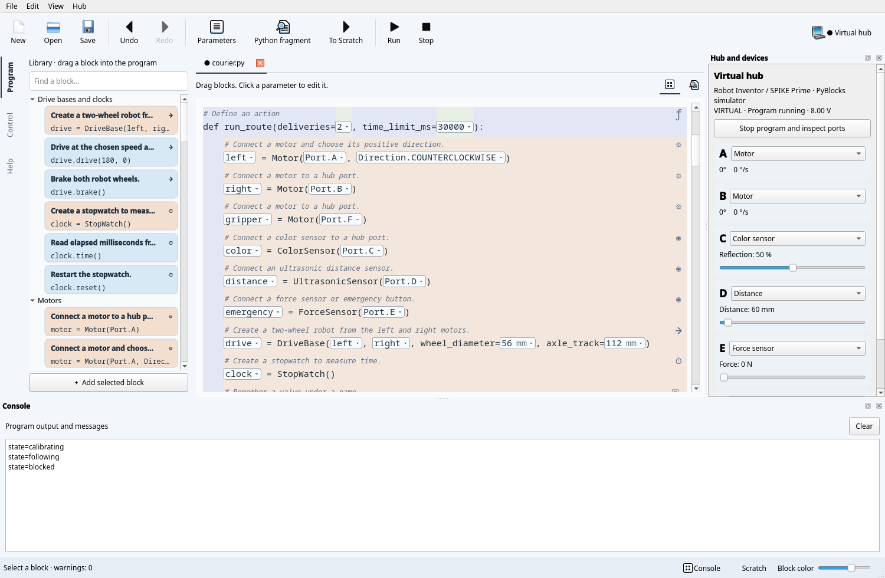

# Robots and controls

## Hubs

Real hubs use Pybricks firmware. Virtual profiles provide the same port layout:

| Profile | Hub | Ports |
| --- | --- | --- |
| `inventor` | Robot Inventor / SPIKE Prime | A–F |
| `boost` | BOOST Move Hub | Built-in motors A/B; external C/D |
| `technic` | LEGO Technic Hub | A–D |

F7 or the top-right hub button opens connection options: virtual, Bluetooth or
USB. Choose the model for a virtual hub, or optionally a Bluetooth name. An empty
name selects the first available hub. Real connections require the `pybricks`
extra. USB depends on model support and OS permissions.

F5 saves and runs the active file; F6 stops it. Console output is indicated in the
bottom bar. TUI uses F7/F5/F6 and F8 for its console. CLI can wait for completion:

```sh
uv run pyblocks run examples/motor.py --transport virtual --model boost
uv run --extra pybricks pyblocks run examples/motor.py --name 'My hub'
```

The device panel shows hub identity, firmware, battery and port readings.
**Open port monitor** replaces the user program with a small monitor; it reports
motor angles/speeds and color, distance or force values. Real readings become
stale when a user program replaces the monitor. Virtual telemetry continues during
program execution. Its battery is a fixed 8 V. BOOST color/distance readings are
percentages; ultrasonic distance is in millimeters.

## Manual control

Select **Control → Assign motors to sticks and triggers**. Start manual control,
assign a motor to an axis or trigger, choose its mode/scale, then enable commands.

Rotation scale is degrees per second at full input. Servo scale is an angle added
to its center: RT with scale 90 and center 20 requests 20–110°. Sticks range from
−1 to +1, triggers from 0 to 1; up is positive Y. Reverse flips the input sign.
Unassigned motors remain stopped. Assignments remain in the current window.

Release the mouse to center a stick or reset a trigger. With a stick focused,
WASD controls the left stick and arrow keys the right. A neutral rotation input
stops the motor; a neutral servo input returns it to its center. Disabling commands
brakes both modes. Changing assignments, leaving Control, losing window focus or
connection disables transmission. The hub brakes after 500 ms without commands.

The `gamepad` extra enables a physical Xbox-compatible SDL controller. Its sticks,
triggers and buttons mirror the screen controls and use the same motor assignments.
Disconnecting it disables commands. To feed your own program instead, select
**Send controller input to my program** and use the helper:

```sh
uv run pyblocks controller examples/pyblocks_controller.py --write
uv run --all-extras pyblocks-qt examples/drive_controller.py
```

`Controller.update()` reads `left_x`, `left_y`, `right_x`, `right_y`,
`left_trigger`, `right_trigger`, a 16-bit `buttons` mask and legacy `slider`.
Axes become neutral after 500 ms without input; your program must apply them to
motors. It requires Pybricks 3.3+ `read_input_byte`, and owns stdin. SDL button
numbers are A/B/X/Y=0/1/2/3, View/Guide/Menu=4/5/6, L3/R3=7/8, LB/RB=9/10,
and d-pad up/down/left/right=11/12/13/14.


## Delivery robot

`examples/courier.py` is a line-following courier with obstacle detection,
a gripper, delivery markers and an emergency stop. It uses three motors,
ColorSensor, UltrasonicSensor, ForceSensor, DriveBase, StopWatch and wait, plus
functions, conditions, loops, break/continue and exception-safe cleanup.

1. Connect a virtual **Inventor / SPIKE Prime**. A/B are wheel motors, C is color,
   D is distance and E is the emergency button. Set **F → Motor** for the gripper.
2. Open `courier.py` and press Run. The robot calibrates reflection, closes its
   gripper to 65°, then follows the line. Console states explain each phase.
3. Lower D below 120 mm: the wheels brake and the state becomes `blocked`.
   Raise it to resume.
4. Lower C to 5%: three dark samples mark a delivery point. The wheels stop,
   the gripper opens, and the console reports `delivery=1`.
5. Raise C to 50% to rearm detection, then lower it again for the second delivery.
   The route completes with all motors stopped. Alternatively raise E to 5 N
   to exercise the emergency stop.

The route also has a 30-second deadline and handles disconnected devices.
Its wheel diameter (56 mm), axle track (112 mm), directions, thresholds and speed
must match the physical robot before running on hardware. These parameters are
editable in Blocks or Python. Virtual tests verify completion, an emergency,
device failure and the route deadline, including obstacle stop/resume and delivery.



## Simulation limits

The virtual hub runs ordinary Python in a separate stoppable process; it is not a
sandbox for untrusted code. It models motor speed/angle/target/time commands,
color/reflection, combined BOOST sensing, ultrasonic distance, force, basic hub
identity, timing, and `DriveBase.drive/stop/brake`. Device readings can be changed
in the panel. Angles and sensor inputs survive program/manual-mode transitions.

Color is approximated as black/white from reflection; motor duty is approximated
as speed. Inertia, load, acceleration, gearing, lights, sound, IMU and other APIs
are not simulated. Unsupported calls fail explicitly. Simulation and MicroPython
compilation do not replace physical Bluetooth/USB and robot tests.

Official references: [Pybricks installation](https://pybricks.com/learn/getting-started/pybricks-environment/),
[Inventor/Prime](https://docs.pybricks.com/en/stable/hubs/primehub.html),
[BOOST](https://docs.pybricks.com/en/stable/hubs/movehub.html),
[Technic](https://docs.pybricks.com/en/stable/hubs/technichub.html).
