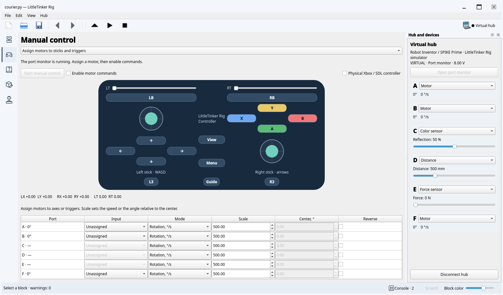

# Robots and controls

## Hubs

Real hubs use Pybricks firmware. Virtual profiles provide the same port layout:

| Profile | Hub | Ports |
| --- | --- | --- |
| `inventor` | Robot Inventor / SPIKE Prime | A–F |
| `boost` | BOOST Move Hub | Built-in motors A/B; external C/D |
| `technic` | LEGO Technic Hub | A–D |

F7 or the top-right hub button opens connection options with Bluetooth selected
by default; USB and virtual hubs are also available. Choose the model for a
virtual hub, or optionally a Bluetooth name / USB serial port (`COM3`,
`/dev/ttyACM0`). An empty name selects the first Bluetooth hub or discovers USB
automatically; multiple serial hubs require a port selection. Real connections
require the `pybricks` extra. USB depends on firmware and OS permissions.

For permission errors and port troubleshooting, open [USB connection help](usb.md).

While connecting, the hub button and F7 cancel the attempt. Once connected,
they disconnect; port monitoring has its own button in **Hub and devices**.
Connection attempts time out after 20 seconds. Cancellation closes the transport
before another attempt can start, including when a native USB driver is stuck.

USB programming on Inventor/Prime uses the new USB Serial protocol with compatible
beta firmware (tested against the 4.1.0b4 protocol); stable 4.0.1 uses Bluetooth.
The older USB backend remains available for firmware that implements it. USB
flashing and USB program transfer are separate protocols: successful flashing
does not imply that the installed firmware supports USB programming.

EV3 has experimental USB Serial upload, run, stop, console and beta installation
support. It requires the new Pybricks firmware, not the older Linux/SD-card EV3
environment. EV3 has not been tested on hardware; its port monitor, virtual
profile and Bluetooth Classic connection are not implemented. The ordinary
Bluetooth choice uses BLE and does not connect an EV3.

**Upload / Shift+F5** sends a snapshot of the active program without executing it.
**Run / F5** sends and runs that snapshot; **Stop / F6** stops execution. Neither
requires choosing a filename. Open local modules contribute their current text;
other imported local modules are read from disk. Ordinary files are not saved by Run.
**Hub → Run stored program** starts the previously uploaded program. On physical
hubs only compiled code is sent; source read-back is not supported.
Upload and Run open **Console** automatically. It shows connection messages,
transfer progress, program output and errors, including stdout/stderr from the
hub worker. The bottom-bar activity indicator stays visible during hub operations.
Terminal progress updates replace their previous line. After hiding Console,
its button counts new messages. TUI uses F7/F5/F6 and F8 for its console.
CLI can wait for completion:

```sh
./.venv/bin/little-tinker-rig run examples/motor.py --transport virtual --model boost
./.venv/bin/little-tinker-rig run examples/motor.py --name 'My hub'
```

On Windows, use `.\.venv\Scripts\little-tinker-rig.exe` in place of
`./.venv/bin/little-tinker-rig`. Install the `pybricks` extra once, as described
in [installation](INSTALL.md), before using a real hub.

The device panel shows hub identity, firmware, battery and port readings.
On wide windows, **Hub and devices** and **Scratch** share the right dock as tabs.
On narrower windows, Scratch moves below the workspace; on very narrow windows,
Hub and devices joins the bottom tabs with Scratch and Console. Each panel can
still be detached, resized or closed.
**Open port monitor** replaces the user program with a small monitor; it reports
motor angles/speeds and color, distance or force values. Real readings become
stale when a user program replaces the monitor. Virtual telemetry continues during
program execution. Its battery is a fixed 8 V. BOOST color/distance readings are
percentages; ultrasonic distance is in millimeters.

## Manual control

Select **Control → Assign motors to sticks and triggers** and start manual control.
With a detected motor, **Configure motors ↓** jumps to its assignment table below
the sticks and triggers. Assign an axis or trigger, choose its mode/scale, scroll
back up, then enable commands.
**Send controller input to my program** shows the complete controller,
including buttons. Both layouts fit the available width.

Rotation scale is degrees per second at full input. Servo scale is an angle added
to its center: RT with scale 90 and center 20 requests 20–110°. Sticks range from
−1 to +1, triggers from 0 to 1; up is positive Y. Reverse flips the input sign.
Unassigned motors remain stopped. Assignments remain in the current window.

Release the mouse or keyboard control to center a stick or reset a trigger.
This includes clicking the trigger's track outside its handle.
Moving keyboard focus away also returns the input to neutral. Trigger sliders
ignore the mouse wheel because it has no release action. With a stick focused,
WASD controls the left stick and arrow keys the right. A neutral rotation input
stops the motor; a neutral servo input returns it to its center. Disabling commands
brakes both modes. Changing assignments, leaving Control, losing window focus or
connection disables transmission. The hub brakes after 500 ms without commands.
If a write is already in progress when commands are disabled, the neutral frame
is sent immediately after that write completes. Stop and disconnect discard
queued movement commands.

The `gamepad` extra enables a physical Xbox-compatible SDL controller. Its sticks,
triggers and buttons mirror the screen controls and use the same motor assignments.
Disconnecting it disables commands. To feed your own program instead, select
**Send controller input to my program** and use the helper:

```sh
./.venv/bin/little-tinker-rig controller examples/little_tinker_rig_controller.py --write
```

On Windows, use the `.venv\Scripts\little-tinker-rig.exe` CLI instead. Then open
`examples/drive_controller.py` in the editor from **File → Examples** and run it
on the connected hub. Install the `gamepad` extra first for a physical controller.

`Controller.update()` reads `left_x`, `left_y`, `right_x`, `right_y`,
`left_trigger`, `right_trigger`, a 16-bit `buttons` mask and legacy `slider`.
Axes become neutral after 500 ms without input; your program must apply them to
motors. It requires Pybricks 3.3+ `read_input_byte`, and owns stdin. SDL button
numbers are A/B/X/Y=0/1/2/3, View/Guide/Menu=4/5/6, L3/R3=7/8, LB/RB=9/10,
and d-pad up/down/left/right=11/12/13/14.



## Delivery robot

`examples/courier.py` is a line-following courier with obstacle detection,
a gripper, delivery markers and an emergency stop. It uses three motors,
ColorSensor, UltrasonicSensor, ForceSensor, DriveBase, StopWatch and wait, plus
functions, conditions, loops, break/continue and exception-safe cleanup.

1. Connect a virtual **Inventor / SPIKE Prime**. A/B are wheel motors, C is color,
   D is distance and E is the emergency button. Set **F → Motor** for the gripper.
2. Open `courier.py` and press Run. The robot calibrates reflection, closes its
   gripper to 65°, then follows the line. Console states explain each phase.
3. Lower D below 120 mm: the wheels brake and the state becomes `blocked`.
   Raise it to resume.
4. Lower C to 5%: three dark samples mark a delivery point. The wheels stop,
   the gripper opens, and the console reports `delivery=1`.
5. Raise C to 50% to rearm detection, then lower it again for the second delivery.
   The route completes with all motors stopped. Alternatively raise E to 5 N
   to exercise the emergency stop.

The route also has a 30-second deadline and handles disconnected devices.
Its wheel diameter (56 mm), axle track (112 mm), directions, thresholds and speed
must match the physical robot before running on hardware. These parameters are
editable in Blocks or Python. Virtual tests verify completion, an emergency,
device failure and the route deadline, including obstacle stop/resume and delivery.

## Simulation limits

The virtual hub runs ordinary Python in a separate stoppable process; it is not a
sandbox for untrusted code. It models motor speed/angle/target/time commands,
color/reflection, combined BOOST sensing, ultrasonic distance, force, basic hub
identity, timing, and `DriveBase.drive/stop/brake`. Device readings can be changed
in the panel. Angles and sensor inputs survive program/manual-mode transitions.

Color is approximated as black/white from reflection; motor duty is approximated
as speed. Inertia, load, acceleration, gearing, lights, sound, IMU and other APIs
are not simulated. Unsupported calls fail explicitly. Simulation and MicroPython
compilation do not replace physical Bluetooth/USB and robot tests.

Official references: [Pybricks installation](https://pybricks.com/learn/getting-started/pybricks-environment/),
[Inventor/Prime](https://docs.pybricks.com/en/stable/hubs/primehub.html),
[BOOST](https://docs.pybricks.com/en/stable/hubs/movehub.html),
[Technic](https://docs.pybricks.com/en/stable/hubs/technichub.html).

## Installing and restoring firmware

Firmware archives and the release catalog persist in the user cache, outside the
repository (`~/.cache/little-tinker-rig/firmware` on Linux). Opening this dialog
uses the saved catalog without network requests. Preparing an already downloaded
version reuses its checked archive; the log says whether it was cached or downloaded.
Changing channels or restarting the app does not discard downloads. A renamed
installation can reuse the previous `pyblocks-studio` cache.

If GitHub's API quota is exhausted, the log shows its reset time and the catalog
uses GitHub's public release feed. API retries wait until the quota reset; failed
refreshes retain the saved catalog. Previously downloaded versions remain usable
offline. Release refresh does not download firmware images.

**Hub → Firmware…** offers Pybricks installation and LEGO recovery. Select the hub
model and firmware kind, refresh the official Pybricks release list, and choose a
version. **Stable** is the default release channel; **Beta** lists prereleases
with links to their release notes. Switching channels invalidates any prepared
installation and its confirmation. **Prepare download** downloads, caches and checks the package. Previously
downloaded versions and the cached catalog work offline; **Open local firmware…**
accepts local packages. Preparation does not contact a hub. Review the version,
SHA-256 and license, accept replacement, then press **Install firmware**. The
editor disconnects its existing hub connection before flashing. Progress and
errors appear in the dialog; it cannot close while flashing.

On Inventor/Prime, BOOST and Technic, a blinking blue light after installing
Pybricks means the hub is ready to connect.
Close the firmware dialog and choose **Connect hub**; no manual restart is needed.
If it is off, briefly press its main button. To restart a BOOST or Technic hub
if needed, hold the green button for about 2–3 seconds until its light goes out,
release it, then briefly press it to turn the hub on again. Inventor / SPIKE Prime
uses the center button. See the [Pybricks status-light and button guide](https://pybricks.com/learn/getting-started/pybricks-environment/#using-hubs-with-one-button).
After restoring LEGO firmware, connect using the LEGO app.

Inventor / SPIKE Prime uses USB DFU. Turn it off, unplug USB, hold Bluetooth while
reconnecting USB, then release at the red/green/blue light. BOOST and Technic use
the Bluetooth bootloader: hold the green button until purple flashes. Leave only
one matching hub in bootloader mode. The installer checks the physical model
before erasing. Older packages use the public `pybricksdev` API; Linux USB access
needs libusb and suitable udev permissions, with `dfu-util` as fallback for these
older packages. Serial ports may need separate OS permissions (often membership
in `dialout` on Linux).

Metadata v3 archives can contain several hardware variants. The installer chooses
F4 or H5 from the actual DFU device, never from the first image in the archive.
During preparation, the required public Pybricks flash tools and F4 second-stage
bootloader are downloaded from a pinned upstream revision into the user firmware
cache. Their hashes are checked again before use; cached preparation and flashing
work offline. New beta installation requires libusb, without the old `dfu-util`
fallback. The source is [Pybricks firmware tools](https://github.com/pybricks/pybricks-micropython/tree/v4.1.0b4/tools/flash).

On an F4 Inventor/Prime, installing a new beta can add the upstream second-stage
bootloader. To return to stable or LEGO firmware, use the Bluetooth-button USB DFU
sequence above to enter the original bootloader. Stable/LEGO images for F4 are
rejected on an H5 or in the newer bootloader mode before erasing anything.

EV3 installation supports releases starting with **4.1.0b4**; older EV3 downloads
are excluded from the catalog. Select **EV3 → Beta**, hold Right while turning the brick on, and release
the buttons when **Updating...** appears. Connect one EV3 by USB. EV3 LEGO recovery
is not offered. Physical installation and recovery have not been verified on EV3.

The built-in LEGO download for Inventor/Prime is recovery firmware **1.3.00.0000**,
from the [official Pybricks recovery assets](https://github.com/pybricks/pybricks-code/tree/master/src/firmware/assets).
The LEGO app may offer an update afterwards. BOOST and Technic recovery requires
a local LEGO image packaged as a firmware ZIP; automatic original-firmware
downloads for these two models are not provided.

A ZIP uses the public Pybricks firmware format: `firmware-base.bin`,
`firmware.metadata.json`, and `ReadMe_OSS.txt`. A LEGO recovery package additionally
declares `"firmware-type": "lego"`; `device-id` is 64 for BOOST, 128 for Technic, or
129 for Inventor/Prime (226 for EV3). Metadata v3 lists variant filenames and
checksums in `variants`. Metadata 2.1 supports `checksum-type: none` for a complete
image that already includes its checksum. Do not relabel an image for another
model. A raw Inventor/Prime `.bin` is accepted if it matches the built-in recovery
image, or has a sibling `.metadata.json` declaring its type, device and version.
Use packages supplied for your hardware; renaming a file does not convert it.

Automated tests validate packages and transport boundaries without flashing a
physical hub. Physical installation and recovery still need hardware verification.
