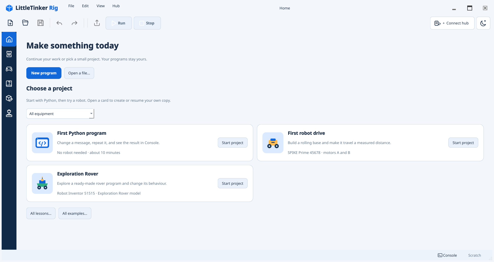
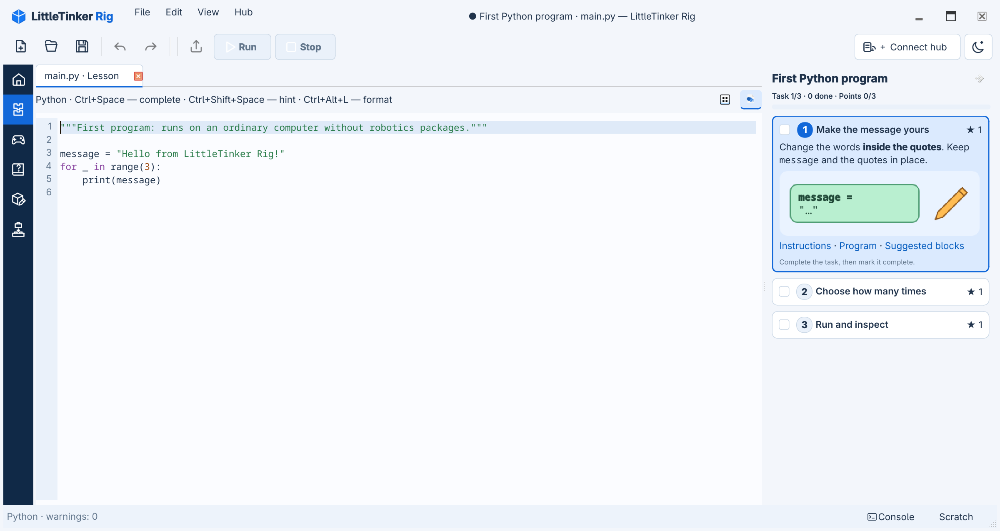

# First steps: learn the workspace

This tutorial takes you from the Home page to a running Python program. You need
no LEGO set or physical hub. If the app is not installed, follow
[installation](../INSTALL.md) first.

## 1. Start a guided program

Launch LittleTinker Rig. **Home** opens with quick ways to begin. Choose
**First Python program**. **New program** creates an empty document, while
**Open a file…** resumes a Python file you already saved.

The lesson opens its complete instructions in **Help**. The numbered sections in
the document match the three tasks in the panel on the right. Click a task's
**Instructions** link to jump to its section; the rest of the document remains
available by scrolling. Choose **Open your program** in the instructions, or
**Program** on the selected task card, to go to the editor.

## 2. Find your way around the editor

The slim bar on the far left switches between workspaces such as **Home**,
**Program**, **Control**, **Help**, **Block Editor**, and **Assembly**. Hover over
an icon to see its name. In Program, the **library** is on the left, your open
file is in the center, and the **task panel** is on the right. The **Console**
opens from the bottom bar. Files appear in tabs above the program.

The library has numbered difficulty buttons. Button **1** shows Beginner blocks;
the icons below it switch library views. The category tree can be opened by
clicking a category name. The first lesson recommends useful blocks, but the
whole catalog remains available.

You are editing a real `.py` file. The colored blocks show Python statements and
their nesting. The starter begins with the line you will edit: `message` stores
some text. The indented `print(message)` reads it inside a repeat loop.

## 3. Edit two parameters

Click the quoted text in `message = "Hello from LittleTinker Rig!"`. Replace it
with `"Hello, Python!"`, including the quotes, then press **Enter**. Keep the
name `message`: the later block uses it. Check the first task's box when the
change is visible. The checkbox records your progress; it does not edit code.

Click the title **Choose how many times** in the task panel. That opens its
instructions. Return with the **Program** link, click the `3` in `range(3)`,
type `5`, and press **Enter**. Before running, predict how many times your
message will appear. Check the second task's box when you can explain why.
If an input is invalid, correct it or press **Escape** to cancel that edit.

## 4. Run and inspect the result

Select **Run and inspect** in the task panel. Use its **Choose virtual hub…**
link to open the connection dialog with **Virtual hub** and
**Robot Inventor / SPIKE Prime** already selected, then press **Connect**.
You can also use **Connect hub** in the top bar. On first use, the same virtual
profile is selected there; later it remembers your last successful connection.
This execution target needs no robot build. Press **Run** or **F5**, then open **Console**
from the bottom bar. Your message should appear five times. Console may also
show connection or run status messages. Mark the third task complete after you
have checked the output. **Stop / F6** interrupts a running program.

## 5. Try a block and see its Python

In the library, choose the **Catalog** view, expand **Program**, and drag
**Display value** into the empty area *below* the loop. Watch the insertion
preview before releasing: the new block should line up with the loop, rather
than with its indented body. Change its quoted value to `"Done!"` and run
again. You should see five greetings followed by `Done!` once. **Ctrl+Z**
undoes the most recent edit; press it again to remove the inserted block.
**Ctrl+Shift+Z** restores each undone change.

The two small icons above the document switch between **Blocks** and **Python**.
Open Python to see the same program as text, then return to Blocks. The indented
line is the loop body; the new `print("Done!")` line is outside it. You can
edit either representation of the same document.

## 6. Keep working

The task panel can be collapsed using the icon in its header. Its small progress
control beside **Connect hub** opens it again. **Instructions** returns to the
full lesson document in Help. The **Home** icon returns to quick actions without
closing the program. Reopening the lesson continues your latest attempt; only
**File → Lessons → Start new attempt** creates another. Lesson work is saved
automatically.

For an ordinary file, use **Home → New program** and **Ctrl+S** to choose a
filename. The [editing guide](../usage.md) covers Scratch, multiple files,
variants, and recovery. When you want to build and program a robot, continue
with [lessons and assembly](../lessons.md) and the [robotics guide](../robotics.md).
