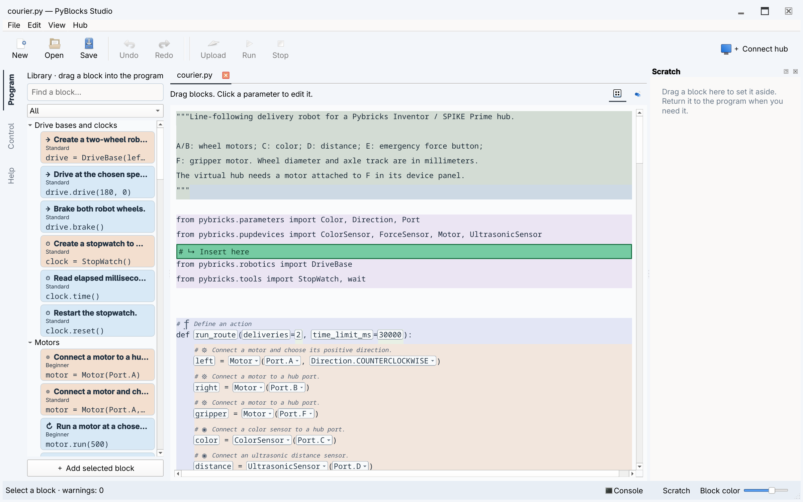
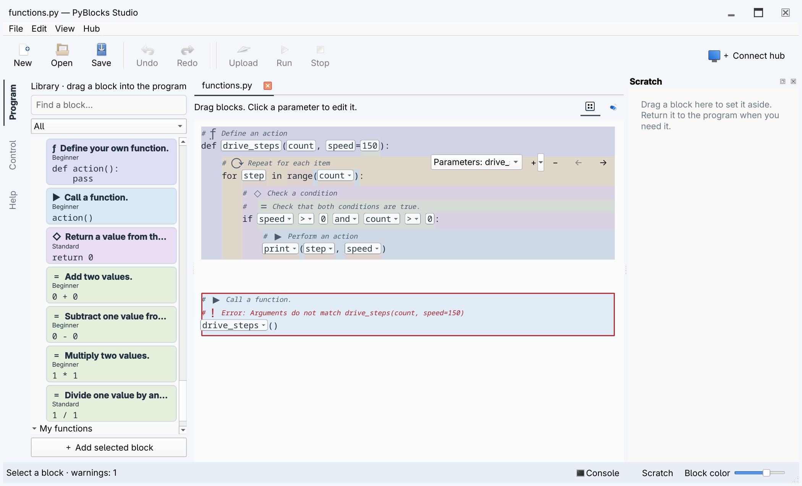

# Editing and command-line tools

This page describes the Qt desktop editor. The [terminal workspace](tui.md) edits
Python source directly and provides its own hub controls.

## Documents and views

Files have independent tabs, drafts and undo histories. The hub connection and
console belong to the window. Run always saves and runs the active document.
Starting without a filename and **File → New** create unnamed documents. Their
first Save, Run or Upload asks for a file location; cancelling leaves the document
open and does not start a hub operation. Saving while closing uses the same rule.
Use the two document icons or **View → Blocks / Python** to change the editor mode.
Global workspaces appear as icons in the narrow left sidebar. Hover over an icon
to see its full name. The selected mode has a shaded background and a left accent.
Short panels scroll vertically without changing the current mode. Lesson and
Assembly appear when the open project provides them.
**Block Editor** (**Ctrl+Alt+3**) edits template definitions with a preview above
the source; see [its guide](block-editor.md).

The Python editor has syntax highlighting, line numbers, indentation with
Tab/Shift+Tab, and search with Ctrl+F. Completion appears while typing names or
after a dot; **Ctrl+Space** requests it explicitly. Choose with arrows and accept
with Enter or Tab; Escape dismisses. Suggestions follow local scope, imports,
object methods and the installed Pybricks API descriptions. Call hints show the
signature and current parameter; **Ctrl+Shift+Space** requests a hint or documentation
for the name under the cursor. Jedi analyzes unfinished source in the background
without running it. Dynamic Python objects may have incomplete suggestions;
API descriptions do not verify support on a connected hub. Ruff
formats valid committed edits. **Ctrl+S** also saves unfinished Python. All programs
are saved as UTF-8 without a BOM. Legacy files are read using their original
encoding; saving updates the encoding declaration in the editor too. Ctrl+Z can
undo that change. Unfinished files reopen in Python view; Run, Upload and switching to Blocks
require valid syntax. A failed structural edit still leaves the block document
unchanged.

In Blocks, clicking a parameter opens a text field over its source value.
When alternatives exist, an arrow opens a list below the field; otherwise the
input has no arrow. Declaration names are plain editable text. The editable field
exists only while editing; the parameter name is a
tooltip, and a read-only suffix shows its unit. Suggestions respect known types:
conditions offer booleans and button readings, motor fields offer motor variables.
Repeated occurrences change together. Enter or choosing an item applies; Escape
dismisses. A structural selection uses the whole block background, including the
remaining line width.

Scratch is visible by default and can be resized or closed with its dock controls.
The bottom Scratch button restores it. Control mode hides Scratch. The title bar
always shows minimize, maximize/restore, and close. Double-click it to toggle
maximization; drag it or a window edge to move or resize. F11 toggles full screen.
After a normal close, the next launch restores the window position, size and
maximized or full-screen state. A minimized window reopens visibly. Qt adjusts
off-screen positions when the monitor configuration changes.

Block titles and action symbols explain their purpose without adding comments to
the Python file. Titles and source comments use the editor's normal font size.
Indentation colors continue through blank lines.

Each recognized inline block has an **A / P / D** button in its upper-right corner.
Each click cycles through these modes:

- **Auto** (default): use the definition's comments until the program
  contains a comment belonging to this block. Blank lines do not affect the choice.
- **Program comments**: show the program's own comments.
- **Definition comments**: show comments from the definition next to the matching code.

Code, names, annotations, parentheses and code formatting always remain those of
the program. This button never expands a function body or substitutes definition code.

The choice is independent for each block and survives parameter edits in the open
view. Switching never changes saved Python, execution or Undo. Comments inserted
in Python view belong to the program; definition comments are edited in Block
Editor. Inserting an inline block does not copy explanatory comments into the
program. A function block shows only its actual Python call and the program's
comments. Use **Open definition** to inspect its body. The function retains its
authored name and is stored once, with its comments, in the managed helper section
after imports. Multiple calls share that definition; unused functions disappear
after the last reference in the program or Scratch is removed. Python view exposes
the complete saved file.

Standalone comments attach to the next statement in the same scope, including
across blank lines. End-of-line comments attach to that statement; docstrings and
final comments without a following statement belong to their enclosing definition
or scope. File metadata and managed section markers retain their file ownership.

## Structural navigation

Expressions use Python's syntax to convey nesting. Hovering or selecting an editable
subexpression highlights its exact extent, without additional nesting borders.
Use **Alt+Left / Right** to select its parent or child, and **Tab / Shift+Tab** to
visit inputs. **Ctrl+Space** or **Enter** opens local search for operations, scoped
names and compatible blocks. **Ctrl+Shift+Space** wraps the selected expression.
Typing an operator such as `+` wraps it and selects the new operand. **Escape**
selects the enclosing statement and restores its palette context.

New empty inputs use Python's `...` placeholder; `None` is an ordinary value.
Click an empty input to build an expression. Unfinished inputs survive save, recovery
and Undo; Run/Upload requires filling them. Collection and argument controls add,
remove and reorder items. The context menu also offers wrapping and keeping one
operand of an expression. Optional Python expression entry remains available.

The library filters expression blocks for the current input, including known type
and unit contracts. Unknown types remain available. When a selected block has more
than one suitable input, choose the destination from the offered list; hovering
highlights that input. Levels still limit the catalog.

| Action | Qt |
| --- | --- |
| Parent / child | Alt+Left / Right |
| Previous / next node | Alt+Up / Down |
| Edit Python fragment | F2 |
| Parameters | F3 |
| Expand recognized snippet | Ctrl+E |
| Start move | Ctrl+M |
| Previous / next destination | Alt+Up / Down |
| Outdent / indent destination | Ctrl+Alt+Left / Right |
| Commit / cancel move | Ctrl+Enter / Esc |
| Fold region | Ctrl+Shift+F |
| Upgrade old snippet | Ctrl+U |

Dragging a block attaches a colored preview of at most four displayed lines to the
pointer. The source is temporarily replaced by an amber **Previous position** row;
an expression leaves this marker in its original parameter. Escape cancels, even
while the mouse button remains held. Returning to the amber row changes nothing.

Hover the upper half of a source row to insert above it, or the lower half to
insert below it. Below a loop or `if` header means the beginning of its body. To
insert after a compound block, hover the next outside block or a following blank
line; horizontal position selects nesting on blank lines. A green **Insert here**
row opens space before the destination's descriptions. Its appearance keeps the
same source row and relative point under the pointer. Edges scroll the view;
dragging does not fold code automatically.

Only an empty parameter (`...`) accepts a compatible expression. Populated
parameters are not replaced by a drop. Invalid contexts offer no insertion and
release restores the source. Library blocks use defaults and known device names.
A successful transfer commits once; Undo restores both program and Scratch.
Attached Python comments move with the block. Syntax validity does not prove that
a moved program still has the intended meaning.

## Finding and reusing blocks

The library has separate buttons for difficulty and view. **Beginner**,
**Intermediate**, **Advanced**, and **Expert** include earlier levels; **All**
shows every level. Hover over a view icon for its name, or reach it with Tab and
activate it with Space. The selected view's name appears above the icons.

**Catalog** groups cards into Program, Values and calculations, Variables and
collections, Functions, Motors and movement, Sensors and input, Light and sound,
and Devices and communication. Open a branch or search by an action, description,
or Python API name. Search includes English names in every interface language.
Direct title matches appear before incidental matches within each category.
Search previews the best matching variant; you can still choose another variant.
Clearing search restores the previous selection and open branches. A message
explains matches hidden by the level, lesson palette, or selected parameter.

A card represents a family of related operations. Select it to choose a
**Variant** below the list; its preview shows the Python that will be inserted.
The context menu offers the same choices. The level, lesson palette, and selected
input also filter variants. Changing a catalog variant does not edit code already
in the program. Drag the card, double-click it, or use **Add selected block**.

- **Favorites:** use the star button or the card's context menu to add or remove a
  link. **Move up** and **Move down** in the context menu set its order. Favorites
  have no twelve-card limit. Missing definitions remain listed and recover when
  their collection or document becomes available again.
- **Recent:** the last twelve distinct families. Inserting another variant of a
  family moves the same entry to the front. **Clear recent** clears this list.
- **Frequent:** up to twelve families ranked by successful insertions over the
  current and previous 29 UTC calendar days, then latest use and stable identity.
  The order stays fixed until you leave and return to the view. **Reset usage
  history** clears Recent and Frequent while preserving Favorites.
- **For this lesson:** the blocks permitted by the current stage, regardless of
  the ordinary level filter. Without an open lesson, the view explains how to
  populate it. **Show all blocks** retains its existing exploration behavior.

Personal lists stay on this computer and do not change project files. Only
successful catalog insertions count, including insertions into Scratch. Opening,
running, recognizing, and redoing code do not count; Undo keeps the original use.
Lists remember families, not previous parameter values or ports. Functions defined
in a program belong to that file's path: equal function names in different files
have separate links and statistics. Each unnamed draft also has its own records,
preserved by recovery and transferred to its path on the first save. Later
**Save As** starts a different function scope.


## Changing an inserted block's variant

Select a recognized family block in the program or Scratch and press **F3**, or
choose **Variants and parameters…** from its context menu. Choose an operation
and edit its Python expressions. Shared fields retain compatible values; newly
exposed options retain fixed behavior such as `wait=False`. The current form stays
available even if it is above the selected level. Other choices follow the level
and lesson palette.

**Additional settings** holds optional fields. Existing non-default values open
the section initially and remain visible in a summary when you collapse it.
Enum and Boolean suggestions use Python values such as `Stop.HOLD` and `False`.
They do not translate or execute your expressions.

Read the operation description and **Python changes** before accepting: changing
the operation can change waiting, units, stop behavior, or remove a field. **OK**
applies one edit, including needed imports; Undo restores it. **Cancel** leaves
the program unchanged. Invalid expressions, incompatible result types, or changes
that cannot preserve argument evaluation order prevent acceptance.

The dialog is available for recognized templates. After adding a body to a generic
loop or condition, use its ordinary structural fields or Python view if it no
longer matches the original construction template.


## Library, Scratch and help

Search the library by name, category or description. The level filter combines
with search: **Beginner**, **Intermediate**, **Advanced**, **Expert**, or **All**.
Each level includes the preceding levels. Groups start collapsed above Beginner
and search opens matching groups. All is
only a filter choice. A fresh installation starts with Beginner; the selected
level is remembered. See the [learning paths](learning.md). Cards use the same semantic
color as inserted blocks. Hover shows the full preview. F1 opens the selected
block's section on its group page or the guide. Help includes offline Markdown and snippet
parameters/source, with search, internal links and Back.

Scratch is a vertical ribbon of independent editable fragments. Drag blocks from
the program or library into the ribbon. The ⠿ handle moves a whole cell; a block
inside it can also be detached individually. Drop between cells to reorder, inside
a cell to combine, or onto a program boundary to restore. Library dependencies
are imported only when the fragment enters the program. One undo restores both
areas after a transfer.

Each cell has Blocks / Python icons. Python accepts arbitrary unfinished text;
parseable fragments can be edited structurally without a complete execution
context. For example, a detached `break` is allowed in Scratch but can only return
inside a loop. Invalid drops preserve both areas.

**View → Name diagnostics** lists unknown names. This lexical analysis does not
infer every execution path or inspect third-party runtime objects.

## CLI

Coordinates refer to the formatted source returned by `inspect`: lines start at
1, columns at 0 and count Unicode characters. Transformations print their result;
only `--write` saves it.

```sh
uv run little-tinker-rig inspect examples/courier.py
uv run little-tinker-rig diagnose examples/courier.py
uv run little-tinker-rig snippets main.py
uv run little-tinker-rig insert main.py python/basics/display --param 'value="Hello"'
uv run little-tinker-rig replace main.py '4 + 5' --at 1:4
uv run little-tinker-rig move main.py --at 2:0 --to 7:0
uv run little-tinker-rig scratch main.py --at 2:0 --write
uv run little-tinker-rig restore main.py 0 --at 1:0 --write
uv run little-tinker-rig format main.py --write
```

`diagnose` exits with 1 for warnings and 0 otherwise. Input/transformation errors
exit with 2. `little-tinker-rig --help` lists commands. Add a collection with
`little-tinker-rig --collection ./my_snippets qt main.py`; saving remembers its path.
See [authoring snippets](snippets.md) and [robot control](robotics.md).




## Recent files and block descriptions

**File → Open recent** lists the ten most recently opened or saved files. Opening
a file already in a tab selects that tab and preserves its unfinished draft.
Missing files remain visible but disabled. **Clear recent files** clears the list.

A block description occupies a separate row in its own semantic color. Nested
expression blocks have their own description rows. The insertion marker appears
before the target block's descriptions and any attached Python comments.

Parameter editing (F3), To Scratch and Python fragment (F2) remain in the menus;
the toolbar focuses on files, history and hub actions.

## Expressions and your own functions

Edit the receiver, callable name, operands and operators directly in the source.
For example, `left.run(speed + 10)` has separate editable values. Click an operator
to choose another; operand grouping is preserved. Right-click an expression to
edit it as Python, clear it to `...`, or wrap it in a logical, arithmetic or
comparison expression. Drag compatible blocks into the resulting empty fields.

Click inside a call, function header or logical expression to show its compact
list controls. Select the list when several are nested. **+** inserts after the
selected item, or appends when no item is selected; its menu also inserts before
an item. **−** removes an item, and the arrows reorder it. Calls and definitions
may have no arguments; `and` and `or` retain at least two operands. Parameters may
include annotations, defaults and Python's `/`, `*`, `*args` and `**kwargs` forms.
Edits that violate Python syntax leave the document unchanged. Each accepted
operation is one Undo step.

The same controls edit lists, tuples, sets, dictionaries and comparison chains.
The **+** menu on calls adds named arguments, `*args` and `**kwargs`. Literal values
entered in local search take priority over descriptions that happen to contain
the same number. **Copy expression / Paste expression** transfers a subexpression;
**Unwrap** keeps a chosen operand. Assignment targets can be composed as attributes,
indexed items or unpacking tuples. Click `+=` to choose another update operator.

At Expert level, a function's context menu can add decorators, edit its return
annotation and declare `global` or `nonlocal` variables. **Edit → Import module…**
adds an explicit import, including classes/functions from other project files.

Use **Define your own function** to create a definition, then edit its name and
parameters and insert actions into its body. Module-level functions appear in
**My functions** in the library. Their calls initially include required
parameters as `...`; optional parameters use the function’s own defaults. Add
optional arguments explicitly when needed. Renaming a function or parameter
updates statically resolved references and known keyword calls. Conflicting or
capturing renames are rejected. Changing a signature keeps existing calls visible.
A known incompatible call receives a red border and an error comment; uncertain
dynamic calls are not reported as signature errors. The program remains editable.
Use **Return a value** inside a function.

A function without a returned value appears as an action. Press **Escape** after
editing an input to select its statement before adding the next action. Functions with a returned
value, generators and functions with a result annotation can be inserted as
expressions. Returns inside a nested function do not change the outer function's
kind. Decorated functions remain expressions because their result is unknown.

The Beginner repeat block exposes its counter and repeat count. The Intermediate
range block exposes the counter, start, exclusive stop and step. Expand a template
to edit its fixed Python parts. A zero range step is reported as an error.

Search matches all entered words across the name, source, group and complete
localized help text, regardless of word order. Comment rows start with `#`, followed
by the enlarged block symbol and description, without additional line spacing.
They share the block's background, hover and selection, including ancestor bands.



## Block context menu

Right-click a block or its generated comment to act on that block, independently
of the previous selection. **Open definition** switches to the definition editor
and focuses the exact function. Built-ins and historical versions are read-only;
current user definitions are editable. The menu also provides Help, Expand/Collapse,
Duplicate, Move to Scratch and Delete. Expressions duplicate to Scratch. Compound
statements move or delete as a whole; Undo restores program and Scratch together.
Deleting an expression on its own line removes the statement. Inside another
expression it leaves an empty `...` field; an emptied suite retains `pass`.
Right-clicking a parameter keeps its expression-editing submenu.

Hovering or editing a repeated parameter highlights its occurrences in the same
block and shows a tooltip such as `speed · 3 uses`. Editing any occurrence changes
the whole group in one Undo step. Identical text in a different parameter or block
is independent. Escape discards an unfinished edit. Explicit Python edits can
break the pattern and leave ordinary Python.

## Recovery, examples and runtime errors

The desktop keeps separate recovery checkpoints of open documents, unsaved text
and Scratch in the operating system's user data directory (`little-tinker-rig/recovery`).
Changes are checkpointed within about a second while the interface is responsive.
After an abnormal exit, **Recover work** offers to restore them. Yes restores;
No discards that checkpoint; Cancel keeps it for later. Other live windows are
excluded. Normal Save/Discard on closing still applies. Recovery never overwrites
source files, and later saves retain external-change checks. If another restored
version would replace unsaved work in an open tab, it opens as a separate
`*_recovered_N.py` document. Recovery does not retain undo history.

**File → Examples** mirrors the bundled `examples/` directory: subdirectories are submenus,
and `.py` filenames are actions. The menu refreshes when opened. Selecting a file
opens it normally, or selects its existing tab without losing edits. These are the
actual example files; use **Save as** to keep a separate variation. Examples are
included in installed distributions and do not depend on the working directory.

Execution errors open the Console with a short explanation and **Show block**.
Known source locations receive a red block annotation or Python line highlight.
Errors inside managed helper functions lead to the calling user block. Full
tracebacks and unknown exception messages remain in the Console. Diagnostics use
the uploaded source snapshot, including local Python modules. If the file has
changed, Show block opens the executed source read-only instead of highlighting
an obsolete line in the current document. Starting another program clears the
previous marker. Run stored uses the last successfully uploaded snapshot from
the current connection; an unknown hub program has no editor source mapping.

## Block boundaries

Logical blocks have thin contours in their semantic color. Equal-color neighboring
blocks share a visible boundary; descriptions and code remain inside one outline.
Compound blocks retain their outer contour and their children's boundaries. Hover
and selection strengthen both fill and border. The renderer is shared by Program,
Scratch, definition previews and drag previews; borders add no row spacing and do
not change drop targets. Error borders and insertion markers remain distinct.
