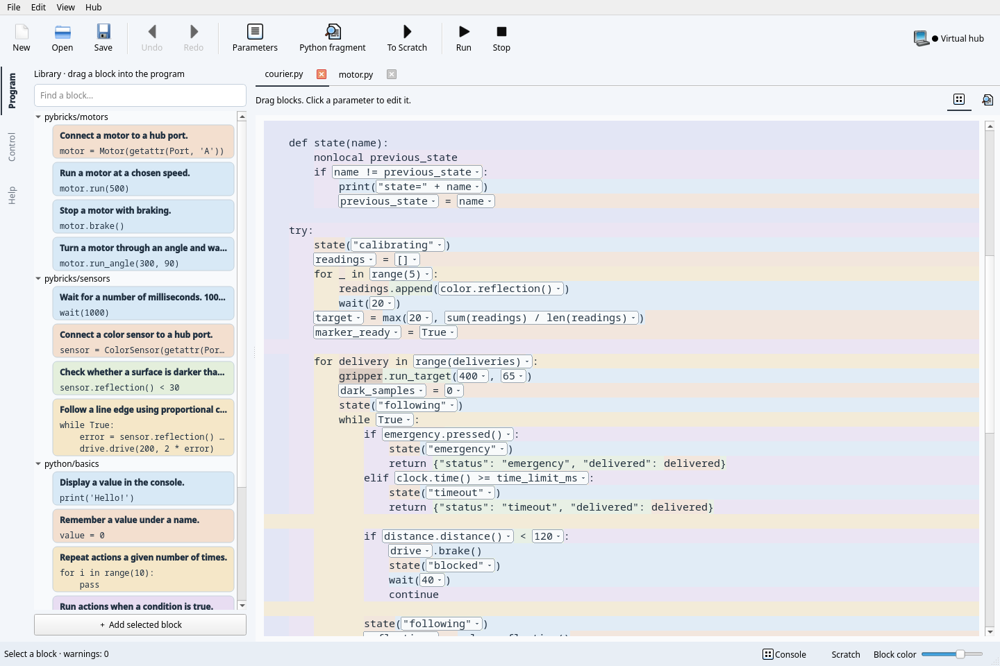

# Editing and command-line tools

## Documents and views

Files have independent tabs, drafts and undo histories. The hub connection and
console belong to the window. Run always saves and runs the active document.
Use the two document icons or **View → Blocks / Python** to change the editor mode.
Global workspaces use narrow rotated labels and neutral active indicators.

The Python editor has syntax highlighting, line numbers, indentation with
Tab/Shift+Tab, word completion with Ctrl+Space, and search with Ctrl+F. Black
formats committed edits. Invalid drafts never replace the committed document
or file; a file containing invalid Python opens as a text draft.

In Blocks, visible parameter fields open a nonmodal editable dropdown. Suggestions
include port values and available variables. Repeated occurrences of a snippet
parameter change together. Enter or ✓ applies; Escape dismisses. A structural
selection uses the whole block background, including the remaining line width.

## Structural navigation

| Action | Qt | TUI |
| --- | --- | --- |
| Parent / child | Alt+Left / Right | Alt+Left / Right |
| Previous / next node | Alt+Up / Down | Alt+Up / Down |
| Edit Python fragment | F2 | F2 |
| Parameters | F3 | F3 |
| Expand recognized snippet | Ctrl+E | Ctrl+E |
| Start move | Ctrl+M | Ctrl+M |
| Previous / next destination | Alt+Up / Down | Alt+Up / Down |
| Outdent / indent destination | Ctrl+Alt+Left / Right | Alt+Left / Right |
| Commit / cancel move | Ctrl+Enter / Esc | Ctrl+Enter / Esc |
| Fold region | Ctrl+Shift+F | Ctrl+F |
| Upgrade old snippet | Ctrl+U | Ctrl+U |

Dragging an existing block or library card displays the insertion position,
indentation and a source preview. Library insertion uses template defaults;
existing device variables are suggested when available. Undefined references
remain visible as Python and can be corrected through parameter fields.

A move preserves attached leading and trailing comments. A blank line separates
a leading comment from a block; file headers stay in place. Syntax validity does
not prove that a moved program still has the intended meaning.

## Library, Scratch and help

Search the library by name, category or description. Cards use the same semantic
color as inserted blocks. Hover shows the full preview. F1 opens the selected
snippet's documentation or the guide. Help includes offline Markdown and snippet
parameters/source, with search, internal links and Back.

Scratch accepts arbitrary unfinished text. Returning a fragment validates it
before changing either area. In Qt use the bottom Scratch button; in TUI select
the Scratch panel with Tab, use F2 to edit, Ctrl+N to create, and Ctrl+R to restore.

**View → Name diagnostics** lists unknown names. This lexical analysis does not
infer every execution path or inspect third-party runtime objects.

## CLI

Coordinates refer to the formatted source returned by `inspect`: lines start at
1, columns at 0 and count Unicode characters. Transformations print their result;
only `--write` saves it.

```sh
uv run pyblocks inspect examples/courier.py
uv run pyblocks diagnose examples/courier.py
uv run pyblocks snippets main.py
uv run pyblocks insert main.py python/basics/display --param 'value="Hello"'
uv run pyblocks replace main.py '4 + 5' --at 1:4
uv run pyblocks move main.py --at 2:0 --to 7:0
uv run pyblocks scratch main.py --at 2:0 --write
uv run pyblocks restore main.py 0 --at 1:0 --write
uv run pyblocks format main.py --write
```

`diagnose` exits with 1 for warnings and 0 otherwise. Input/transformation errors
exit with 2. `pyblocks --help` lists commands. Add a collection with
`pyblocks --collection ./my_snippets qt main.py`; saving remembers its path.
See [authoring snippets](snippets.md) and [robot control](robotics.md).


