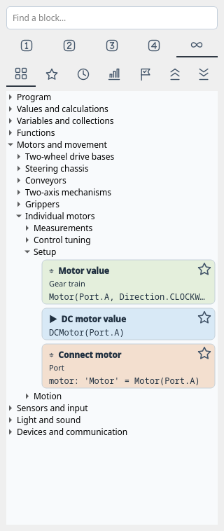
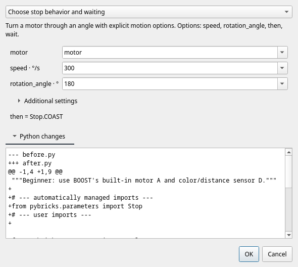
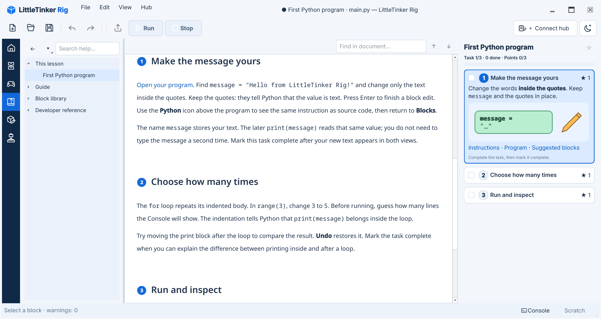

# Editing and command-line tools

This page describes the Qt desktop editor. The [terminal workspace](tui.md) edits
Python source directly and provides its own hub controls.

## Documents and views

Files have independent tabs, drafts and undo histories. The hub connection and
console belong to the window. Run and Upload capture the active document and its
imported local Python modules, using current text from any open module tabs. A
recovery checkpoint is written first. Ordinary files are not overwritten by Run.
Syntax errors in imported local modules name the module, including when its
current text has not been saved.
Starting without a filename opens **Home**. Its rail icon or **View → Home**
(**Ctrl+Alt+0**) returns to it. **New program** there and **File → New**
create unnamed documents; returning Home keeps open documents and lesson progress.
Continue working includes an open unnamed program, ordinary files, example
attempts and lesson attempts without duplicating their program modules or saved
lesson archives. When a lesson has several attempts, their numbers distinguish
them. Recent files with the same name show distinguishing folders; hover over a
card or its Continue button to see the full path. A saved lesson attempt keeps
its archive path and checks for external changes when saved again. The equipment
filter changes the displayed starter projects and remembers the choice. **Robot
projects** shows only projects with assembly steps; **Assembly → Choose a project**
selects it automatically. **All lessons…** and **All examples…**
open the complete bundled catalogs. Click anywhere on a project card to open it;
its button is also available to keyboard users. Run and
Upload need no filename; explicit Save asks for one. Cancelling Save leaves the
document open. Saving while closing uses the same rule. Example attempts autosave
separately, as described below.
Tab moves through Home's quick actions, recent work, equipment filter, project
buttons and catalog buttons in their displayed order.
Use the two document icons or **View → Blocks / Python** to change the editor mode.
Global workspaces appear as icons in the narrow left sidebar. Hover over an icon
to see its full name. The selected mode has a shaded background and a left accent.
Block search and other controls without visible labels have localized names for
screen readers.
Short panels scroll vertically without changing the current mode. Assembly is
available from the sidebar; a lesson project adds a full-height task panel on the
right, without changing the workspace modes. At narrow widths it opens over the
workspace. Its collapse icon leaves a progress control beside hub connection;
Scratch shares the right dock area on wide windows.
The catalog narrows on compact windows to leave more room for the program. Drag
the divider between catalog and program to choose your own width; that choice
stays in place while resizing this window. When the lesson and editor would be
too cramped side by side, tasks open over the workspace instead of taking a
permanent right column.
**Block Editor** (**Ctrl+Alt+3**) edits template definitions with a preview above
the source, or beside it when vertical space is limited; see
[its guide](block-editor.md).

Program text, including unfinished Python, block edits and Scratch share one
Undo/Redo history per document. Switching between Blocks and Python preserves it.
Undoing a transfer restores both its source and destination, including in Python.
Find, Format Python, Create block from selection, Name diagnostics and the
editor-mode shortcuts target the selected program or Scratch cell. The catalog
follows that editor's Blocks / Python mode. Undo is unavailable in Help, Control
and Assembly. In Help, the always-visible in-document search highlights matches
and provides next/previous controls and a match count. Ctrl+F focuses that field;
Escape clears it while leaving the controls visible. The sidebar search filters guide
pages and blocks; Escape clears its filter. An empty sidebar result is explained,
and following a link clears a filter that would hide its destination. In a program
or Scratch, Enter finds the next match, Shift+Enter the previous match, and
Escape closes search. A missed search reports
**Not found** without moving the cursor. Select a catalog block and press Enter
to insert it at the current structural selection; double-clicking does the same.

If a file or its Scratch metadata changes outside the editor, Save offers
**Reload from disk**, **Save a copy…**, or Cancel. Reload explicitly replaces the
open document and Scratch; copying preserves both versions. **File → Reload from
disk…** is also available without first saving. Ordinary Open selects an existing
tab and does not discard its edits. Running a snapshot does not resolve or
overwrite external file changes; explicit Save still checks them.
If opening, saving or reloading fails, the error appears in the Console and the
current document stays open. When opening several files, a damaged file does not
prevent the remaining files from opening.

The Python editor has syntax highlighting, line numbers, indentation with
Tab/Shift+Tab, and search with Ctrl+F. Enter preserves existing tab or space
indentation, and Tab/Shift+Tab follow the file's indentation style. Completion
appears while typing names or after a dot; **Ctrl+Space** requests it explicitly.
Choose with arrows and accept with Enter or Tab; Escape dismisses. Suggestions
follow local scope, imports, object methods and the installed Pybricks API
descriptions. Call hints show the
signature and current parameter; **Ctrl+Shift+Space** requests a hint or documentation
for the name under the cursor. Jedi analyzes unfinished source in the background
without running it. Dynamic Python objects may have incomplete suggestions;
API descriptions do not verify support on a connected hub. Ruff
formats valid committed edits. **Ctrl+S** also saves unfinished Python. All programs
are saved as UTF-8 without a BOM. Legacy files are read using their original
encoding; saving updates the encoding declaration in the editor too. Ctrl+Z can
undo that change. A UTF-8 file with a mistyped encoding declaration still opens
for correction; saving replaces the declaration with UTF-8. Unfinished files
reopen in Python view; Run, Upload and switching to Blocks
require valid syntax. A failed structural edit still leaves the block document
unchanged.

In Blocks, clicking a parameter opens a text field over its source value.
When alternatives exist, an arrow opens a list below the field; otherwise the
input has no arrow. Declaration names are plain editable text. The editable field
exists only while editing; the parameter name is a
tooltip, and a read-only suffix shows its unit. Suggestions respect known types:
conditions offer booleans and button readings, motor fields offer motor variables.
Repeated occurrences change together. Enter, choosing an item or leaving the field
applies valid input; Escape cancels it. Save and Run apply the active field first.
Invalid input stays editable and prevents saving, running or leaving its document
until corrected or cancelled. Choosing another value through the context menu
first applies a valid draft; an invalid draft stays open for correction.
Right-clicking elsewhere while a field is open applies it first. If that changes
the program, right-click again to open the menu on the updated block.
**Stop (F6)** and **Disconnect** always remain available when connected, even
with invalid input; they preserve that input.
F6 also stops the owning window's hub while one of its dialogs is open.
Stop and Disconnect cancel pending console input and device configuration before
issuing the hub operation.
Uncommitted Python text shows **changes not checked**
instead of a warning count from an earlier version.
A structural selection uses the whole block background, including the
remaining line width.

Scratch and Hub and devices start hidden to leave room for your program.
Open Scratch with the bottom button; resize or close it with its dock controls. Control mode hides Scratch. The title bar
always shows minimize, maximize/restore, and close. Double-click it to toggle
maximization; drag it or a window edge to move or resize. F11 toggles full screen.

On very narrow windows, Hub and devices joins the bottom dock tabs so it does not
squeeze the editor. The hub connection button becomes an icon with a tooltip;
**F7** also opens the connection dialog when disconnected.
The Console, Scratch, and Hub and devices commands in **View** select their panel
even when another bottom tab is in front. A second selection hides the active panel.
The dock context menu offers the same controls; **Task panel** appears there only
while a lesson is open.
Hover over a dock's title icons to see which panel will be detached or hidden.
The document tab close icons name the file they will close.

The compact LittleTinker Rig header keeps File, Edit, View, and Hub menus visible,
including in full screen. Use **View → Appearance → Light / Dark** to switch the
interface immediately, or click the sun/moon button beside the hub control to
switch between the two themes. The choice is saved; Light is the default. The
**Block color** slider in the same menu adjusts block shading across open
documents and Scratch.
The header shortens long project titles while keeping the file name visible;
hover over the title to see its full name.
After a normal close, the next launch restores the window position, size and
maximized or full-screen state. A minimized window reopens visibly. Qt adjusts
off-screen positions when the monitor configuration changes.

Block titles and action symbols explain their purpose without adding comments to
the Python file. Short titles use the interface font; Python and source comments use monospace.
Indentation colors continue through blank lines.

A display icon appears at the upper right of an inline block when you hover or
select it, and stays visible for a manual override. Click to cycle modes, or use
**Block display** in the context menu:

- **Auto** (default): use the definition's comments until the program
  contains a comment belonging to this block. Blank lines do not affect the choice.
- **Program comments**: show the program's own comments.
- **Definition comments**: show comments from the definition next to the matching code.

Code, names, annotations, parentheses and code formatting always remain those of
the program. This button never expands a function body or substitutes definition code.

The choice is independent for each block and survives parameter edits in the open
view. Switching never changes saved Python, execution or Undo. Comments inserted
in Python view belong to the program; definition comments are edited in Block
Editor. Inserting an inline block does not copy explanatory comments into the
program. A function block shows only its actual Python call and the program's
comments. Use **Open definition** to inspect its body. The function retains its
authored name and is stored once, with its comments, in the managed helper section
after imports. Multiple calls share that definition; unused functions disappear
after the last reference in the program or Scratch is removed. Python view exposes
the complete saved file.

Standalone comments attach to the next statement in the same scope, including
across blank lines. End-of-line comments attach to that statement; docstrings and
final comments without a following statement belong to their enclosing definition
or scope. File metadata and managed section markers retain their file ownership.

## Structural navigation

Expressions use Python's syntax to convey nesting. Hovering or selecting an editable
subexpression highlights its exact extent, without additional nesting borders.
Use **Alt+Left / Right** to select its parent or child, and **Tab / Shift+Tab** to
visit inputs. **Ctrl+Space** or **Enter** opens local search for operations, scoped
names and compatible blocks. **Ctrl+Shift+Space** wraps the selected expression.
Typing an operator such as `+` wraps it and selects the new operand. **Escape**
selects the enclosing statement. Close a pinned search with the back button above
the catalog.

New empty inputs use Python's `...` placeholder; `None` is an ordinary value.
Click an empty input to build an expression. Unfinished inputs survive save, recovery
and Undo; Run/Upload requires filling them. Collection and argument controls add,
remove and reorder items. The context menu also offers wrapping and keeping one
operand of an expression. Optional Python expression entry remains available.

Use **Find value blocks** in the input's context menu to filter the library by
known type and unit contracts. Selection alone does not filter it; local
expression search and the pinned catalog search are separate actions. Unknown
types remain available. When a selected block has more than one suitable input,
choose the destination from the offered list; hovering
highlights that input. Levels still limit the catalog.

| Action | Qt |
| --- | --- |
| Parent / child | Alt+Left / Right |
| Previous / next node | Alt+Up / Down |
| Edit Python fragment | F2 |
| Parameters | F3 |
| Expand recognized snippet | Ctrl+E |
| Start move | Ctrl+M |
| Previous / next destination | Alt+Up / Down |
| Outdent / indent destination | Ctrl+Alt+Left / Right |
| Commit / cancel move | Ctrl+Enter / Esc |
| Fold region | Ctrl+Shift+F |
| Upgrade old snippet | Ctrl+U |

Dragging a block attaches a colored preview of at most four displayed lines to the
pointer. The source is temporarily replaced by an amber **Previous position** row;
an expression leaves this marker in its original parameter. Escape cancels, even
while the mouse button remains held. Returning to the amber row changes nothing.

Hover the upper half of a source row to insert above it, or the lower half to
insert below it. Below a loop or `if` header means the beginning of its body. To
insert after the final loop or other compound, drag into the empty space below
the program. This selects the program's end regardless of horizontal position.
Use the lower half of the last body row to stay inside the compound. Between
blocks, the next outside block offers insertion after a compound; horizontal
position selects nesting on interior blank lines. A green row names the destination, such as **Inside loop**, **After loop**,
or **At program level**, and opens space before the destination's descriptions. Its appearance keeps the
same source row and relative point under the pointer. Edges scroll the view;
dragging does not fold code automatically.

Ordinary drops accept compatible expressions only in empty parameters (`...`).
Moving an existing block between the program and Scratch checks every open inline
field in that document. An invalid draft stays visible and the move is refused;
if a valid edit changes the document after pickup, pick up the block again.
Dropping a library block into the program or Scratch also applies open fields
first; an invalid draft remains editable and blocks the insertion.
After **Find value blocks**, the searched input also accepts replacement of its
current value; other populated inputs remain protected. Invalid contexts offer no insertion and
release restores the source. Library blocks use defaults and known device names.
A successful transfer commits once; Undo restores both program and Scratch.
Attached Python comments move with the block. Syntax validity does not prove that
a moved program still has the intended meaning.

## Finding and reusing blocks

The library has separate buttons for difficulty and view. **Beginner**,
**Intermediate**, **Advanced**, and **Expert** include earlier levels; **All**
shows every level. Both groups use icons: numbered badges 1–4 indicate the
four levels, and infinity means All. Hover for localized names, or reach a button
with Tab and activate it with Space. The active choice stays highlighted.
The two chevron buttons beside the views collapse or expand all category branches.
Click a category or nested group name, or its disclosure arrow, to toggle that
branch.

**Catalog** groups cards into Program, Values and calculations, Variables and
collections, Functions, Motors and movement, Sensors and input, Light and sound,
and Devices and communication. Open a branch or search by an action, description,
or Python API name. Search includes English names in every interface language.
Click the magnifying-glass icon to focus and select the search query; click the
clear icon to remove it.

Direct title matches appear before incidental matches within each category.
Search previews the best matching variant; you can still choose another variant.
Clearing search restores the previous selection and open branches. If you switch
levels during a search, its open branches stay open after clearing the search. A message
explains matches hidden by the level, current task view, or explicit input search.

A card represents a family of related operations. Right-click it and choose a
**Variant**; the card's preview shows the Python that will be inserted.
The level and explicit input search also filter variants.
Changing a catalog variant does not edit code already in the program.
Drag the card to the intended position. Double-click also inserts
at the current selection.

- **Favorites:** click the star on a card to add or remove its link; a filled star
  means it is already a favorite. The context menu offers the same action and
  **Move up** / **Move down** to set its order. Favorites
  have no twelve-card limit. Missing definitions retain their card titles in the
  list and recover when their collection or document becomes available again.
- **Recent:** the last twelve distinct families. Inserting another variant of a
  family moves the same entry to the front. The **Clear recent** icon clears this list.
- **Frequent:** up to twelve families ranked by successful insertions over the
  current and previous 29 UTC calendar days, then latest use and stable identity.
  The order stays fixed until you leave and return to the view. **Reset usage
  history** icon clears Recent and Frequent while preserving Favorites.
- **For this task:** blocks recommended for the selected lesson task, regardless
  of the ordinary level filter. Without an open lesson, the view explains how to
  populate it. The full Catalog remains available during every task.

Personal lists stay on this computer and do not change project files. Only
successful catalog insertions count, including insertions into Scratch. Opening,
running, recognizing, and redoing code do not count; Undo keeps the original use.
Lists remember families, not previous parameter values or ports. Functions defined
in a program belong to that file's path: equal function names in different files
have separate links and statistics. Each unnamed draft also has its own records,
preserved by recovery and transferred to its path on the first save. Later
**Save As** starts a different function scope.



## Changing an inserted block's variant

Changing a declared variable's name in the dialog also renames its resolved uses
in the current program or Scratch fragment. Conflicting names are rejected, and
Undo restores the declaration, references and other field edits together.

Right-click a recognized block in the program or Scratch and choose **Variant**
for an immediate switch. The current form is checked, and the other choices
follow the level. Compatible field values are retained;
the switch uses one Undo and does not count as another catalog insertion.

Select a recognized family block in the program or Scratch and press **F3**, or
choose **Variants and parameters…** from its context menu. Choose an operation
and edit its Python expressions. Shared fields retain compatible values; newly
exposed options retain fixed behavior such as `wait=False`. The current form stays
available even if it is above the selected level. Other choices follow the level
without restricting them to the current task's recommendations.

**Additional settings** holds optional fields. Existing non-default values open
the section initially and remain visible in a summary when you collapse it.
Enum and Boolean suggestions use Python values such as `Stop.HOLD` and `False`.
They do not translate or execute your expressions.

Read the operation description and expand **Python changes** when changes exist: changing
the operation can change waiting, units, stop behavior, or remove a field. **OK**
applies one edit, including needed imports; Undo restores it. **Cancel** leaves
the program unchanged. Invalid expressions, incompatible result types, or changes
that cannot preserve argument evaluation order prevent acceptance.

The dialog is available for recognized templates. After adding a body to a generic
loop or condition, use its ordinary structural fields or Python view if it no
longer matches the original construction template.



## Library, Scratch and help

Search the library by name, category or description. The level filter combines
with search: **Beginner**, **Intermediate**, **Advanced**, **Expert**, or **All**.
Each level includes the preceding levels. Switching levels keeps open and closed
groups as they are; search opens matching groups. Changing level while searching
keeps those groups open afterward. All is only a
filter choice. A fresh installation starts with Beginner; the selected
level is remembered. See the [learning paths](learning.md). Cards use the same semantic
color as inserted blocks. Hover shows the full preview. F1 opens the selected
block's section on its group page or the guide. Help includes offline Markdown and snippet
parameters/source, with search, internal links, a compact Back control, and a
Recent pages menu that lists unique documents.
Back and Recent pages sit beside Find in document above the article, so they
remain available when a lesson hides the Help sidebar.
Searching the Help sidebar opens matching groups; clearing the query restores
their previous open state while keeping a newly opened page visible.

Scratch is a vertical ribbon of independent editable fragments. Drag blocks from
the program or library into the ribbon. The ⠿ handle moves a whole cell; a block
inside it can also be detached individually. Drop between cells to reorder, inside
a cell to combine, or onto a program boundary to restore. Library dependencies
are imported only when the fragment enters the program. One undo restores both
areas after a transfer.

Each cell has Blocks / Python icons. Switching document tabs preserves each
cell's mode and cursor, along with the shared document history. Python accepts
arbitrary unfinished text; parseable fragments can be edited structurally without a complete execution
context. For example, a detached `break` is allowed in Scratch but can only return
inside a loop. Invalid drops preserve both areas.
The icon controls and drag handle have descriptive names for screen readers.
Reordering cells or removing a neighboring cell keeps each remaining fragment's
own text editor, including when two fragments have identical text.
Undo restores removed cells with their previous editor mode and cursor.

**View → Name diagnostics** lists unknown names. This lexical analysis does not
infer every execution path or inspect third-party runtime objects.
It detects uses after `del name` until that name receives another value.
An exception alias (`except ... as error`) is unavailable after its handler.
Deleting a module or class binding can reveal a built-in name again; deleting a
function-local binding does not make that name available from an outer scope.

## CLI

Coordinates refer to the formatted source returned by `inspect`: lines start at
1, columns at 0 and count Unicode characters. Transformations print their result;
only `--write` saves it.

```sh
./.venv/bin/little-tinker-rig inspect examples/courier.py
./.venv/bin/little-tinker-rig diagnose examples/courier.py
./.venv/bin/little-tinker-rig snippets main.py
./.venv/bin/little-tinker-rig insert main.py python/basics/display --param 'value="Hello"'
./.venv/bin/little-tinker-rig replace main.py '4 + 5' --at 1:4
./.venv/bin/little-tinker-rig move main.py --at 2:0 --to 7:0
./.venv/bin/little-tinker-rig scratch main.py --at 2:0 --write
./.venv/bin/little-tinker-rig restore main.py 0 --at 1:0 --write
./.venv/bin/little-tinker-rig format main.py --write
```

`./.venv/bin/little-tinker-rig` is the installed CLI on Linux/macOS. On Windows,
use `.\.venv\Scripts\little-tinker-rig.exe` from PowerShell. Neither launcher
needs `uv` options after installation.

`diagnose` exits with 1 for warnings and 0 otherwise. Input/transformation errors
exit with 2. `little-tinker-rig --help` lists commands. Add a collection with
`./.venv/bin/little-tinker-rig --collection ./my_snippets qt main.py`; saving
remembers its path.
See [authoring snippets](snippets.md) and [robot control](robotics.md).



## Recent files and block descriptions

**File → Open recent** lists the ten most recently opened or saved files. Opening
a file already in a tab selects that tab and preserves its unfinished draft.
If an unchanged lesson archive is linked to a retained attempt, opening the archive
continues that attempt and its newer autosaved work.
Missing files remain visible but disabled. **Clear recent files** clears the list.

A block description occupies a separate row in its own semantic color. Nested
expression blocks have their own description rows. The insertion marker appears
before the target block's descriptions and any attached Python comments.

Parameter editing (F3), To Scratch and Python fragment (F2) remain in the menus;
the toolbar focuses on files, history and hub actions.

## Expressions and your own functions

Edit the receiver, callable name, operands and operators directly in the source.
For example, `left.run(speed + 10)` has separate editable values. Click an operator
to choose another; operand grouping is preserved. Right-click an expression to
edit it as Python, clear it to `...`, or wrap it in a logical, arithmetic or
comparison expression. Drag compatible blocks into the resulting empty fields.

Click inside a call, function header or logical expression to show its compact
list controls below the editor. Opening a value field hides these controls until
the next list selection. An invalid field must be corrected or cancelled before
a list command can run. Scalar input clicks only edit their value. Select the list
when several are nested. **+** inserts after the selected item, or appends when
no item is selected; its menu also inserts before an item. **−** removes an item,
and the arrows reorder it. Calls and definitions
may have no arguments; `and` and `or` retain at least two operands. Parameters may
include annotations, defaults and Python's `/`, `*`, `*args` and `**kwargs` forms.
Edits that violate Python syntax leave the document unchanged. Each accepted
operation is one Undo step.

The same controls edit lists, tuples, sets, dictionaries and comparison chains.
The **+** menu on calls adds named arguments, `*args` and `**kwargs`. Literal values
entered in local search take priority over descriptions that happen to contain
the same number. **Copy expression / Paste expression** transfers a subexpression;
**Unwrap** keeps a chosen operand. Assignment targets can be composed as attributes,
indexed items or unpacking tuples. Click `+=` to choose another update operator.

At Expert level, a function's context menu can add decorators, edit its return
annotation and declare `global` or `nonlocal` variables. **Edit → Import module…**
adds an explicit import, including classes/functions from other project files.

Use **Define your own function** to create a definition, then edit its name and
parameters and insert actions into its body. Module-level functions appear in
**My functions** in the library. Their calls initially include required
parameters as `...`; optional parameters use the function’s own defaults. Add
optional arguments explicitly when needed. Renaming a function or parameter
updates statically resolved references and known keyword calls. Conflicting or
capturing renames are rejected. Changing a signature keeps existing calls visible.
A known incompatible call receives a red border and an error comment; uncertain
dynamic calls are not reported as signature errors. The program remains editable.
Use **Return a value** inside a function.

A function without a returned value appears as an action. Press **Escape** after
editing an input to select its statement before adding the next action. Functions with a returned
value, generators and functions with a result annotation can be inserted as
expressions. Returns inside a nested function do not change the outer function's
kind. Decorated functions remain expressions because their result is unknown.

The Beginner repeat block exposes its counter and repeat count. The Intermediate
range block exposes the counter, start, exclusive stop and step. Expand a template
to edit its fixed Python parts. A zero range step is reported as an error.

Search matches all entered words across the name, source, group and complete
localized help text, regardless of word order. Comment rows start with `#`, followed
by the enlarged block symbol and description, without additional line spacing.
They share the block's background, hover and selection, including ancestor bands.

## Block context menu

Right-click a block or its generated comment to act on that block, independently
of the previous selection. **Open definition** switches to the definition editor
and focuses the exact function. Built-ins and historical versions are read-only;
current user definitions are editable. The menu also provides Help, Expand/Collapse,
Duplicate, Move to Scratch and Delete. Expressions duplicate to Scratch. Compound
statements move or delete as a whole; Undo restores program and Scratch together.
Deleting an expression on its own line removes the statement. Inside another
expression it leaves an empty `...` field; an emptied suite retains `pass`.
Right-clicking a parameter keeps its expression-editing submenu.

Hovering or editing a repeated parameter highlights its occurrences in the same
block and shows a tooltip such as `speed · 3 uses`. Editing any occurrence changes
the whole group in one Undo step. Identical text in a different parameter or block
is independent. Escape discards an unfinished edit. Explicit Python edits can
break the pattern and leave ordinary Python.

## Recovery, examples and runtime errors

The desktop keeps separate recovery checkpoints of open documents, unsaved text
and Scratch in the operating system's user data directory (`little-tinker-rig/recovery`).
Changes are checkpointed within about a second while the interface is responsive.
After an abnormal exit, **Recover work** offers to restore them. Yes restores;
No discards that checkpoint; Cancel keeps it for later. Other live windows are
excluded. Ordinary documents still offer Save/Discard on closing. Restoring a
checkpoint does not itself overwrite source files, and later saves retain
external-change checks. Example attempts autosave through the same file checks;
if autosave fails, a separate recovery checkpoint still preserves the edited text.
If another restored version would replace unsaved work in an open tab, or the
original program or workspace metadata cannot be read, recovery opens a separate
`*_recovered_N.py` document. Saving that tab leaves the original files untouched.
Recovery does not retain undo history.

**File → Examples** mirrors the bundled `examples/` directory. On first opening,
the app creates a persistent working copy with its local Python imports. Changes,
unfinished Python and Scratch autosave within about a second and on normal close.
Repeating the menu action continues the last opened attempt, preserving an open
tab and its history. The bundled originals remain available for new attempts.

**Start this example again** creates another attempt without replacing the old one.
**My attempts** lists previous work, grouped by example; choosing one makes it the
next continuation. Attempt numbers stay attached to their creation order.
**Save as** preserves the example association and copies local modules, including
open edits and their Scratch. A conflicting destination module must be resolved
before saving. The renamed work continues to autosave at its chosen location.
Opening a new ordinary document leaves the example workflow.

Attempts are ordinary Python files and workspace sidecars under the user-data
`little-tinker-rig/examples` directory, with a small `work.json` manifest for the
original example, current paths and opening order. They are not temporary cache
files. The menu also works when examples are installed with the application.

Execution errors open the Console with a short explanation and **Show block**.
Known source locations receive a red block annotation or Python line highlight.
Errors inside managed helper functions lead to the calling user block. Full
tracebacks and unknown exception messages remain in the Console. Diagnostics use
the uploaded source snapshot, including local Python modules. If the file has
changed, Show block opens the executed source read-only instead of highlighting
an obsolete line in the current document. Starting another program clears the
previous marker. Run stored uses the last successfully uploaded snapshot from
the current connection; an unknown hub program has no editor source mapping.

## Block boundaries

Logical blocks have thin contours in their semantic color. Equal-color neighboring
blocks share a visible boundary; descriptions and code remain inside one outline.
Compound blocks retain their outer contour and their children's boundaries. Hover
and selection strengthen both fill and border. The renderer is shared by Program,
Scratch, definition previews and drag previews; borders add no row spacing and do
not change drop targets. Error borders and insertion markers remain distinct.

## Finding a missing device or value

An amber input border marks a warning. For a missing name, the tooltip starts with
the fix: which creation block to put before this use, or which later definition
to move. The expected type, unit and ordinary help follow. Right-click the field
to edit it, select an existing value, show a known definition, or **Find creation
blocks**. **Find value blocks**
searches expressions for the selected input. Hovering and ordinary clicks leave
the catalog alone. The explicit search stays pinned while you browse; its back
button restores your previous view and search. Editing the program ends the search.
The same workflow works in Scratch and stays pinned when focus moves to the
catalog. Drag a result onto the searched input or double-click its card to replace
that value. The replacement and any required imports form one Undo operation.
Switching the originating program or Scratch cell to Python ends the search;
return to blocks and start a new search after editing the text.
Quick measurement suggestions contain declared readouts, such as `motor.angle()`;
motor movements remain explicit catalog actions even when they return a number.

Creation search uses what a block produces: a Motor input finds motor constructors,
and a ForceSensor input selects that variant of the shared sensor family. The
chosen catalog level still applies; task recommendations do not limit the search.
Place a variable's creation before its use
in an accessible scope. After **Find creation blocks**, Enter or a double-click
places a declaration block immediately before the consumer; dragging lets you
choose its location. A public declaration reuses a compatible missing name, such
as `drive` in `drive.straight(200)`, instead of inventing `drive_2`. Real declarations
still reserve their names. An annotation alone, such as `drive: DriveBase`, does
not create a value: the tooltip still offers a creator, which can reuse `drive`.
Private helpers never capture unresolved references.
An expression constructor inside a loop runs on every iteration. The editor does
not choose ports or create prerequisite devices for you.
Lexical hints cannot prove that every branch or runtime call initializes a name.
Straight-line reads before assignment are diagnosed inside functions too, including
an initial `value = value + 1`. A closure's outer values may be initialized after
the closure is defined. Nested calls retain their input contracts: the sensor in
`force = sensor.force()` offers the same creation help as a standalone reading.
Value searches and drops also respect the type of that nested input.

Large catalog branches have nested mechanism or input groups. Individual motors,
two-wheel bases and steering chassis have separate branches; model-dependent
conveyor actions live under **Conveyors / BOOST Auto Builder**. Shared sensor
creation stays directly under Sensors and input. Search includes group names;
Favorites, Recent and Frequent remain flat lists.
Card tooltips include the learning level. Cards reserve a variant row only when
there is a variant label; there is no separate level badge or empty metadata row.
