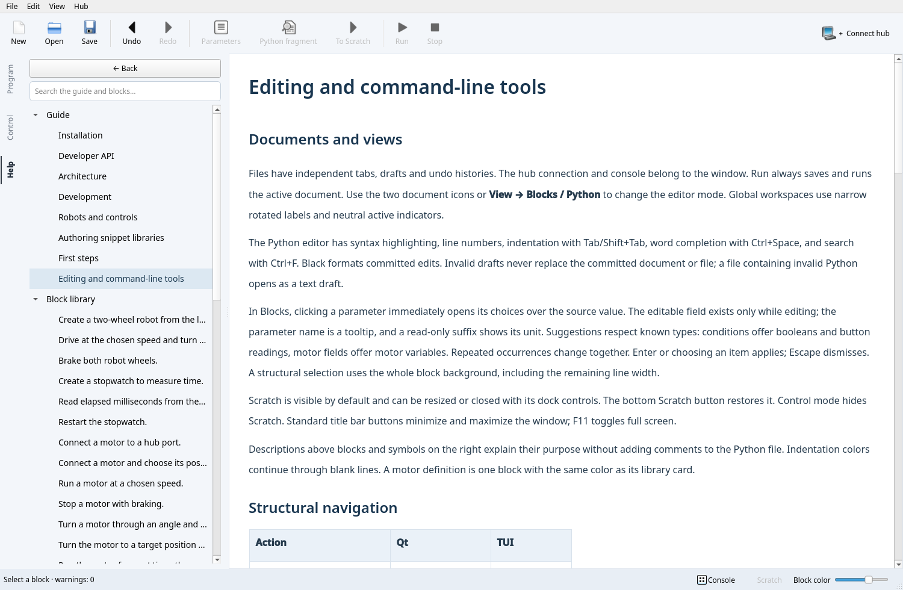

# Editing and command-line tools

## Documents and views

Files have independent tabs, drafts and undo histories. The hub connection and
console belong to the window. Run always saves and runs the active document.
Use the two document icons or **View → Blocks / Python** to change the editor mode.
Global workspaces use narrow rotated labels and neutral active indicators.

The Python editor has syntax highlighting, line numbers, indentation with
Tab/Shift+Tab, word completion with Ctrl+Space, and search with Ctrl+F. Black
formats committed edits. Invalid drafts never replace the committed document
or file; a file containing invalid Python opens as a text draft.

In Blocks, clicking a parameter immediately opens its choices over the source
value. The editable field exists only while editing; the parameter name is a
tooltip, and a read-only suffix shows its unit. Suggestions respect known types:
conditions offer booleans and button readings, motor fields offer motor variables.
Repeated occurrences change together. Enter or choosing an item applies; Escape
dismisses. A structural
selection uses the whole block background, including the remaining line width.

Scratch is visible by default and can be resized or closed with its dock controls.
The bottom Scratch button restores it. Control mode hides Scratch. Standard title
bar buttons minimize and maximize the window; F11 toggles full screen.

Descriptions above blocks and symbols on the right explain their purpose without
adding comments to the Python file. Indentation colors continue through blank
lines. A motor definition is one block with the same color as its library card.

## Structural navigation

| Action | Qt | TUI |
| --- | --- | --- |
| Parent / child | Alt+Left / Right | Alt+Left / Right |
| Previous / next node | Alt+Up / Down | Alt+Up / Down |
| Edit Python fragment | F2 | F2 |
| Parameters | F3 | F3 |
| Expand recognized snippet | Ctrl+E | Ctrl+E |
| Start move | Ctrl+M | Ctrl+M |
| Previous / next destination | Alt+Up / Down | Alt+Up / Down |
| Outdent / indent destination | Ctrl+Alt+Left / Right | Alt+Left / Right |
| Commit / cancel move | Ctrl+Enter / Esc | Ctrl+Enter / Esc |
| Fold region | Ctrl+Shift+F | Ctrl+F |
| Upgrade old snippet | Ctrl+U | Ctrl+U |

Dragging an existing block or library card displays the insertion position,
indentation and a source preview. Library insertion uses template defaults;
existing device variables are suggested when available. Undefined references
remain visible as Python and can be corrected through parameter fields.

After insertion, visible text keeps its position; the view scrolls only as needed
to show the beginning of the inserted block. Dropping outside a valid target
changes neither area. A move preserves attached leading and trailing comments. A blank line separates
a leading comment from a block; file headers stay in place. Syntax validity does
not prove that a moved program still has the intended meaning.

## Library, Scratch and help

Search the library by name, category or description. Cards use the same semantic
color as inserted blocks. Hover shows the full preview. F1 opens the selected
snippet's documentation or the guide. Help includes offline Markdown and snippet
parameters/source, with search, internal links and Back.

Scratch is a vertical ribbon of independent editable fragments. Drag blocks from
the program or library into the ribbon. The ⠿ handle moves a whole cell; a block
inside it can also be detached individually. Drop between cells to reorder, inside
a cell to combine, or onto a program boundary to restore. Library dependencies
are imported only when the fragment enters the program. One undo restores both
areas after a transfer.

Each cell has Blocks / Python icons. Python accepts arbitrary unfinished text;
parseable fragments can be edited structurally without a complete execution
context. For example, a detached `break` is allowed in Scratch but can only return
inside a loop. Invalid drops preserve both areas. In TUI select Scratch with Tab,
use F2 to edit, Ctrl+N to create, and Ctrl+R to restore.

**View → Name diagnostics** lists unknown names. This lexical analysis does not
infer every execution path or inspect third-party runtime objects.

## CLI

Coordinates refer to the formatted source returned by `inspect`: lines start at
1, columns at 0 and count Unicode characters. Transformations print their result;
only `--write` saves it.

```sh
uv run pyblocks inspect examples/courier.py
uv run pyblocks diagnose examples/courier.py
uv run pyblocks snippets main.py
uv run pyblocks insert main.py python/basics/display --param 'value="Hello"'
uv run pyblocks replace main.py '4 + 5' --at 1:4
uv run pyblocks move main.py --at 2:0 --to 7:0
uv run pyblocks scratch main.py --at 2:0 --write
uv run pyblocks restore main.py 0 --at 1:0 --write
uv run pyblocks format main.py --write
```

`diagnose` exits with 1 for warnings and 0 otherwise. Input/transformation errors
exit with 2. `pyblocks --help` lists commands. Add a collection with
`pyblocks --collection ./my_snippets qt main.py`; saving remembers its path.
See [authoring snippets](snippets.md) and [robot control](robotics.md).



