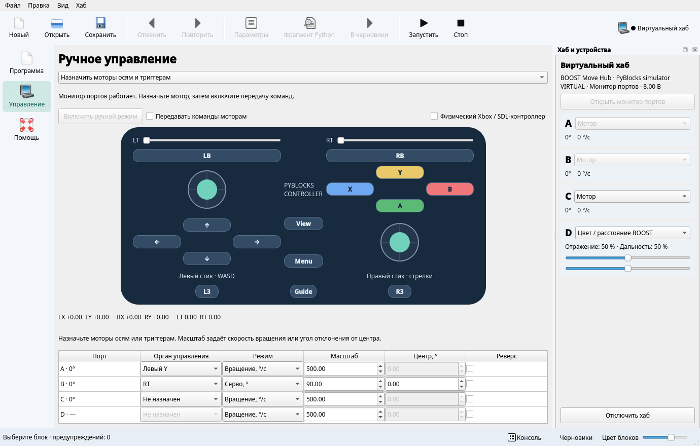

# Робот и органы управления

## Подключение

Целевые хабы работают на прошивке **Pybricks**:

| Хаб | Профиль виртуального хаба | Порты |
| --- | --- | --- |
| Robot Inventor / SPIKE Prime | `inventor` | A–F |
| BOOST Move Hub | `boost` | Встроенные моторы A/B, внешние C/D |
| LEGO Technic Hub | `technic` | A–D |

В Qt нажмите **Подключить хаб** справа вверху или **F7**. Выберите виртуальный
хаб, Bluetooth или USB. Для виртуального хаба выберите модель; для Bluetooth
можно указать имя. Пустое имя выбирает первый найденный хаб.

Виртуальный хаб не требует дополнительных пакетов связи:

```sh
uv run --extra qt pyblocks-qt examples/motor.py
```

Для настоящего хаба добавьте `--extra pybricks`. Bluetooth и USB используют
публичные API `pybricksdev`; USB доступен только у поддерживающих его моделей.
Установку прошивки описывает [руководство Pybricks](https://pybricks.com/learn/getting-started/pybricks-environment/).

**F5 / Запустить** сохраняет и передаёт программу, **F6 / Стоп** останавливает её.
Вывод `print` поступает в скрытую консоль: кнопка **Консоль** внизу показывает
новые сообщения. В TUI используются F7, F5, F6 и F8 для консоли.

Запуск из терминала с ожиданием завершения:

```sh
uv run pyblocks run examples/motor.py --transport virtual --model boost
uv run --extra pybricks pyblocks run examples/motor.py --name 'My hub'
uv run --extra pybricks pyblocks run examples/motor.py --transport usb
```

## Информация о хабе

После подключения справа открывается панель устройства. Она показывает имя,
тип, прошивку, транспорт и состояние программы. Кнопка хаба скрывает и открывает
панель. **Открыть монитор портов** запускает служебную программу вместо текущей
пользовательской программы. Она сообщает напряжение батареи, устройства на
портах, углы и скорости моторов, показания датчиков.

Настоящий хаб передаёт показания только во время работы монитора. После запуска
своей программы последние значения помечаются как прошлые. Виртуальный хаб
передаёт телеметрию и во время программы. Его батарея условно равна 8 В.

Поддержаны угловые моторы Powered Up, датчики цвета, расстояния и силы, а также
комбинированный датчик BOOST. Дальность комбинированного датчика — проценты;
ультразвукового — миллиметры. Неизвестное устройство показывается с его ID.

## Ручное управление без программы

1. Откройте слева **Управление**.
2. Выберите **Назначить моторы осям и триггерам** и включите ручной режим.
   На настоящем хабе это останавливает пользовательскую программу.
3. В строке мотора выберите ось левого/правого стика или LT/RT.
4. Выберите **Вращение** или **Серво**, задайте масштаб и при необходимости реверс.
5. Включите **Передавать команды моторам**.

Для вращения масштаб — скорость при полном отклонении, в °/с. Для сервопривода
масштаб — отклонение в градусах; центр — целевой угол при нулевом входе.
Например, левый Y с масштабом 300 задаёт скорость от −300 до +300 °/с.
RT в режиме серво с масштабом 90 и центром 20 задаёт угол от 20° до 110°.
Оси стиков принимают значения −1…1, триггеры — 0…1; вверх соответствует +Y.

Стик возвращается в центр при отпускании мыши. Левый стик также управляется
WASD, правый — стрелками, пока соответствующий стик в фокусе. Триггер возвращается
в ноль после отпускания мыши. Нулевой вход останавливает вращение, а сервопривод
возвращает к заданному центру. Выключение передачи команд тормозит оба режима.

Смена назначения, уход из режима управления, потеря активности окна или связи
выключают передачу команд. Монитор тормозит моторы, если команды не поступают
500 мс. **Стоп** останавливает программу независимо от положения органов.
Назначения сохраняются в текущем окне; после нового запуска их нужно выбрать снова.

## Физический геймпад

Добавьте `--extra gamepad` и включите **Физический Xbox / SDL-контроллер**.
Стики, триггеры и кнопки физического устройства отображаются на экранном
контроллере и используют те же назначения моторов. pygame-ce использует
[публичный SDL Controller API](https://www.pygame.org/docs/ref/sdl2_controller.html)
со стандартными назначениями Xbox. Около центра стиков действует мёртвая зона.
Отключение геймпада выключает передачу; подключение требует повторного включения.

## Управление своей программой

Режим **Передавать контроллер в мою программу** предназначен для собственного
алгоритма, который читает состояние ввода. Создайте вспомогательный файл:

```sh
uv run pyblocks controller examples/pyblocks_controller.py --write
uv run --extra qt pyblocks-qt examples/drive_controller.py
```

Запустите программу на выбранном хабе, откройте «Управление», выберите передачу
в программу и включите команды. Режим не запускает монитор и не меняет алгоритм.
Пример ожидает моторы A/B; размеры колеса и колеи задаются в миллиметрах.

```python
from pyblocks_controller import Controller
from pybricks.tools import wait

controller = Controller()
while True:
    controller.update()
    drive.drive(controller.left_y * 300, controller.left_x * 120)
    wait(20)
```

`Controller` содержит `left_x`, `left_y`, `right_x`, `right_y`, `left_trigger`,
`right_trigger`, `buttons` и совместимое поле `slider`. Маска кнопок использует
номера SDL: A/B/X/Y — 0/1/2/3, View/Guide/Menu — 4/5/6, L3/R3 — 7/8,
LB/RB — 9/10, крестовина вверх/вниз/влево/вправо — 11/12/13/14.

Вызывайте `update()` на каждом шаге: спустя 500 мс без свежего кадра значения
обнуляются. Программа должна применять их к моторам. Helper использует публичный
`read_input_byte` в Pybricks 3.3+; другой код не должен одновременно читать stdin.

## Учебный виртуальный хаб

Подключите виртуальную модель и запустите `examples/motor.py`: мотор A повернётся
на 90°, а панель покажет результат. Для BOOST это встроенный мотор A.
В панели можно менять устройства и значения датчиков; встроенные A/B BOOST
остаются моторами. Показания и углы сохраняются при переходе между программой
и ручным режимом в рамках подключения.



Симулятор исполняет Python отдельным процессом, поэтому кнопка «Стоп» прерывает
даже бесконечный цикл. Это обычный процесс с правами пользователя: учебная модель
не изолирует недоверенный код.

Поддержаны `Motor` (скорость, угол, относительное/абсолютное/временное движение,
сброс угла, остановка), `ColorSensor`, `ColorDistanceSensor`, `UltrasonicSensor`,
`ForceSensor`, `Port`, `Direction`, `Stop`, `Color`, `wait`, `StopWatch`,
`read_input_byte`, `DriveBase.drive/stop/brake` и классы выбранного хаба.
Модель цвета различает чёрный/белый по отражению. `Motor.dc` приближённо переводит
проценты в скорость. Свет, звук, IMU, нагрузки, ускорения, редукторы, профили
регуляторов и остальные API не моделируются; неподдержанный вызов сообщает ошибку.
Совместимость произвольной программы с MicroPython проверяется отдельно.

Автотесты исполняют служебный монитор на всех трёх виртуальных профилях,
проверяют движение, датчики, тайм-аут и интерфейс. Это не проверка реального
Bluetooth/USB или характеристик моторов. Аппаратные испытания остаются отдельным этапом.

Справочники устройств: [Inventor/Prime](https://docs.pybricks.com/en/stable/hubs/primehub.html),
[BOOST](https://docs.pybricks.com/en/stable/hubs/movehub.html),
[Technic](https://docs.pybricks.com/en/stable/hubs/technichub.html).
