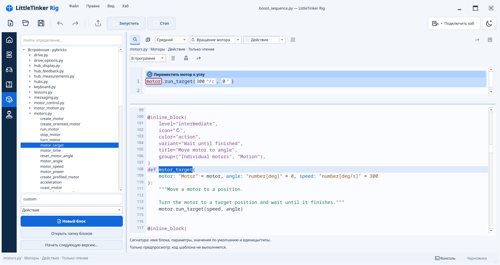

# Редактор блоков

При недостатке высоты, например с открытой консолью, предпросмотр и исходник
располагаются рядом. В высоком окне предпросмотр находится над исходником.

Откройте **Редактор блоков** на панели режимов или нажмите **Ctrl+Alt+3**.
Контекстное меню библиотеки и раздел справки каждого блока также содержат
действие **Открыть определение**. Определения — обычные текстовые шаблоны функций
Python. Редактор разбирает их, но никогда не выполняет значения по умолчанию,
импорты или тело функции.

## Изучение и создание

Слева расположены коллекции, модули и блоки. Поиск учитывает описания.
Если совпадений нет, редактор сообщает об этом, не перемещая курсор Python.
Очистите запрос значком или нажмите Escape, чтобы вернуться к дереву; ветки
снова примут прежнее состояние.
В очень узком окне список определений изначально свёрнут, чтобы исходник Python
оставался читаемым. Значок поиска в начале панели редактора открывает и скрывает
список. Пока список открыт, поля уровня, значка, цвета и свойств каталога скрыты;
закройте список, чтобы изменить эти свойства.

Встроенные определения доступны для изучения без редактирования.
**Копировать в мою коллекцию** копирует выбранную функцию вместе с описанием,
декораторами, импортами и необходимыми вспомогательными функциями. Копия получает собственный идентификатор и не
заменяет встроенный блок.

Укажите **Группу / модуль**, например `custom` или `robots/motors`, и выберите
заготовку: **Действие**, **Выражение** или **Последовательность команд**.
**Новый блок** добавляет функцию в этот модуль. При копировании используется
то же поле группы. При совпадении имён добавляется числовой суффикс. Функции одного
модуля образуют одну страницу справки. Категории каталога могут объединять
карточки из разных модулей. Имя, сигнатура,
строка документации и тело функции редактируются непосредственно в Python.

В программе действие **Правка → Создать блок из выделения** создаёт определение
из выбранного структурного блока или выделенного текста Python. Программа
сохраняется без изменений. Параметры нужно явно объявить в сигнатуре и использовать
в теле: редактор не угадывает, какие константы требуется сделать параметрами.
В определение попадают импорты, необходимые выделенному коду. Локальные псевдонимы
имеют приоритет перед импортами основной программы, в том числе при выборе в Scratch.
Тела функций сохраняют внешние импорты, объявленные ниже определения. Значения
по умолчанию и декораторы используют импорты, доступные в момент определения;
импорты в теле класса не становятся зависимостями его методов.

## Предпросмотр над исходником

Предпросмотр использует то же оформление, что и программа. Изначально видны
не более четырёх строк исходника; **Развернуть предпросмотр** показывает остальные.
Горизонтальный разделитель позволяет менять размеры предпросмотра и редактора.
Ввод текста не изменяет их размеры. **В библиотеке** переключает предпросмотр
на настоящую карточку библиотеки.

Курсор внутри функции с декоратором выбирает её блок. Обычные помощники и пустые строки между функциями сохраняют
предыдущий выбор. Нажатие на параметр в предпросмотре программы переносит курсор
к объявлению и выделяет его использования; нажатие на описание — к строке
документации. Поля открытых имён также ведут к объявлениям. Подсветка декораторов,
сигнатуры, параметров и аннотаций вместе с контекстными
подсказками объясняет устройство определения. Дополнение Python учитывает область
видимости, импорты и методы объектов. **Ctrl+Space** вызывает список вариантов,
**Ctrl+Shift+Space** — сигнатуру текущего вызова или документацию. Тот же редактор
используется для файлов программ.

**Проверочные значения** подставляет выражения Python только в предпросмотр
программы. Значения по умолчанию в определении не меняются, выражения не
выполняются. Карточка библиотеки продолжает показывать значения, которые получит
пользователь при вставке. **Сбросить проверочные значения** возвращает значения
по умолчанию. При ошибке в исходнике или проверочном выражении сохраняется
последний корректный предпросмотр и выводится сообщение. Нажатие на сообщение
об ошибке исходника переносит курсор к её строке.

## Сохранение и перенос

Значок **Свойства каталога…** рядом с уровнем, значком и цветом открывает настройки
категории и семейства. Выберите категорию, при необходимости укажите полный
идентификатор основного блока и название варианта. Пустое семейство означает
отдельную карточку; участник семейства без названия варианта служит совместимым
алиасом. Общие ключи полей связывают эквивалентные параметры с разными именами
в вариантах. Флажок **Дополнительное** доступен для параметров со значениями по
умолчанию и помещает их в раздел дополнительных настроек при редактировании.

Применение меняет декоратор одной текстовой правкой с обычной отменой.
**Сохранить и применить** проверяет всю коллекцию, включая ссылки на основные
блоки. Копия встроенного варианта становится отдельной карточкой с сохранённой
категорией; при необходимости явно включите её в семейство своей коллекции.

**Сохранить и применить**, или **Ctrl+S**, проверяет модуль и коллекцию, затем
обновляет рабочую библиотеку и справку. Поля уровня, значка и цвета меняют литералы
в декораторе. Это обычные текстовые правки с общей историей отмены; отдельной копии
свойств блока нет. Описания, значения по умолчанию, типы и открытые имена находятся
в том же Python-исходнике. Импорты разрешены на уровне модуля и внутри функций;
помощники без декораторов могут быть общими для нескольких блоков.
Значение-заполнитель `motor=motor` здесь допустимо и не вычисляется.
Допустимые конструкции описаны в [формате шаблонов](snippets.md).

Через короткую паузу изменения сохраняются как черновик, в том числе при ошибках
Python, и восстанавливаются при открытии модуля. Переключение модулей сохраняет
историю отмены текста в течение сеанса. **Открыть сохранённое** после подтверждения
отбрасывает черновик текущего модуля. Ошибочный черновик не заменяет рабочую
библиотеку. Внешние изменения того же модуля или сведений о коллекции препятствуют
случайной перезаписи.

Личная коллекция находится в стандартном каталоге данных пользователя:
на Linux по умолчанию `~/.local/share/little-tinker-rig/blocks/`, с учётом
`XDG_DATA_HOME`. Кнопка **Открыть папку блоков** открывает этот каталог.
Существующая личная библиотека автоматически доступна во всех документах
и интерфейсах; её путь не записывается в рабочее пространство каждого файла.
Внешние коллекции по-прежнему можно подключать к отдельному проекту.
Каталог создаётся при первом использовании. Встроенные коллекции поставляются
с приложением и доступны для чтения. Личные черновики находятся в `.drafts/`.

Значок и цвет выбираются из редактируемых списков. У символов указано назначение,
у цветов показаны образцы и смысловые группы. Можно ввести свой символ или цвет
`#RRGGBB`. В декораторе сохраняются сами символы и стабильные ключи вроде `action`,
независимо от языка интерфейса. Исходник, списки и предпросмотр обновляются
согласованно; изменения отменяются обычным Undo.

**Начать следующую версию…** архивирует сохранённую коллекцию перед сменой версии.
Сначала сохраните или отбросьте черновики всех модулей, затем укажите больший номер
`MAJOR.MINOR.PATCH`. Предыдущие определения, помощники и снимок манифеста остаются
в `history/<версия>/`. Начинайте новую версию *до* изменения опубликованных
определений: обычное сохранение не создаёт архив. История доступна для чтения.
Действие **Обновить блок** в программе показывает различия перед применением
совместимого обновления. Отмена диалога сохраняет исходник, Undo восстанавливает
принятое изменение целиком.

Сохранение определений не переписывает программы и Черновики, не применяет их
текстовые правки и не изменяет историю отмены. Распознавание использует новые
определения; старый код, переставший совпадать с шаблоном, остаётся обычным Python.
Изменение программы и обновление версий блоков выполняются отдельно и явно.
Отправка и запуск программы на хабе недоступны во время редактирования определений.

Нажмите правую кнопку на вставленном блоке и выберите **Открыть определение** для
прямого перехода сюда. Исторический блок открывает свой исходный файл и версию
только для чтения, а не текущую реализацию с тем же идентификатором. Скопируйте
его в пользовательскую коллекцию, чтобы получить редактируемый вариант.

В свойствах каталога также задаются короткое название и путь из одного или двух уровней (например, `Individual motors / Motion`). Путь задаётся на основном блоке семейства. Названия и группы пишутся на английском и переводятся для интерфейса; полное описание остаётся в строке документации.

Флажок **Предлагать как измерение** записывает `readout=True` в декоратор выражения.
Отмечайте так чтения, которые не запускают движение, не ждут события, не потребляют
ввод и не меняют состояние устройства. Подходящие методы чтения появляются
в подсказках параметров вместе с необходимыми импортами. Числового результата
недостаточно, чтобы действие считалось измерением. Определения без этого свойства
продолжают работать и остаются доступными в каталоге.
