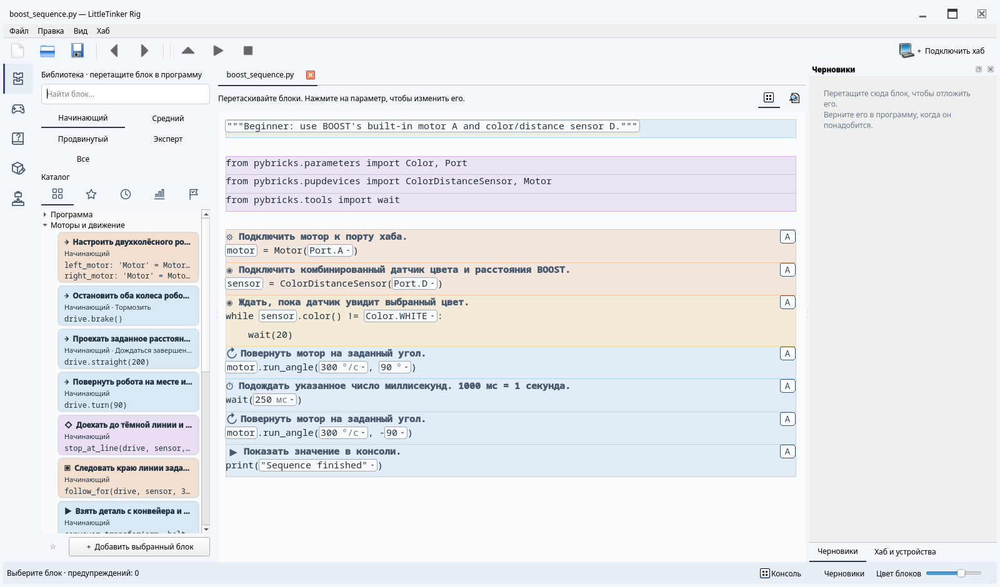

# От первых действий к Python

Библиотека открывается на уровне **Начинающий**, затем добавляются **Средний**,
**Продвинутый** и **Эксперт**. **Все** — вариант фильтра, а не уровень сложности.
Уровни накопительные, выбор сохраняется. Старое значение `standard` в настройках
и коллекциях преобразуется в `intermediate`. Уровень ограничивает новые варианты
в библиотеке, но не существующий исходник.

Начальный набор содержит 20 блоков. На остальных уровнях группы сначала свёрнуты,
чтобы ребёнок мог изучать одну тему за раз. Поиск раскрывает подходящие группы;
его очистка восстанавливает прежнее состояние. Справка описывает блоки одной
группы вместе, с указанием уровня и полным исходником Python.

## Начинающий: подключить, выполнить, подождать

| Группа | Доступные действия |
|---|---|
| Основы Python | Вывод в консоль; повтор заданное число раз |
| Моторы | Подключение; поворот на угол; движение заданное время |
| Датчики и время | Подключение датчика цвета SPIKE или BOOST; ожидание цвета или времени |
| Колёсные базы и таймеры | Настройка двухколёсного робота; путь; поворот; торможение |
| Задания для робота | Остановка у линии; следование по линии; перенос детали конвейера; прямоугольник; танец; захват |
| Управление пультом | Управление роботом с пульта LEGO Powered Up |

Начните с одного мотора и конечного перемещения. Измените угол с `90` на `-90`,
поставьте два действия подряд и повторите их. Затем добавьте ожидание датчика.
Попробуйте `examples/sequence.py` для Inventor/Prime и Technic либо
`examples/boost_sequence.py` для BOOST. Виртуальный датчик показывает белый при
отражении от 50 и чёрный ниже 50; физический датчик различает больше цветов.

Затем используйте **Настроить двухколёсного робота одним блоком**. Выберите разные
порты левого и правого моторов, диаметр колеса и колею в миллиметрах. По умолчанию
левый мотор развёрнут для зеркального шасси. Добавьте проезд и поворот.
Раскрытие настройки показывает обычные конструкторы моторов и `DriveBase`,
позволяя позже изменить направления или использовать моторы отдельно.

Готовый блок следования по линии позволяет менять время, скорость, целевое
отражение и коэффициент коррекции. По истечении времени он тормозит и передаёт
управление следующему действию. Смена знака коэффициента меняет край следования.
В `examples/line_mission.py` используются моторы A/B и датчик цвета SPIKE на C.
Для BOOST замените настройку датчика на `ColorDistanceSensor` порта D. Блок
остановки у линии не начинает движение, если линия уже под датчиком.
**Стоп / F6** прерывает программу, ожидающую линию, которая так и не появилась.

Для управления включите физический пульт LEGO Powered Up. Левые +/- задают
движение вперёд и назад, правые +/- — поворот, отпускание кнопок тормозит,
центральная кнопка завершает блок. Это прямое подключение пульта к хабу,
а не экранный джойстик Studio. Симулятор не моделирует Bluetooth-подключение.

Такой порядок повторяет переход от параметров и последовательностей к поведению
по датчикам в [BOOST](https://www.lego.com/en-au/product/boost-creative-toolbox-17101)
и [заданиях SPIKE с линиями](https://education.lego.com/en-us/lessons/prime-competition-ready/training-camp-3-react-to-lines/).
Готовое поведение полезно ещё до изучения его цикла и арифметики.
[Примеры наборов LEGO](examples.md) показывают эти действия в полных программах
Pybricks с сохранением исходного поведения механизмов.

## Средний: измерять, выбирать, давать имена

Читайте показания моторов и датчиков, запускайте непрерывное движение, ждите
условия и выбирайте действие через `if`/`else`. Добавьте переменные, арифметику,
логические выражения, диапазоны, функции и вызовы. Секундомер измеряет длительность
действия. При наличии подключайте ультразвуковой датчик или датчик силы.
Ультразвуковое расстояние измеряется в миллиметрах, расстояние BOOST — в процентах.

Перед блоками индикатора, кнопок и наклона выберите настройку своего хаба.
Встроенные дисплей и динамик есть только у Prime/Inventor. Центральная кнопка
обычно останавливает программу; боковые кнопки Prime/Inventor позволяют управлять
взаимодействиями, сохраняя эту остановку.

Примеры заданий: цветовая сигнализация, выбор одного из двух движений, счётчик
повторов, собственное действие с двумя вызовами. Раскройте готовый блок, чтобы
изучить его условия и измерения. Раскрытие меняет структуру редактирования, но
не алгоритм или сохранённый Python. Это временное состояние представления:
после правки исходника редактор снова распознаёт текущие шаблоны.

Случайные целые используют `urandom`, доступный на Inventor/Prime и Technic,
но отсутствующий на BOOST. Виртуальные профили сохраняют это различие прошивок.

## Продвинутый: объединять данные и управление

Добавляются списки, словари, индексы, перебор коллекций, срезы, списковые включения,
числовые функции и условные выражения. Также доступны настройки скорости и
ускорения базы, дуги, сброс одометрии, курс гироскопа и отдельные операции пульта.
Прежний непрерывный регулятор следования по линии остаётся для опытов с алгоритмом.

`examples/robot_route.py` объединяет список расстояний с собственной функцией
и выводит примерно `90 270` на любом виртуальном профиле. Измените маршрут,
добавьте действия в функцию. В циклах опроса оставляйте небольшую задержку.

Блоки `Car` используют калибровку руля и управление приводом Pybricks.
Нужен реальный механизм с рулевыми упорами; его калибровка не моделируется.
`Car` и `DriveBase` описывают разную механику, а не являются взаимозаменяемыми
именами объекта. См. [справку Pybricks](https://docs.pybricks.com/en/stable/robotics.html).

## Эксперт: обрабатывать ошибки и расширять Python

Добавляются обработка исключений, гарантированное завершение действий средствами
Python, собственные ошибки, проверки и прямое задание мощности мотора.
`examples/data_pipeline.py` проверяет и преобразует значения, собирает успешные
результаты и сообщает их число. Он выводит `[0, 8] 3` в обычном Python и на всех
виртуальных профилях.

Используйте представление Python для API и конструкций, которые понятнее в виде
исходника. Корректный код редактируется и без карточки в библиотеке. Физический
хаб выполняет MicroPython со своими модулями, а не неограниченный Python компьютера.

## Симуляция и отложенные возможности

Действия с моторами и датчиками, следование по таймеру, дуги, настройки движения
и одометрия проверяются на виртуальных устройствах. Модель использует постоянные
скорости, без физики шин, ускорения, рулевых упоров и столкновений. Свет, значки,
числа и тоны выводятся сообщениями в консоль; настоящий звук не воспроизводится.
В интерактивном симуляторе кнопки, наклон и курс хаба остаются в начальном состоянии;
тесты могут задавать последовательности входных значений.

Bluetooth-подключение пульта и калибровка `Car` требуют оборудования. Тесты цикла
управления задают нажатия программно и используют виртуальные моторы: проверяются
отпускание, выход центральной кнопкой и ошибка связи, но не Bluetooth-оборудование.

Общие события, библиотеки походок, облачные и мультимедийные службы, автоматическое
управление общими вспомогательными определениями отложены. Новые поведения используют
короткие шаблоны обычного Python и существующие автоматические импорты, без новых
зависимостей исполнения. Исследовательский каталог в
`AI/LEGO_CURRICULUM_AND_BLOCK_CATALOG.md` описывает более широкий план,
а не только уже реализованные возможности.
