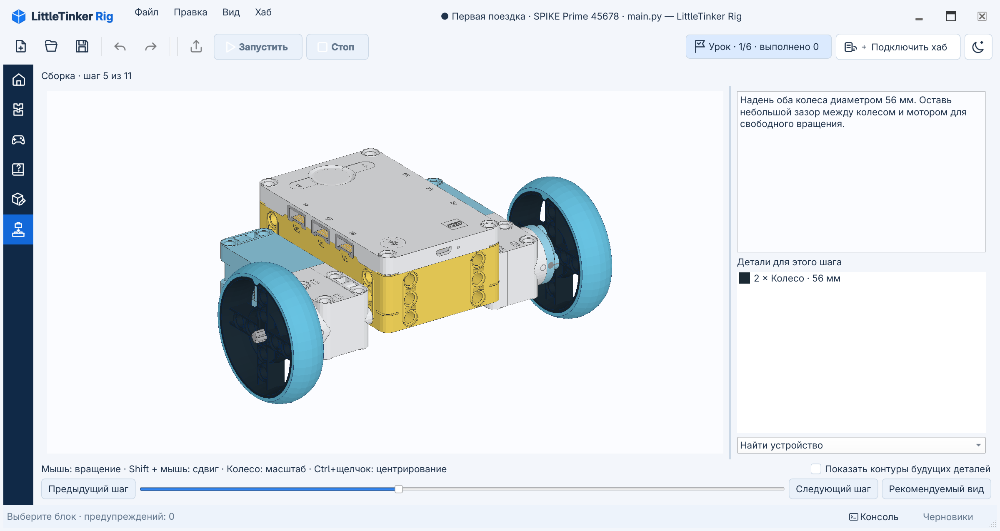

# Уроки и проекты ученика

Уроки необязательны. **Начало → Первая программа на Python** открывает короткий
урок из трёх заданий без настоящего робота. Измените текстовую переменную и
число повторов, затем запустите программу на виртуальном хабе и проверьте
консоль. У каждого задания есть небольшая схема. **Начало → Первая поездка
робота** ведёт к сборке и движению SPIKE Prime.
На карточках указано нужное оборудование; фильтр скрывает неподходящие.
Повторное открытие продолжает последнюю попытку.

**Файл → Уроки → Уроки с заданиями → Первая поездка · SPIKE Prime 45678** открывает
последнюю попытку прохождения или создаёт первую. **Файл → Уроки → Начать заново**
явно создаёт новую попытку. Редактор Python и рабочие режимы не меняются. При
первом открытии урока сразу появляется полный текст инструкции в разделе **Помощь**
с начала документа. Продолжение попытки открывает раздел выбранного задания в том
же документе.

Справа появляется **Панель заданий**. У каждого задания видны номер шага,
галочка, название и очки. Соответствующие разделы в **Помощи** отмечены синими
круглыми номерами; в начале инструкции ссылки на разделы тоже пронумерованы.
В уроке «Первая поездка» схемы колёсной базы,
направления движения и расстояния до препятствия показаны в заданиях и полной
инструкции. Настоящие детали и порядок их установки смотри в режиме **Сборка**.
Выбранное задание раскрывается и показывает цель, условие завершения,
ссылки и подсказки; остальные остаются короткими строками. Панель видна только
в проекте урока. Нажатие на название выбирает задание, меняет рекомендуемые
блоки и открывает его раздел в **Помощи**, не меняя код и отметку выполнения.
Галочка только отмечает результат и не выполняет переход.
**Инструкция** открывает полный Markdown-документ урока в режиме **Помощь** и
перемещает к разделу выбранного задания, не открывая нового окна и не добавляя
новых пунктов в дерево помощи. В группе **Этот урок** остаётся один документ;
нажатие на него возвращает к началу инструкции. В документе есть ссылки на все
задания; постоянно видимое поле **Поиск в документе…** ищет в тексте, подсвечивает
совпадения и позволяет перейти к предыдущему или следующему. Ctrl+F ставит
фокус в это поле. При переходе к другому разделу запрос и подсветка остаются,
а счётчик показывает 0 до выбора результата кнопкой перехода. Чтение другого
раздела не меняет выбранное задание и рекомендуемые блоки. Ссылки **Программа**,
**Сборка**, **Управление**
и ссылки на **Хаб и устройства** ведут к нужному файлу, режиму или панели.
**Следующая подсказка** открывает помощь в карточке. Панель доступна во всех
рабочих режимах. Сверни её значком в заголовке или через **Вид → Панель заданий**.
Кнопка прогресса, например **Урок · 1/6 · выполнено 0**, рядом с подключением
хаба откроет её снова. В узком окне панель открывается поверх рабочей области,
не сужая редактор. Escape, щелчок вне панели или переход по ссылке временно
скрывают её; при расширении окна возвращается сохранённое состояние. Scratch
и задания занимают одну правую область; консоль можно оставить открытой под
редактором.

Отметь задание после выполнения. Очки начисляются один раз и снимаются, если
убрать галочку. Панель различает отметку ученика и проверенное подключение.
Задание на подключение можно отметить только после свежих показаний монитора
портов. Приложение не утверждает, что проверило физическую сборку или успех
программы на настоящем роботе. Просмотр задания и переход по ссылке не завершают
его. **Открыть стартовую программу** при первом нажатии создаёт отдельный файл
ученика, а затем открывает тот же файл, сохраняя его правки и текущую программу.

**Для этого задания** показывает рекомендуемые блоки независимо от выбранного
уровня. Обычный каталог, кнопки уровней, Scratch, выражения и редактор Python
доступны на протяжении всего урока.

Выбор параметра и наведение не меняют каталог. Нажмите на поле правой кнопкой
и выберите **Найти блоки значений** для поиска подходящих выражений или
**Найти блоки создания** для объявления недостающей переменной. Кнопка возврата
над каталогом восстанавливает прежнее представление и поиск. Escape в редакторе
возвращает выделение к целому действию.
Обычное **Файл → Новый** создаёт программу вне урока с полной библиотекой.

## Проекты Pybricks

В **Файл → Уроки → Проекты для изучения → Pybricks · BOOST / Robot Inventor / SPIKE Prime / Technic**
доступны 24 проекта с конкретными целями, таблицами портов, опытами и рекомендуемыми блоками
на английском и русском. В уроке могут быть несколько вариантов программы и общие
модули. **Программа** и ссылки в задании выбирают нужную ученическую копию;
повторное открытие сохраняет правки. Кнопка прогресса называет их **Проектами**;
в целях заданий указаны нужная программа и действие для каждого варианта.

Код, зависимости, описания, лицензии и прогресс сохраняются вместе. Для Blast 51515,
R2-D2 75253, X-treme Off-Roader 42099 и Liebherr 42100 включены модели LDraw
сообщества с авторскими шагами. Нажми **Открыть пошаговую 3D-инструкцию** в начале
описания этапа подготовки или **Сборка** в панели заданий. Панель можно снова
открыть кнопкой прогресса; она откроет робота урока, даже если отдельно открыта
другая модель.
Рядом доступны авторство, лицензии и ссылки на оригинальные LEGO PDF. Нумерация
шагов соответствует MPD и отличается от страниц PDF. Остальные уроки сохраняют
имеющиеся ссылки на сборку. PDF, фотографии и видео открываются в браузере и
требуют интернета либо заранее сохранённой копии. Для клавиатурных программ открой **Консоль**,
поставь курсор в **Ввод для хаба** и включи **Отправлять клавиши сразу**. Только это
поле отправляет клавиши; Escape возвращает построчный ввод. В построчном режиме
Enter отправляет текст и возврат каретки. Нужен настоящий хаб Bluetooth/USB с
остановленным монитором портов. Поле ввода появляется после подключения такого
хаба и остаётся неактивным, пока работает монитор портов. Это ввод для
программы, без эмуляции терминала или REPL.

Перенесены материалы [репозитория Projects под MIT](https://github.com/pybricks/pybricks-projects/blob/master/LICENSE).
Урок 42100 использует существующие программы LittleTinker Rig под MIT и собственные
пояснения. Четыре модели сообщества имеют отдельные лицензии CC BY 2.0 и сведения
об авторстве в каталогах `robot`; геометрия деталей остаётся во внешней библиотеке.
На дополнительные [проекты сайта](https://pybricks.com/project/) даны ссылки:
[условия сайта](https://pybricks.com/legal/#pybricks-website-site-content) требуют
разрешения на копирование этих материалов. Источники указаны в каждом задании.
EV3 в каталог не входит. Полные авторские пояснения под MIT доступны офлайн
в английской версии; русская содержит адаптированные задания и инструкции.

## Сохранение и продолжение

**Сохранить** записывает переносимый архив `.ltr`: обычные программы Python,
Scratch, копию материалов урока и схемы робота, вид редактора, подсказки и
очки и прогресс. Незавершённый Python с синтаксической ошибкой тоже можно сохранить.
Повторное открытие шаблона продолжает последнюю локальную попытку; сохранённый
`.ltr` открывает переносимый архив. **Файл → Уроки → Мои попытки уроков** открывает
предыдущую попытку, **Начать заново** создаёт новую. **Файл → Новая программа в
проекте урока** добавляет ещё одну программу в тот же проект.
На вкладках программ урока после имени файла показывается **· Урок**, поэтому
урочный `main.py` можно отличить от обычного файла с тем же именем.

Библиотеки деталей указаны ссылками с версией и контрольной суммой. **Файл →
Экспортировать проект урока с ресурсами…** создаёт отдельную офлайн-копию только
с нужными деталями, цветами и сведениями об авторах. В неё входят текущие черновики
и Scratch; путь сохранения исходного проекта не меняется. Авторские модели остаются
в проекте, а не только в очищаемом кеше.
Подготовку экспорта можно отменить во время сбора деталей. Отмена до окончательной
записи не меняет существующий файл экспорта.

Рабочие файлы и восстановление после сбоя находятся в стандартном пользовательском
каталоге данных, в `little-tinker-rig/projects` и `little-tinker-rig/recovery`, а не в
каталоге установки или урока. Последняя попытка по шаблону сохраняется локально
после правок и остаётся после нормального закрытия. Явная команда **Сохранить**
создаёт или обновляет переносимый архив; локальное сохранение не записывает в
него изменения незаметно. Внешние изменения архива не затираются. После сбоя
также предлагается контрольная копия для восстановления. Архив можно распаковать
обычным ZIP-архиватором.

## Сборка

**Файл → Открыть инструкцию сборки…** открывает описание `robot.json` без урока.
Режим сборки всегда доступен слева. Список с названиями моделей появляется,
только когда открыты и отдельная инструкция, и робот текущего урока. Для отдельной сборки приложение
запоминает последнюю модель, шаг и камеру в настройках; прогресс сборки урока
хранится независимо, в его проекте.

Учебная база содержит 20 деталей и 11 шагов. Шаги 1–7 создают колёсную базу,
8–11 добавляют датчик расстояния. Левый мотор — **A**, правый — **B**, датчик — **D**.
Диаметр колеса — **56 мм**, колея — **136 мм**. Геометрия креплений проверена в
модели; посадку деталей и калибровку нужно проверить на настоящем наборе.

- Левая кнопка вращает модель, Shift + левая либо правая или средняя сдвигает,
  колёсико приближает.
  При приближении внешние края выделения удерживаются возле границ окна, постепенно
  перемещая его центр в кадр. Без выделения учитывается собранная часть робота или
  выбранная подсборка; будущие детали не влияют на камеру. Когда выделение становится
  больше окна, его края могут выходить за кадр. Отдаление сохраняет полученный центр;
  ручное перемещение камеры остаётся свободным.
- Предыдущие детали приглушены, текущие сохраняют цвета, будущие скрыты; при
  желании можно включить их контуры.
- Щелчок определяет деталь. Список шага показывает количество, цвет и заданную
  автором длину. Подсказка сохраняет название и номер LDraw. Выбор строки подсвечивает
  все копии, добавляемые на этом шаге, на их местах, в том числе сквозь другие детали.
  Выбор и снятие выделения сохраняют положение камеры. Ctrl+щелчок по детали или
  строке списка центрирует выделение без изменения масштаба и ракурса; вращение
  затем происходит вокруг нового центра.
  Повторный щелчок по строке, Escape, щелчок по фону модели или смена шага снимают выделение.
- **Рекомендуемый вид** показывает собранную часть. В импортированной модели можно
  отдельно рассмотреть собранную часть подсборки, а **Вид: Весь робот** возвращает
  всю конструкцию. Просмотр деталей и подсборок не меняет шаг сборки.
- **Найти устройство** выделяет устройство и отмечает ожидаемый порт хаба.
  В списке только устройства, установленные к текущему шагу. Это инструкция:
  реальным подключением управляет исходник Python.

Просмотрщик загружает локальные LDraw/MPD в рабочем потоке, повторно использует
геометрию одинаковых деталей и рисует через Qt OpenGL и ModernGL. Зависимости от
TopoVEC нет. При недоступности OpenGL остаются описание шагов и список деталей.
Физика, автоматическое определение порядка сборки и прокладка проводов не моделируются.

## Внешние детали и работа без сети

При открытии **Сборки** скачивается закреплённый официальный архив LDraw, если его
нет в общем пользовательском кеше. Открытие урока и редактирование программы не
запускают загрузку. В сборке есть прогресс и отмена; после ошибки или отмены можно
повторить загрузку или выбрать **Открыть ZIP деталей…** с подходящей локальной копией.
Если загрузка завершится ошибкой или будет отменена, инструкция выбранного шага
останется на экране.
Архив для первого урока занимает около 139 МиБ и скачивается один раз для всех проектов.

На Linux кеш по умолчанию расположен в `~/.cache/little-tinker-rig/ldraw/`; на других
системах используется стандартный каталог кеша. Архив именуется по SHA-256,
проверяется перед использованием и устанавливается атомарно. Просмотрщик читает
в память только нужные записи ZIP без распаковки тысяч файлов на диск. Вращение
модели и переключение шагов не вызывают сетевых запросов.

Подготовленная геометрия модели сохраняется в подкаталоге `scenes/` и используется
после перезапуска LittleTinker Rig, в том числе для разных рабочих копий одного урока.
Первое открытие создаёт этот кеш, последующие читают готовую геометрию. Изменения
модели, используемых деталей, цветов или преобразователя геометрии вызывают
пересоздание кеша. Настройки камеры и прогресс урока сохраняются отдельно.
При открытии просмотрщика геометрию по-прежнему требуется передать видеокарте.

Удаление только `scenes/` приводит к пересозданию геометрии из модели и кеша деталей
без повторного скачивания. Ошибка чтения или записи кеша сцены не мешает открыть
исправную модель.

Официальный адрес `complete.zip` обновляется вместе с библиотекой. При несовпадении
контрольной суммы геометрия не подменяется: потребуется подходящий локальный архив
или офлайн-экспорт проекта. Позже тем же форматом ссылки можно подключить архив
из нашего релиза с постоянной версией. После очистки кеша нужную версию придётся
скачать снова; офлайн-экспорт позволяет сохранить независимость от сервера.
