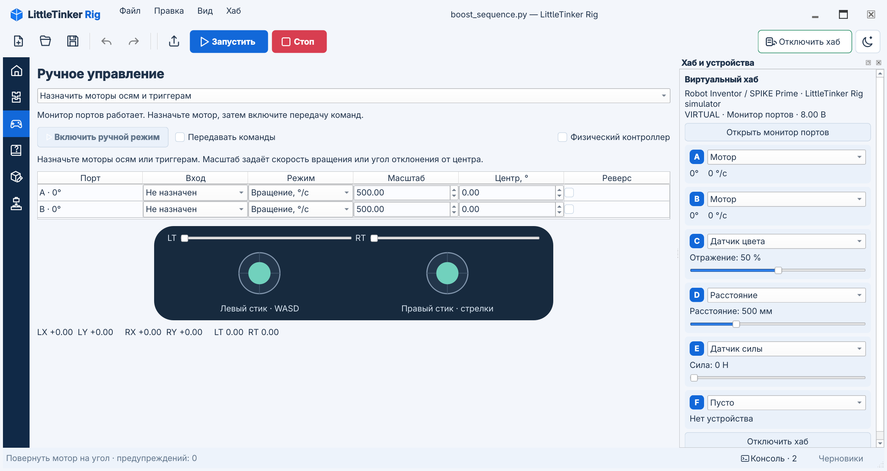

# Робот и органы управления

## Подключение

Целевые хабы работают на прошивке **Pybricks**:

| Хаб | Профиль виртуального хаба | Порты |
| --- | --- | --- |
| Robot Inventor / SPIKE Prime | `inventor` | A–F |
| BOOST Move Hub | `boost` | Встроенные моторы A/B, внешние C/D |
| LEGO Technic Hub | `technic` | A–D |

В Qt нажмите **Подключить хаб** справа вверху или **F7**. При первом использовании
выбран виртуальный хаб. Далее окно запоминает последний успешно подключённый
тип и модель виртуального хаба; ссылка в уроке выбирает свой тип подключения.
Доступны также Bluetooth и USB. Для виртуального хаба выберите модель; для
Bluetooth можно указать имя, для USB — последовательный порт (`COM3`, `/dev/ttyACM0`).
Пустое поле выбирает первый Bluetooth-хаб либо автоматически находит USB-хаб.
Если последовательных USB-хабов несколько, нужно указать порт.

При ошибке прав или недоступном порте откройте [помощь с подключением USB](usb.md).
Поля подключения и настройки устройств и моторов по портам имеют переведённые
названия для программ экранного доступа.

Во время подключения кнопка хаба и F7 отменяют попытку, после подключения —
отключают хаб. Монитор портов открывается отдельной кнопкой панели **Хаб и устройства**.
Время подключения ограничено 20 секундами. Перед повторной попыткой транспорт
закрывается, в том числе при зависании нативного USB-драйвера.

Виртуальный хаб не требует дополнительных пакетов связи. Откройте в редакторе
**Файл → Примеры → motor.py** и подключите виртуальный хаб. Для настоящего хаба
один раз установите опцию `pybricks` по [инструкции](INSTALL.md), затем
используйте тот же ярлык редактора. Bluetooth и старый USB используют
публичные API `pybricksdev`; новый USB Serial работает через pySerial.
Поддержка USB зависит от прошивки и разрешений ОС; в Linux для последовательного
порта может понадобиться членство в группе `dialout`.
Установка и восстановление прошивки доступны в меню **Хаб → Прошивка…**.

Для программирования Inventor/Prime по USB нужна совместимая бета-прошивка с USB
Serial: протокол проверен по версии 4.1.0b4. Стабильная 4.0.1 подключается по
Bluetooth. Прежний USB-транспорт сохранён для прошивок, которые его поддерживают.
Установка прошивки по USB и передача программ — разные протоколы: успешная
перепрошивка сама по себе не означает поддержку USB-программирования.

Для EV3 предусмотрены экспериментальные загрузка, запуск, остановка, консоль
через USB Serial и установка бета-прошивки. Нужна новая прошивка Pybricks,
а не прежнее окружение Linux/SD-карты. EV3 не проверен на оборудовании;
его монитор портов, виртуальная модель и подключение Bluetooth Classic пока
не реализованы. Обычный пункт Bluetooth использует BLE и к EV3 не подключается.

**Отправить на хаб / Shift+F5** передаёт снимок активной программы без запуска.
**F5 / Запустить** передаёт и запускает снимок; **F6 / Стоп** останавливает его.
Выбирать имя файла не требуется. Для открытых локальных модулей берётся текущий
текст, остальные импортированные модули читаются с диска. Обычные файлы при
запуске не сохраняются.
**Хаб → Запустить сохранённую программу** запускает уже загруженную версию.
На настоящий хаб передаётся только скомпилированный код; чтение программы обратно
не поддерживается.
При отправке и запуске **Консоль** открывается автоматически. В ней видны сообщения
подключения, прогресс передачи, вывод программы и ошибки, включая stdout/stderr
рабочего потока хаба. В нижней строке на время операции появляется индикатор
занятости. Прогресс обновляется в одной строке. Если скрыть консоль, её кнопка
показывает число новых сообщений. В узком окне кнопка **Консоль** открывает её
поверх вкладки **Хаб и устройства**; повторное нажатие скрывает консоль. В TUI
используются F7, F5, F6 и F8 для консоли.

Запуск из терминала с ожиданием завершения:

```sh
./.venv/bin/little-tinker-rig run examples/motor.py --transport virtual --model boost
./.venv/bin/little-tinker-rig run examples/motor.py --name 'My hub'
./.venv/bin/little-tinker-rig run examples/motor.py --transport usb
```

В Windows вместо `./.venv/bin/little-tinker-rig` используйте
`.\.venv\Scripts\little-tinker-rig.exe`. Для настоящего хаба сначала один раз
установите опцию `pybricks` по [инструкции](INSTALL.md).

## Информация о хабе

В широком окне **Хаб и устройства** и **Черновик** находятся во вкладках справа.
В более узком окне Черновик переходит вниз, а в очень узком окне панель устройств
располагается там же, рядом со вкладками Черновика и Консоли. Панели можно
откреплять, растягивать и закрывать.
После подключения выбирается вкладка устройства. Она показывает имя,
тип, прошивку, транспорт и состояние программы. Кнопка хаба скрывает и открывает
панель. **Открыть монитор портов** выводит панель устройств на передний план и
запускает служебную программу вместо текущей
пользовательской программы. Она сообщает напряжение батареи, устройства на
портах, углы и скорости моторов, показания датчиков.

Настоящий хаб передаёт показания только во время работы монитора. После запуска
своей программы последние значения помечаются как прошлые. Виртуальный хаб
передаёт телеметрию и во время программы. Его батарея условно равна 8 В.

Поддержаны угловые моторы Powered Up, датчики цвета, расстояния и силы, а также
комбинированный датчик BOOST. Дальность комбинированного датчика — проценты;
ультразвукового — миллиметры. Неизвестное устройство показывается с его ID.

## Ручное управление без программы

1. Откройте слева **Управление**.
2. Выберите **Назначить моторы осям и триггерам** и включите ручной режим.
   На настоящем хабе это останавливает пользовательскую программу.
3. Нажмите **Настроить моторы ↓** и в строке мотора выберите ось
   левого/правого стика или LT/RT.
4. Выберите **Вращение** или **Серво**, задайте масштаб и при необходимости реверс.
5. Включите **Передавать команды**.

Стики и триггеры остаются наверху; таблица обнаруженных моторов находится под
ними. После настройки прокрутите экран обратно к стикам. Полный контроллер с
кнопками доступен в режиме **Передавать контроллер в мою программу**.
В компактном окне стики остаются видимыми, а нижняя панель **Хаб и устройства**
показывает кнопку монитора портов. Остальные элементы доступны прокруткой.

Для вращения масштаб — скорость при полном отклонении, в °/с. Для сервопривода
масштаб — отклонение в градусах; центр — целевой угол при нулевом входе.
Например, левый Y с масштабом 300 задаёт скорость от −300 до +300 °/с.
RT в режиме серво с масштабом 90 и центром 20 задаёт угол от 20° до 110°.
Оси стиков принимают значения −1…1, триггеры — 0…1; вверх соответствует +Y.

Стики и триггеры возвращаются в нейтральное положение при отпускании мыши или
клавиши, в том числе после щелчка по дорожке ползунка вне бегунка, а также при
переходе фокуса к другому элементу. Левый стик управляется
WASD, правый — стрелками, пока соответствующий стик в фокусе. Триггеры игнорируют
колесо мыши: у него нет действия отпускания. Нулевой вход останавливает вращение,
а сервопривод возвращает к заданному центру. Выключение передачи команд тормозит
оба режима.
Если передача уже идёт, нейтральная команда отправляется сразу после её завершения.
Стоп и отключение хаба удаляют ожидающие команды движения.

Смена назначения, уход из режима управления, потеря активности окна или связи
выключают передачу команд. Монитор тормозит моторы, если команды не поступают
500 мс. **Стоп** останавливает программу независимо от положения органов.
Назначения сохраняются в текущем окне; после нового запуска их нужно выбрать снова.

## Физический геймпад

Добавьте `--extra gamepad` к [команде установки](INSTALL.md) и включите
**Физический контроллер**.
Стики, триггеры и кнопки физического устройства отображаются на экранном
контроллере и используют те же назначения моторов. pygame-ce использует
[публичный SDL Controller API](https://www.pygame.org/docs/ref/sdl2_controller.html)
со стандартными назначениями Xbox. Около центра стиков действует мёртвая зона.
Отключение геймпада выключает передачу; подключение требует повторного включения.

## Управление своей программой

Режим **Передавать контроллер в мою программу** предназначен для собственного
алгоритма, который читает состояние ввода. Создайте вспомогательный файл:

```sh
./.venv/bin/little-tinker-rig controller examples/little_tinker_rig_controller.py --write
```

В Windows используйте `.venv\Scripts\little-tinker-rig.exe`. Затем откройте
`examples/drive_controller.py` через **Файл → Примеры** и запустите на
подключённом хабе. Для физического контроллера сначала установите опцию
`gamepad`.

Запустите программу на выбранном хабе, откройте «Управление», выберите передачу
в программу и включите команды. Режим не запускает монитор и не меняет алгоритм.
Пример ожидает моторы A/B; размеры колеса и колеи задаются в миллиметрах.

```python
from little_tinker_rig_controller import Controller
from pybricks.tools import wait

controller = Controller()
while True:
    controller.update()
    drive.drive(controller.left_y * 300, controller.left_x * 120)
    wait(20)
```

`Controller` содержит `left_x`, `left_y`, `right_x`, `right_y`, `left_trigger`,
`right_trigger`, `buttons` и совместимое поле `slider`. Маска кнопок использует
номера SDL: A/B/X/Y — 0/1/2/3, View/Guide/Menu — 4/5/6, L3/R3 — 7/8,
LB/RB — 9/10, крестовина вверх/вниз/влево/вправо — 11/12/13/14.

Вызывайте `update()` на каждом шаге: спустя 500 мс без свежего кадра значения
обнуляются. Программа должна применять их к моторам. Helper использует публичный
`read_input_byte` в Pybricks 3.3+; другой код не должен одновременно читать stdin.

## Робот-курьер

`examples/courier.py` — робот, который идёт по линии и доставляет груз на двух
тёмных метках. Он использует три мотора, датчики цвета, расстояния и силы,
`DriveBase`, `StopWatch`, `wait`, функции, условия, циклы, `break` / `continue`
и обработку ошибок с обязательной остановкой в `finally`.

1. Подключите виртуальный **Inventor / SPIKE Prime**. Моторы колёс — A/B,
   датчик цвета — C, расстояния — D, аварийная кнопка — E. В панели устройства
   назначьте **F → Мотор** для захвата.
2. Откройте `examples/courier.py` и нажмите **Запустить**. Робот измерит фон,
   закроет захват на 65° и начнёт движение. Консоль сообщает смену состояний.
3. Уменьшите D ниже 120 мм: колёса затормозятся, появится `state=blocked`.
   Увеличьте расстояние, чтобы продолжить движение.
4. Уменьшите отражение C до 5%: три тёмных отсчёта обозначают точку доставки.
   Колёса остановятся, захват откроется, консоль покажет `delivery=1`.
5. Поднимите C до 50%, чтобы снова разрешить поиск метки, затем уменьшите до 5%.
   После второй доставки маршрут завершится, все моторы остановятся.
   Вместо этого можно поднять E до 5 Н для аварийной остановки.

На маршрут отведено 30 секунд; отключение устройства также завершает программу
с торможением доступных моторов. Пример рассчитан на Inventor/Prime: BOOST и
Technic имеют другую конфигурацию портов. Перед работой с реальным роботом
нужно согласовать с конструкцией диаметр колёс 56 мм, колею 112 мм, направление
моторов, скорость и пороги. Параметры доступны в режиме блоков и в Python.

## Учебный виртуальный хаб

Подключите виртуальную модель и запустите `examples/motor.py`: мотор A повернётся
на 90°, а панель покажет результат. Для BOOST это встроенный мотор A.
В панели можно менять устройства и значения датчиков; встроенные A/B BOOST
остаются моторами. Показания и углы сохраняются при переходе между программой
и ручным режимом в рамках подключения.



Симулятор исполняет Python отдельным процессом, поэтому кнопка «Стоп» прерывает
даже бесконечный цикл. Это обычный процесс с правами пользователя: учебная модель
не изолирует недоверенный код.

Поддержаны `Motor` (скорость, угол, относительное/абсолютное/временное движение,
сброс угла, остановка), `ColorSensor`, `ColorDistanceSensor`, `UltrasonicSensor`,
`ForceSensor`, `Port`, `Direction`, `Stop`, `Color`, `wait`, `StopWatch`,
`read_input_byte`, `DriveBase.drive/stop/brake` и классы выбранного хаба.
Модель цвета различает чёрный/белый по отражению. `Motor.dc` приближённо переводит
проценты в скорость. Свет, звук, IMU, нагрузки, ускорения, редукторы, профили
регуляторов и остальные API не моделируются; неподдержанный вызов сообщает ошибку.
Совместимость произвольной программы с MicroPython проверяется отдельно.

Автотесты исполняют служебный монитор на всех трёх виртуальных профилях,
проверяют движение, датчики, тайм-аут и интерфейс. Это не проверка реального
Bluetooth/USB или характеристик моторов. Аппаратные испытания остаются отдельным этапом.

Справочники устройств: [Inventor/Prime](https://docs.pybricks.com/en/stable/hubs/primehub.html),
[BOOST](https://docs.pybricks.com/en/stable/hubs/movehub.html),
[Technic](https://docs.pybricks.com/en/stable/hubs/technichub.html).

## Установка и восстановление прошивки

Архивы прошивок и каталог версий сохраняются в пользовательском кеше вне репозитория
(в Linux — `~/.cache/little-tinker-rig/firmware`). При открытии окна используется
сохранённый каталог без запросов к сети. Уже скачанная версия повторно берётся из
кеша с проверкой контрольной суммы; журнал сообщает, скачан архив или взят из кеша.
Смена канала и перезапуск приложения не удаляют прошивки. После переименования
приложение может использовать прежний кеш `pyblocks-studio`.

При исчерпании квоты GitHub API журнал показывает время её восстановления, а
каталог загружается из общедоступной ленты выпусков. До указанного времени запросы
к API не повторяются. Ошибка обновления не удаляет сохранённый каталог; скачанные
прошивки доступны без интернета. Обновление каталога само по себе не скачивает прошивки.

В **Хаб → Прошивка…** выберите модель и установку Pybricks либо восстановление LEGO.
По умолчанию выбран канал **Стабильные**; **Бета** показывает предварительные
версии со ссылками на описание выпуска. Смена канала сбрасывает подготовленную
прошивку и подтверждение установки. Обновите список официальных версий Pybricks, выберите версию и нажмите
**Загрузить и проверить**. Каталог и загруженные файлы сохраняются в кеше для
работы без сети. **Открыть файл прошивки…** позволяет выбрать локальный пакет.
Подготовка не обращается к хабу. Проверьте версию, SHA-256 и лицензию, подтвердите
замену и нажмите **Установить прошивку**. Подключение редактора предварительно
закрывается. Диалог показывает ход установки и ошибки; во время записи закрыть
его нельзя.

На Inventor/Prime, BOOST и Technic после установки Pybricks синее мигание означает
готовность к подключению.
Закройте окно прошивки и нажмите **Подключить хаб**; вручную перезагружать его
не нужно. Если хаб выключен, коротко нажмите основную кнопку. Чтобы при необходимости
перезапустить BOOST или Technic, удерживайте зелёную кнопку примерно 2–3 секунды
до выключения индикатора, отпустите и коротко нажмите для включения. У Inventor /
SPIKE Prime используется центральная кнопка. Подробнее — в [инструкции Pybricks](https://pybricks.com/learn/getting-started/pybricks-environment/#using-hubs-with-one-button).
После восстановления прошивки LEGO подключайтесь через приложение LEGO.

Inventor / SPIKE Prime прошивается по USB DFU: выключите хаб, отключите USB,
зажмите Bluetooth и подключите USB, отпустите кнопку при красно-зелёно-синем
мигании. Для BOOST и Technic используется Bluetooth: удерживайте зелёную кнопку
до мигания фиолетовым. В режиме загрузчика должен находиться только один хаб
выбранной модели. Перед стиранием установщик проверяет модель устройства.
Для старых пакетов используется публичный API `pybricksdev`; для USB в Linux нужны
libusb и разрешения udev, запасной вариант для этих пакетов — `dfu-util`.

Метаданные v3 допускают несколько аппаратных вариантов. Установщик выбирает F4
или H5 по подключённому устройству DFU, а не по порядку образов в архиве. Во время
подготовки нужные публичные инструменты Pybricks и дополнительный загрузчик F4
скачиваются из зафиксированной ревизии в пользовательский кеш прошивок.
Перед использованием их хеши проверяются повторно. После заполнения кеша
подготовка и установка работают без сети. Новому установщику необходим libusb;
запасного пути через `dfu-util` для него нет.
Исходники: [инструменты прошивки Pybricks](https://github.com/pybricks/pybricks-micropython/tree/v4.1.0b4/tools/flash).

Новая бета на Inventor/Prime F4 может установить дополнительный загрузчик.
Чтобы вернуться к стабильной или LEGO-прошивке, войдите в исходный загрузчик
через кнопку Bluetooth и подключение USB, как описано выше. Запись старого
образа для F4 на H5 или через новый загрузчик запрещается до стирания.

Установка EV3 поддерживает версии начиная с **4.1.0b4**; более старые загрузки
EV3 исключены из каталога. Выберите **EV3 → Бета**. Удерживая «Вправо», включите блок центральной
кнопкой; отпустите кнопки, когда появится **Updating...**. Подключите один EV3 по
USB. Восстановление LEGO для EV3 не предлагается. Физическая установка и
восстановление на EV3 пока не проверены.

Встроенная загрузка LEGO для Inventor/Prime устанавливает образ восстановления
**1.3.00.0000** из [официальных ресурсов Pybricks](https://github.com/pybricks/pybricks-code/tree/master/src/firmware/assets).
После этого приложение LEGO может предложить обновление. Восстановление BOOST
и Technic требует локального ZIP-пакета LEGO; автоматической загрузки оригинальных
образов для этих двух моделей нет.

ZIP использует публичный формат Pybricks: `firmware-base.bin`,
`firmware.metadata.json`, `ReadMe_OSS.txt`. Пакет LEGO дополнительно объявляет
`"firmware-type": "lego"`; `device-id` равен 64 для BOOST, 128 для Technic и 129 для
Inventor/Prime (226 для EV3). Метаданные v3 перечисляют варианты файлов и
контрольных сумм в `variants`. Метаданные версии 2.1 поддерживают `checksum-type: none` для
готового образа со своей контрольной суммой. Не меняйте модель в метаданных чужого
образа. Для Inventor/Prime принимается также `.bin`, совпадающий со встроенным
образом, либо с соседним `.metadata.json`, указывающим тип, модель и версию.
Переименование файла не преобразует прошивку.

Автоматические тесты проверяют пакеты и границы транспортов без записи в настоящий
хаб. Установку и восстановление на физическом оборудовании ещё нужно проверить.
