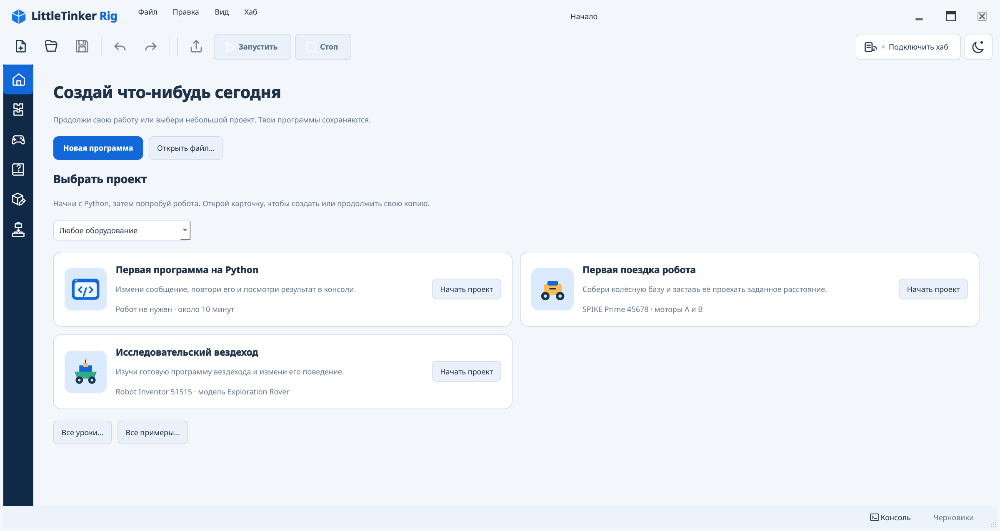
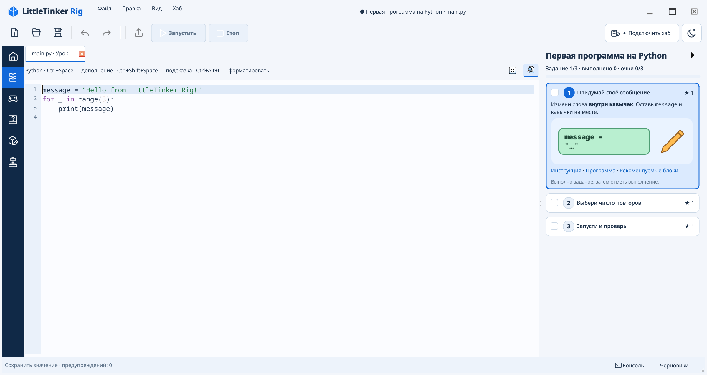

# Первые шаги: знакомство с программой

Это руководство проведёт вас от страницы **Начало** до запуска программы на
Python. Набор LEGO и настоящий хаб не нужны. Если приложение ещё не установлено,
начните с [инструкции по установке](../INSTALL.md).

## 1. Откройте учебную программу

Запустите LittleTinker Rig. На странице **Начало** выберите **Первая программа
на Python**. Кнопка **Новая программа** создаёт пустой документ, а **Открыть
файл…** возвращает к сохранённому файлу Python.

Урок сразу открывает полный текст инструкции в **Помощи**. Нумерованные разделы
документа соответствуют трём заданиям справа. Ссылка **Инструкция** в карточке
задания переводит к его разделу; остальные разделы остаются доступными при
прокрутке. Нажмите **Открой программу** в инструкции или **Программа** в
карточке задания, чтобы перейти к редактору.

## 2. Осмотритесь в редакторе

Узкая панель слева переключает рабочие режимы: **Начало**, **Программа**,
**Управление**, **Помощь**, **Редактор блоков** и **Сборка**. Наведите курсор на
значок, чтобы увидеть его название. В режиме программы слева находится
**библиотека блоков**, в центре — ваш файл, справа — **панель заданий**.
**Консоль** открывается снизу. Открытые файлы показаны во вкладках над программой.

В библиотеке есть кнопки уровней с цифрами. Кнопка **1** показывает начальные
блоки; значки под ней переключают виды библиотеки. Группу можно раскрыть
щелчком по её названию. Урок предлагает подходящие блоки, но весь каталог
остаётся доступным.

Вы редактируете настоящий файл `.py`. Цветные блоки показывают команды Python
и их вложенность. Готовая программа начинается сразу со строки, которую вы
измените: `message` хранит текст. Строка `print(message)` с отступом читает его
внутри цикла.

## 3. Измените два параметра

Нажмите на текст в кавычках в строке `message = "Hello from LittleTinker Rig!"`.
Замените его на `"Привет, Python!"` вместе с кавычками и нажмите **Enter**.
Имя `message` оставьте прежним: его использует следующий блок. Когда изменение
появится в программе, поставьте галочку у первого задания. Галочка записывает
прогресс, но не меняет код.

Нажмите название **Выбери число повторов** в панели заданий. Откроется его
раздел инструкции. Вернитесь по ссылке **Программа**, нажмите `3` в `range(3)`,
введите `5` и нажмите **Enter**. До запуска предположите, сколько раз появится
сообщение. Отметьте второе задание, когда сможете объяснить ответ.
Если введено некорректное значение, исправьте его или нажмите **Escape** для
отмены этой правки.

## 4. Запустите и проверьте результат

Выберите **Запусти и проверь** в панели заданий. Нажмите ссылку **Подключить
виртуальный хаб** в карточке или **Подключить хаб** в верхней панели. Выберите
**Виртуальный хаб**, затем **Robot Inventor / SPIKE Prime** и подключитесь.
Для этого занятия ничего собирать не нужно. Нажмите **Запустить** или **F5**,
затем откройте **Консоль** снизу. Сообщение должно появиться пять раз. В
консоли также могут быть сообщения о подключении и запуске. Отметьте третье
задание после проверки результата. **Стоп / F6** прерывает запущенную программу.

## 5. Добавьте блок и посмотрите код Python

В библиотеке выберите вид **Каталог**, раскройте группу **Программа** и
перетащите **Вывести значение** в пустое место *под* циклом. Перед отпусканием
проверьте подсказку места вставки: новый блок должен быть на одном уровне с
циклом, а не внутри него. Измените его значение в кавычках на `"Готово!"` и
запустите программу снова. Должно появиться пять приветствий, а затем один
раз — `Готово!`. **Ctrl+Z** отменит последнюю правку; нажмите ещё раз, чтобы
убрать вставленный блок. **Ctrl+Shift+Z** вернёт отменённые изменения по одному.

Два маленьких значка над документом переключают **Блоки** и **Python**. Откройте
Python, чтобы увидеть ту же программу как текст, затем вернитесь к блокам.
Строка с отступом находится внутри цикла, а новая `print("Готово!")` — после
него. Оба представления редактируют один документ.

## 6. Продолжайте работу

Панель заданий сворачивается значком в её заголовке. Небольшая кнопка прогресса
рядом с **Подключить хаб** разворачивает её обратно. Ссылка **Инструкция**
возвращает к полному документу урока в Помощи. Значок **Начало** открывает
быстрые действия, не закрывая программу. Повторное открытие урока продолжает
последнюю попытку; только **Файл → Уроки → Начать заново** создаёт новую.
Работа над уроком сохраняется автоматически.

Для обычного файла выберите **Начало → Новая программа** и нажмите **Ctrl+S**,
чтобы задать имя. В [руководстве по редактированию](../usage.md) описаны
Scratch, несколько файлов, варианты блоков и восстановление. Когда захотите
собрать и запрограммировать робота, откройте [уроки и сборку](../lessons.md)
и [руководство по роботам](../robotics.md).
