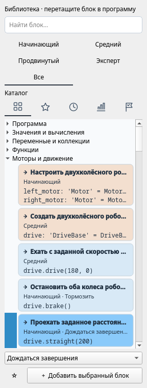
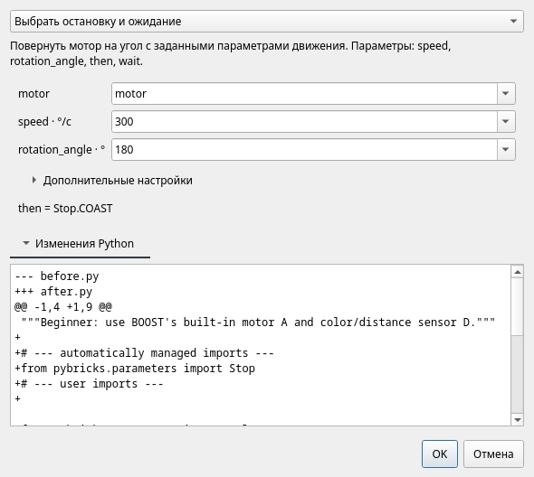
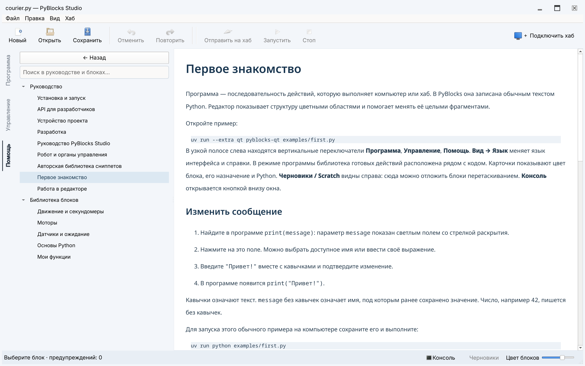

# Работа в редакторе

Здесь описан редактор Qt. [Терминальная среда](tui.md) редактирует исходники
Python напрямую и содержит собственные инструменты работы с хабом.

## Рабочие режимы Qt

При запуске без имени файла открывается страница **Начало** с быстрыми действиями,
последними программами и несколькими проектами. **Новая программа** открывает
пустой документ; значок слева или **Вид → Начало** (**Ctrl+Alt+0**) возвращает
сюда, не закрывая вкладки и не
сбрасывая урок. В продолжении работы видна открытая программа без имени;
обычные файлы, примеры и уроки показаны без повторения файлов модулей и
сохранённых архивов уроков. Несколько попыток одного урока различаются
номерами. Недавние файлы с одинаковыми именами различаются подписями папок;
полный путь виден в подсказке карточки и кнопки **Продолжить**. Сохранённая
попытка помнит путь к архиву и при следующем сохранении проверяет, не изменился
ли файл извне. Фильтр оборудования запоминает выбор и
скрывает неподходящие карточки проектов. **Проекты с роботом** показывает только
проекты с шагами сборки; кнопка **Сборка → Выбрать проект** включает этот фильтр.
Кнопки **Все уроки…** и **Все примеры…**
открывают полные списки встроенных материалов. Проект можно открыть щелчком в
любом месте карточки; кнопка доступна и с клавиатуры.
Клавиша Tab проходит по быстрым действиям страницы «Начало», недавним работам,
фильтру оборудования, карточкам проектов и кнопкам каталогов в порядке показа.

Иконки в узкой панели слева переключают **Начало**, **Программа**, **Управление**, **Помощь**,
**Редактор блоков**. Название появляется в подсказке при наведении на иконку.
**Сборка** доступна слева; проект урока добавляет панель заданий на всю высоту
справа, не меняя рабочие режимы. В узком окне она открывается поверх рабочей
области. После сворачивания её открывает кнопка прогресса рядом с подключением
хаба. В широком окне Scratch занимает ту же правую область.
В компактном окне каталог становится уже, оставляя больше места программе.
Перетащите разделитель между каталогом и программой, чтобы выбрать свою ширину:
она сохранится при изменении размера этого окна. Если панель заданий слишком
сильно сужает редактор, она открывается поверх рабочей области, не занимая
постоянный столбец справа.
При нехватке высоты панель режимов
прокручивается, сохраняя текущий режим. [Редактор блоков](block-editor.md)
(**Ctrl+Alt+3**) показывает предпросмотр над текстом определения.
Активный режим отмечен фоном и линией слева; цвета
сохранены для типов блоков. Две небольшие иконки справа вверху документа
переключают **Блоки / Python**. Те же команды находятся в меню **Вид**
(**Ctrl+Alt+1 / Ctrl+Alt+2**). У поиска блоков и других элементов без видимых
подписей есть переведённые названия для программ экранного доступа.
Подключение хаба находится справа вверху. Scratch и панель устройств изначально
скрыты, чтобы оставить место программе.
Откройте Scratch кнопкой внизу окна; панель можно растянуть или закрыть. В режиме управления хабом Scratch скрыт.
Консоль открывается кнопкой внизу окна. Сохранить, отменить и запустить можно с тулбара.

В очень узком окне панель устройств переходит во вкладки снизу и не сжимает редактор.
Кнопка подключения хаба показывается значком с подсказкой; диалог также открывается
клавишей **F7**, если хаб не подключён.
Команды **Консоль**, **Scratch** и **Хаб и устройства** в меню **Вид** выводят нужную
панель поверх соседней вкладки. Повторный выбор скрывает активную панель.
Контекстное меню док-панелей действует так же; **Панель заданий** появляется в нём
только при открытом уроке.
Подсказки значков в заголовке панели называют панель, которую можно открепить или
скрыть. Значок закрытия вкладки документа называет закрываемый файл.

**Стоп (F6)** и **Отключить** работают и при ошибке в редактируемом параметре:
незавершённый ввод сохраняется. Создание блока из выделения и диагностика имён
относятся к выбранному редактору программы или ячейке Scratch. Каталог виден,
когда этот редактор работает в режиме блоков.
F6 останавливает хаб своего окна и при открытом диалоге.
Стоп и отключение отменяют ожидающие отправки в консоль и настройки устройств
перед выполнением команды хабу.

Режим **Python** — обычный текстовый редактор с подсветкой, номерами строк,
автоотступами и Tab/Shift+Tab. Enter сохраняет существующий отступ табуляцией или
пробелами, а Tab/Shift+Tab учитывают стиль отступов в файле. Дополнение появляется
при наборе имени или после точки; **Ctrl+Space** вызывает его явно. Стрелки
выбирают вариант, Enter или Tab вставляют его, Escape закрывает список. Подсказки
учитывают локальную область, импорты, методы объектов и установленные описания API
Pybricks. При вызове функции
показываются сигнатура и текущий параметр; **Ctrl+Shift+Space** вызывает подсказку
или документацию имени под курсором. Jedi анализирует незавершённый код в фоне,
не выполняя его. Для динамических объектов подсказки могут быть неполными;
описания API не проверяют поддержку на подключённом хабе. Ruff форматирует
код при сохранении, запуске, переходе к блокам и по **Ctrl+Alt+L**.
**Ctrl+S** сохраняет и незавершённый Python. Все программы записываются в UTF-8
без BOM. Старые файлы читаются в исходной кодировке; при сохранении объявление
кодировки обновляется и в редакторе. Это изменение можно отменить через Ctrl+Z.
Файл UTF-8 с ошибкой в объявлении кодировки тоже откроется для исправления;
при сохранении объявление заменится на UTF-8.
Файл с синтаксической ошибкой сразу открывается в Python. Запуск, отправка на хаб
и переход к блокам требуют корректного синтаксиса. Ошибочная структурная правка
по-прежнему не меняет блоковый документ. При закрытии несохранённого текста предлагается
сохранить, отбросить или отменить закрытие.

В Python работают обычные вырезание, копирование и вставка; Ctrl+X не отправляет
текст в Scratch. Текстовые правки, включая незавершённый Python и форматирование,
изменения блоков и Scratch используют одну историю Undo/Redo документа.
Ctrl+Z отменяет последнюю операцию целиком: после переноса восстанавливаются оба
места, в том числе в режиме Python. **Ctrl+F** ищет текст.

Переход между блоками и Python сохраняет историю текстового редактора. Поиск,
форматирование и сочетания клавиш переключения режима относятся к выбранной
программе или ячейке черновика. В справке, управлении и сборке отмена правок
программы недоступна. В справке поле поиска по текущему документу видно постоянно:
совпадения подсвечиваются, есть переходы и счётчик. Ctrl+F переводит фокус в поле,
Escape очищает его, оставляя инструменты поиска на месте. Поиск в боковой панели
по-прежнему фильтрует страницы руководства и библиотеку блоков.
При поиске в боковой панели раскрываются подходящие разделы; очистка запроса
возвращает прежнее состояние веток, сохраняя видимой вновь открытую страницу.
В программе и черновике Enter ищет следующее совпадение, Shift+Enter — предыдущее,
Escape закрывает поиск. При отсутствии совпадения выводится «Не найдено», позиция
редактора сохраняется. Выбранный блок каталога можно вставить клавишей Enter
или двойным щелчком — в текущую структурную позицию.

Корректный параметр применяется при уходе из поля, сохранении и запуске.
Escape отменяет ввод. Ошибочный ввод остаётся доступным для исправления и
блокирует сохранение, запуск и уход из документа. При выборе другого значения
через контекстное меню корректный ввод сначала применяется, а поле с ошибкой
остаётся открытым для исправления.
Щелчок правой кнопкой вне открытого поля сначала применяет его. Если программа
изменилась, щёлкните правой кнопкой ещё раз, чтобы открыть меню обновлённого блока.
Изменённый текст Python показывает
«изменения не проверены» вместо счётчика предупреждений старой версии.

## Документы и язык

**Ctrl+O** позволяет выбрать несколько `.py`-файлов. Они открываются во вкладках
над документом; вкладки можно переставлять. Повторное открытие файла выбирает
его вкладку. У каждого файла собственные черновик, Scratch, выделение и история
отмены. Сохранение и запуск относятся к активному файлу.

Если файл или данные черновиков изменены другой программой, при сохранении можно
выбрать «Перечитать с диска», «Сохранить копию…» или отмену. Перечитывание заменяет
документ и его черновики, сохранение копии оставляет обе версии. Команда
**Файл → Перечитать с диска…** доступна и отдельно. Обычное открытие уже открытого
файла выбирает его вкладку и не отбрасывает правки. Запуск использует снимок
текущего текста и не перезаписывает внешние изменения; сохранение по-прежнему
проверяет конфликты.
Если открыть, сохранить или перечитать файл не удалось, ошибка появляется в Консоли,
а текущий документ остаётся открытым. При открытии нескольких файлов повреждённый
файл не мешает открыть остальные.

**Ctrl+N** открывает пустой документ, **Ctrl+W** закрывает текущий. Несохранённые
изменения отмечены точкой перед именем. Закрытие предлагает сохранить, отбросить
изменения или отменить действие. Сохранить можно и недописанную программу.

При запуске без имени файла и по **Файл → Новый** создаётся документ без выбранного
места сохранения. Запуск и отправка на хаб не требуют имени файла: используются
текущий текст программы и открытых локальных модулей, обычные файлы не
перезаписываются. Перед отправкой создаётся копия для восстановления после сбоя.
При синтаксической ошибке в импортируемом локальном модуле сообщение указывает
его имя, даже если текущий текст модуля ещё не сохранён.
Явное сохранение предлагает имя и папку; отмена оставляет документ открытым.
То же правило действует при сохранении перед закрытием. Попытки учебных примеров
сохраняются автоматически, как описано ниже.

**Вид → Язык → Русский / English** переключает подписи, библиотеку и встроенную
помощь без перезапуска. Выбор сохраняется между запусками. Текст программы,
имена файлов, показания устройств и история отмены сохраняются.

Кнопки заголовка позволяют свернуть, развернуть и закрыть окно.
**F11 / Вид → Полный экран** переключает полноэкранный режим.
В компактном заголовке меню **Файл**, **Правка**, **Вид** и **Хаб** остаются
доступны и в полноэкранном режиме. Выберите **Вид → Оформление → Светлая /
Тёмная**, чтобы сразу сменить тему, или нажмите кнопку с солнцем или луной рядом
с управлением хабом. Выбор сохраняется; по умолчанию используется светлая тема.
Ползунок **Цвет блоков** в том же меню меняет окраску блоков во всех открытых
документах и Scratch.
Длинное название проекта в заголовке сокращается так, чтобы осталось видно имя
файла; наведите на заголовок, чтобы прочитать его целиком.
После обычного закрытия приложение восстанавливает положение, размер и
развёрнутое или полноэкранное состояние окна. Свёрнутое окно при следующем
запуске становится видимым. При смене мониторов Qt возвращает положение окна
в доступную область экрана.

## Выделение и перемещение

В Qt нажмите на блок вне поля параметра. Его фон станет насыщеннее и будет
медленно пульсировать по всей ширине области. В этом режиме нет текстового
курсора; ввод открывается только в выбранном поле.
**Alt+Left** выбирает родительскую конструкцию, **Alt+Right** — дочернюю.
Например, можно перейти от числа к выражению, затем к вызову, затем к циклу.
**Alt+Up / Alt+Down** выбирает соседний узел того же родителя: так можно перейти
к другому аргументу вызова или операнду выражения, не используя мышь.

Распознанный сниппет по умолчанию редактируется целиком. Поля параметров видны
прямо в программе как светлые области. Нажатие открывает поле ввода на месте
значения. Если есть альтернативы, стрелка раскрывает список под полем: можно
выбрать предложенное имя, порт или значение либо ввести Python-выражение.
Имена объявляемых переменных и параметры без вариантов показываются без стрелки.
Имя параметра видно в подсказке при наведении, единица — внутри поля, отдельно
от редактируемого текста. Подсказки учитывают тип: в условии предлагаются
логические значения и показания кнопки, у мотора — переменные моторов.
**Enter** или выбор пункта применяет изменение, **Esc** закрывает поле. Ошибка
оставляет прежний код. **F3** открывает первый параметр выбранного блока;
**F2** позволяет изменить внутренний Python-код. Если изменённая
структура больше не соответствует шаблону, она остаётся обычными Python-блоками.
**Ctrl+E** раскрывает сниппет для структурной работы с его внутренними узлами;
повторное нажатие возвращает составной вид. Это временное состояние отображения:
после изменения исходника распознавание выполняется заново.

Перенос с клавиатуры:

| Действие | Qt |
| --- | --- |
| Начать перенос | Ctrl+M |
| Предыдущая / следующая позиция | Alt+Up / Alt+Down |
| Меньшая / большая вложенность | Ctrl+Alt+Left / Right |
| Применить перенос | Ctrl+Enter |
| Отменить перенос | Esc |
| Свернуть / развернуть выбранную область | Ctrl+Shift+F |

При переносе мышью цветной блок следует за указателем. Предпросмотр содержит
не более четырёх видимых строк. На прежнем месте остаётся янтарная строка
**Прежнее положение**; при переносе выражения метка остаётся в его параметре.
**Esc** отменяет перенос, даже если кнопка мыши ещё нажата. Возврат на янтарную
строку оставляет документ и историю отмены без изменений.

Верхняя половина строки предлагает вставку выше, нижняя — ниже. Нижняя половина
заголовка цикла или `if` предлагает начало его тела. Для вставки после составного
блока в конце программы перетащите в свободное место под программой: положение
по горизонтали здесь не влияет на вложенность. Чтобы остаться внутри конструкции,
используйте нижнюю половину последней строки её тела. Между блоками можно навести
на следующий внешний блок; на внутренних пустых строках положение по горизонтали
выбирает вложенность.
Зелёная строка указывает вложенность, например **Внутри цикла** или **После цикла**,
и появляется перед описаниями места назначения.
При её появлении строка под мышью и относительное положение указателя сохраняются.
У краёв работает прокрутка; автоматического сворачивания при переносе нет.

Обычное перетаскивание помещает совместимое выражение только в пустой параметр (`...`).
При переносе готового блока между программой и Scratch проверяются все открытые
поля этого документа. Ошибочный ввод остаётся видимым, а перенос отменяется.
Если корректное изменение применилось после захвата блока, захватите блок заново.
Вставка карточки каталога в программу или Scratch также сначала применяет
открытые поля; ошибочный ввод остаётся доступным для исправления и не допускает вставку.
После команды **Найти блоки значений** можно также заменить значение именно того
поля, для которого открыт поиск. Остальные заполненные поля защищены от замены.
В недопустимом контексте вставка не предлагается;
отпускание возвращает блок. Один **Undo** восстанавливает обе области после переноса.
Редактор проверяет допустимость Python, но не доказывает правильность алгоритма.

Отдельный комментарий принадлежит следующей команде в той же области
вложенности, в том числе через пустые строки. Строчный комментарий принадлежит
команде на этой строке. Докстринги и конечные комментарии без следующей команды
принадлежат определению или окружающей области. Метаданные файла и маркеры
управляемых разделов остаются у файла. При перемещении команды её комментарии
перемещаются вместе с ней.

Заголовок и символ действия — оформление блока, которое не записывается в `.py`.
Короткие заголовки используют шрифт интерфейса, Python и комментарии — моноширинный.
Цветовые полосы вложенности продолжаются на пустых строках.

Значок отображения справа вверху inline-блока появляется при наведении или
выделении и остаётся видимым при ручном выборе режима. Щелчок переключает режим;
те же варианты доступны через **Отображение блока** в контекстном меню:

- **Авто**: комментарии определения, пока у блока нет комментариев
  в программе. Пустые строки на выбор не влияют.
- **Комментарии программы**: собственные комментарии программы.
- **Комментарии определения**: комментарии определения рядом с соответствующим кодом.

Код, имена, аннотации, скобки и оформление строк кода всегда берутся из программы.
Переключение не раскрывает тело функции и не подменяет код текстом определения.

Каждый блок выбирает режим независимо; ручной выбор сохраняется при изменении
параметров в открытом представлении. Переключение не меняет сохранённый Python,
выполнение и Undo. Комментарии программы редактируются в Python, комментарии
определения — в редакторе блоков. Вставка inline-блока не копирует пояснения в
программу. Блок-функция показывает только настоящий вызов Python и комментарии
программы. Действие **Перейти к определению** открывает её тело. Функция сохраняет
имя из определения блока и добавляется один раз, вместе с комментариями, в
управляемый раздел после импортов. Все вызовы используют это определение; после
удаления последнего обращения из программы и Scratch ненужные функции удаляются.
Полный сохранённый файл доступен в Python.

## Поиск и повторное использование блоков

В библиотеке отдельно выбираются уровень и представление. **Начинающий**,
**Средний**, **Продвинутый** и **Эксперт** включают предыдущие уровни; **Все**
показывает все уровни. Обе группы представлены значками: 1–4 обозначают
уровни, бесконечность — Все. Названия доступны при наведении,
активный выбор подсвечен. Кнопки доступны через Tab и активируются пробелом.
Две кнопки со стрелками рядом с представлениями сворачивают и раскрывают все ветки.
Смена уровня сохраняет раскрытые и свёрнутые ветки; поиск раскрывает
подходящие группы. Если сменить уровень во время поиска, эти группы останутся
открытыми и после очистки строки.
Щёлкните по названию категории или вложенной группы либо по её треугольнику,
чтобы свернуть или раскрыть эту ветку.

**Каталог** содержит ветки: Программа, Значения и вычисления, Переменные и
коллекции, Функции, Моторы и движение, Датчики и ввод, Свет и звук, Устройства и
связь. Раскройте ветку или ищите по действию, описанию либо имени Python API.
Английские имена участвуют в поиске при любом языке интерфейса. Щёлкните по
значку лупы, чтобы перейти к поиску и выделить запрос; значок очистки удаляет его.

Внутри категории совпадения в названиях идут перед случайными упоминаниями.
Очистка поиска восстанавливает выделение и раскрытые ветки, если уровень не менялся во время
поиска. Сообщение поясняет, сколько подходящих
семейств скрыто уровнем, представлением текущего задания или явным поиском для параметра.
Поиск показывает наиболее подходящий вариант семейства; его можно сменить вручную.

Карточка представляет семейство близких операций. Нажмите на неё правой кнопкой
мыши и выберите **Вариант**: предпросмотр карточки покажет Python для вставки.
Уровень и явный поиск для параметра ограничивают варианты. Выбор в каталоге не
изменяет уже вставленный код.
Перетащите карточку в нужное место. Двойной щелчок также вставляет её в текущую
позицию выбора.

- **Избранное:** нажимайте на звезду самой карточки для добавления или удаления
  ссылки. Заполненная звезда означает, что блок уже в избранном. То же действие
  доступно в контекстном меню. **Переместить выше** и **Переместить ниже** задают
  порядок. Ограничения в двенадцать карточек нет. Недоступные определения
  сохраняются в списке под названием карточки и восстанавливаются при возвращении
  коллекции или документа.
- **Недавние:** последние двенадцать различных семейств. Вставка другого варианта
  семейства перемещает ту же запись в начало. Значок **Очистить недавние** очищает список.
- **Часто используемые:** до двенадцати семейств по числу успешных вставок за
  текущие и предыдущие 29 календарных суток UTC; при равенстве учитываются
  последнее использование и постоянный идентификатор. Порядок обновляется при
  повторном входе в представление. Значок **Сбросить историю использования** очищает
  недавние и часто используемые, сохраняя избранное.
- **Для этого задания:** рекомендуемые блоки выбранного задания независимо от
  обычного фильтра уровня. Если урок не открыт, представление поясняет, как
  получить подборку. Полный каталог доступен на любом задании.

Личные списки хранятся на этом компьютере и не меняют файлы проекта. Учитываются
только успешные вставки из каталога, в том числе в Scratch. Открытие, запуск,
распознавание и повтор правки не учитываются; отмена сохраняет факт использования.
Списки запоминают семейство, но не прежние параметры и порты. Функции из программы
привязаны к пути её файла: одинаковые имена в разных файлах имеют отдельные ссылки
и статистику. У каждого безымянного черновика также свои записи: они сохраняются
при восстановлении и переносятся к пути файла при первом сохранении. Последующее
**Сохранить как** создаёт отдельную область для функций.



## Изменение варианта вставленного блока

Изменение имени объявляемой переменной в диалоге переименовывает и связанные
обращения в текущей программе или фрагменте Scratch. Конфликтующие имена
отклоняются. Undo одновременно восстанавливает объявление, обращения и правки полей.

Нажмите правой кнопкой на распознанный блок в программе или Scratch и выберите
**Вариант** для немедленного переключения. Текущая форма отмечена, остальные
учитывают уровень. Совместимые значения полей сохраняются;
переключение отменяется одним Undo и не считается новой вставкой из каталога.

Выберите распознанный блок семейства в программе или Scratch и нажмите **F3**
либо **Варианты и параметры…** в контекстном меню. Выберите операцию и измените
выражения Python. Общие поля сохраняют совместимые значения; вновь открытые
параметры сохраняют прежние фиксированные настройки, например `wait=False`.
Текущая форма доступна и выше выбранного уровня. Остальные варианты учитывают
уровень, но не ограничены рекомендациями текущего задания.

В **Дополнительных настройках** находятся необязательные поля. При отличии от
значений по умолчанию раздел сразу раскрыт; после сворачивания активные отличия
остаются видны в краткой строке. Подсказки используют значения Python, например
`Stop.HOLD` и `False`: выражения не переводятся и не выполняются.

Перед применением прочитайте описание операции и **Изменения Python**: смена
операции может изменить ожидание, единицы, остановку или убрать поле. **OK**
применяет одну правку вместе с нужными импортами; отмена восстанавливает прежний
код. **Отмена** закрывает окно без изменений. Ошибка в выражении, несовместимый
тип результата или невозможность сохранить порядок вычисления аргументов
не позволяют применить правку.

Окно доступно для распознанных шаблонов. После заполнения тела обычного цикла
или условия конструкция может перестать совпадать с исходным шаблоном; её
по-прежнему можно редактировать через структурные поля или представление Python.



## Library и помощь

Вложенность выражений задаётся синтаксисом Python. При наведении и выборе
подвыражения подсвечиваются его точные границы, без дополнительных постоянных рамок.
**Alt+Left / Right** выбирает родителя или дочернее выражение, **Tab / Shift+Tab**
переходит между полями. **Ctrl+Space** или **Enter** открывает локальный поиск
операций, имён и подходящих блоков. **Ctrl+Shift+Space** оборачивает выбранное
выражение. Ввод оператора, например `+`, добавляет операцию и выбирает новый операнд.
**Escape** выбирает содержащую выражение команду. Закреплённый поиск
закрывается кнопкой возврата над каталогом.

Новое незаполненное поле обозначается Python-маркером `...`; `None` остаётся обычным
значением. Щелчок по пустому полю открывает сборку выражения. Пустые поля сохраняются
при сохранении, восстановлении и отмене; перед запуском или загрузкой их нужно
заполнить. Кнопки списков добавляют, удаляют и переставляют аргументы и элементы
коллекций. Контекстное меню позволяет обернуть выражение или оставить один операнд.
При желании выражение по-прежнему можно ввести текстом Python.

Команда **Найти блоки значений** в контекстном меню поля фильтрует библиотеку по
известным типам и единицам измерения. Сам выбор поля не меняет каталог; локальный
поиск выражения и закреплённый поиск в каталоге — отдельные действия. Выражения
неизвестного типа остаются доступными. Если у выбранного блока подходят несколько
полей, нужно выбрать одно из списка; наведение подсвечивает это поле. Фильтр уровня
продолжает ограничивать каталог.

Поиск учитывает имя, категорию и описание сниппета. В Qt вставка — двойной щелчок
либо перетаскивание в исходник.
Qt сразу вставляет значения по умолчанию, без модального окна. Объектные параметры
предлагают уже объявленные устройства, а новые имена избегают совпадений.
Подсказки имён доступны в полях параметров.
Неизменяемая часть поля показывает единицу: `°/с`, `мс`, `%`.
Это подсказка редактора; программа получает обычные числа.

**F1** открывает раздел выбранного блока на странице его группы или общую справку.
В оглавлении перечислены группы; на каждой странице собраны все блоки группы.
Карточка библиотеки содержит описание и первые строки Python, с тем же цветом
конструкции, что после вставки. Полный код доступен при наведении.
Режим «Помощь» объединяет руководство и извлечённые из сниппетов описания,
параметры и код. Поиск работает по содержимому; внутренние ссылки, компактная
кнопка «Назад» и меню «Недавние страницы» помогают переходить между документами.
Они находятся рядом с полем «Поиск в документе…» над текстом и остаются доступны,
когда панель заданий скрывает боковой список разделов.
Разделы одной инструкции не дублируются в меню. Помощь доступна без сети и в установленном
пакете. Внешние ссылки открываются в браузере.

Если поиск ничего не нашёл, рядом с ним появляется сообщение. Escape очищает
фильтр и переводит фокус к дереву разделов. Enter в боковом поиске открывает
выбранный видимый раздел или первый результат и переводит фокус к дереву.
Если совпадений нет, открытая страница не меняется. Переход по ссылке также
очищает фильтр, если тот скрывает целевую страницу. При смене языка фильтр
сбрасывается, если он скрывает переведённую текущую страницу.
Если совпадение есть только в уже открытом материале урока, выбор результата
открывает этот материал. Он по-прежнему использует общую строку инструкции в дереве.

## Scratch

Scratch — вертикальная лента самостоятельных фрагментов. Перетащите действие
из программы в свободное место между ячейками или сразу из библиотеки. Ячейки
показывают код теми же цветами, полями и подсказками, что основной документ.
Ручка ⠿ переносит всю ячейку; выделенный блок внутри неё можно отцепить отдельно.
Перенос в другую ячейку объединяет фрагменты, между ячейками — меняет их порядок.

Для возврата перетащите блок к нужной позиции программы. Недостающие импорты
из библиотеки добавляются при этом; в Scratch они не добавляются. Фрагмент
`break` может лежать отдельно, но вернуться в программу может только внутрь
цикла. Ошибка сохраняет оба места, удачный перенос отменяется одним **Ctrl+Z**.

В каждой ячейке есть **Блоки / Python**. Переключение вкладок документов сохраняет
режим каждой ячейки, курсор и общую историю отмены документа.
Значки переключения и ручка переноса имеют названия для программ экранного доступа.
Перестановка ячеек и удаление соседней сохраняют редактор каждого
оставшегося фрагмента, даже если тексты двух фрагментов совпадают.
Undo возвращает убранные ячейки с прежним режимом редактора и положением курсора.
Текстовый режим допускает незаконченные выражения и произвольный текст;
блоковый режим становится доступен после
синтаксического разбора. Python внутри ячейки редактируется на месте. **Ctrl+X**
в блоковом режиме также откладывает выделенное; в текстовом — вырезает текст.

## Диагностика

Редактор показывает предупреждения об очевидно неизвестных именах. В Qt откройте
Вид → Диагностика имён; в CLI используйте `little-tinker-rig diagnose файл.py`.
Диагностика обнаруживает обращения после `del name` до следующего присваивания.
Имя исключения (`except ... as error`) недоступно после выхода из обработчика.
После удаления имени уровня модуля или класса снова может стать доступна
встроенная функция. Удаление локального имени функции не открывает доступ к
одноимённому значению из внешней области.
Предупреждения не запрещают сохранение. Анализ лексический: он не предсказывает
все ветви выполнения, динамические импорты и содержимое сторонних библиотек.

## CLI

Все позиции относятся к отформатированному исходнику из `inspect`:
строки начинаются с 1, столбцы — с 0 и считаются в Unicode-символах.
Команды преобразования печатают результат. Только `--write` сохраняет файл.

```sh
./.venv/bin/little-tinker-rig inspect examples/first.py
./.venv/bin/little-tinker-rig diagnose examples/first.py
./.venv/bin/little-tinker-rig snippets examples/first.py
./.venv/bin/little-tinker-rig insert main.py python/basics/display --param 'value="Hello!"'
./.venv/bin/little-tinker-rig replace main.py '4 + 5' --at 1:4
./.venv/bin/little-tinker-rig move main.py --at 2:0 --to 7:0
./.venv/bin/little-tinker-rig scratch main.py --at 2:0 --write
./.venv/bin/little-tinker-rig restore main.py 0 --at 1:0 --write
./.venv/bin/little-tinker-rig format main.py --write
```

В Linux/macOS установленная CLI-команда находится в `./.venv/bin/little-tinker-rig`.
В Windows используйте `.\.venv\Scripts\little-tinker-rig.exe` из PowerShell.
После установки параметры `uv` для запуска не нужны.

`inspect` выводит JSON с текстом, структурными областями и распознанными шаблонами.
`diagnose` возвращает код 1 при предупреждениях, 0 при их отсутствии.
Ошибки ввода и преобразования дают код 2. Список команд: `little-tinker-rig --help`.

## Библиотеки и версии

Дополнительную библиотеку подключают через общий параметр CLI:

```sh
./.venv/bin/little-tinker-rig --collection ./my_snippets qt main.py
```

В Windows используйте `.\.venv\Scripts\little-tinker-rig.exe` вместо
`./.venv/bin/little-tinker-rig`.

После сохранения путь сохраняется в workspace-файле. При распознавании целые
алгоритмы имеют приоритет перед составляющими их маленькими блоками; текущая
форма сниппета заменяет историческую форму того же сниппета в той же области.
**Ctrl+U / Upgrade snippet** обновляет распознанную старую форму с сохранением
параметров. Несовместимая сигнатура или смена основной версии запрещает
автоматическое обновление. Правила для авторов: [библиотеки](snippets.md).



## Недавние файлы, поля и описания блоков

**Файл → Открыть недавние** хранит десять последних открытых или сохранённых
файлов. Уже открытый файл выбирается в своей вкладке с сохранением черновика.
Если архив урока не изменился извне и связан с сохранённой попыткой, его открытие
продолжает эту попытку, включая более новые автоматически сохранённые правки.
Отсутствующие файлы видны, но недоступны; список можно очистить.

В заголовке всегда видны кнопки сворачивания, разворачивания/восстановления и
закрытия. Двойной щелчок по заголовку разворачивает окно, перетаскивание заголовка
перемещает его, а перетаскивание края меняет размер.

Параметр без вариантов и имя объявляемой переменной редактируются обычным полем
без стрелки. При наличии вариантов стрелка открывает список под полем.
Описание каждого блока занимает отдельную строку своего цвета; вложенные
выражения также получают собственные строки описаний. Линия вставки проходит
перед описаниями целевого блока и его присоединёнными комментариями Python.

## Уровни блоков

Фильтр **Начинающий / Средний / Продвинутый / Эксперт / Все** работает вместе с
поиском и группами. Каждый уровень включает предыдущие. Выше начального группы
сначала свёрнуты, поиск раскрывает подходящие. «Все» — только вариант фильтра.
При первом запуске выбран начальный уровень, затем выбор сохраняется.
См. [учебные уровни](learning.md). F3, отправка в Scratch и редактирование Python-фрагмента (F2)
остаются в меню; тулбар содержит действия с файлами, историей и хабом.

## Выражения и собственные функции

Объект вызова, имя функции, операнды и операторы редактируются прямо в исходнике.
Например, у `left.run(speed + 10)` есть отдельные редактируемые части. Щелчок по
оператору позволяет выбрать другой; группировка операндов сохраняется. Правый
щелчок по выражению позволяет изменить его как Python, очистить до `...` или
обернуть в логическое, арифметическое выражение либо сравнение. В пустые поля
можно перетаскивать совместимые блоки.

Щёлкните внутри вызова, заголовка функции или логического выражения, чтобы увидеть
компактные кнопки списка. При открытии поля значения кнопки скрываются до нового
выбора списка. Пока поле содержит ошибку, команду списка можно выполнить только
после исправления или отмены ввода. Если списки вложены, выберите нужный.
**+** вставляет после выбранного элемента либо в конец; меню кнопки позволяет
вставить перед элементом. **−** удаляет элемент, стрелки меняют порядок. У вызова и определения
список может быть пустым; у `and` и `or` остаётся минимум два операнда. Параметры
поддерживают аннотации, значения по умолчанию и формы Python `/`, `*`, `*args`,
`**kwargs`. Синтаксически неверное изменение не меняет документ. Каждая принятая
операция отменяется одним Undo.

Эти же кнопки редактируют списки, кортежи, множества, словари и цепочки сравнений.
Меню **+** у вызова добавляет именованный аргумент, `*args` или `**kwargs`.
Введённое в локальном поиске число приоритетнее описаний, содержащих такое число.
**Копировать выражение / Вставить выражение** переносят подвыражение;
**Оставить операнд** сохраняет выбранный операнд вместо операции. Цель присваивания
можно составить из атрибута, обращения по индексу или кортежа имён для распаковки.
Щёлкните по `+=`, чтобы выбрать другой оператор изменения значения.

На уровне Expert меню функции добавляет декораторы, аннотацию результата и
объявления `global`/`nonlocal`. **Правка → Импортировать модуль…** добавляет явный
импорт, в том числе классов и функций из других файлов проекта.

Блок **Определить свою функцию** создаёт определение: измените имя и параметры,
вставьте действия в тело. Функции верхнего уровня появляются в группе
**Мои функции**. Их вызовы первоначально содержат обязательные параметры со значениями `...`;
необязательные используют значения по умолчанию самой функции. При необходимости
добавьте необязательные аргументы явно. Переименование функции или параметра
обновляет статически определимые обращения и известные именованные вызовы.
Конфликт имён и захват чужих переменных не допускаются. Изменение сигнатуры
сохраняет существующие вызовы. Известное несоответствие отмечается красной рамкой
и строкой ошибки; неопределённые динамические вызовы не получают ложной ошибки
сигнатуры. Программа остаётся редактируемой. Блок возврата значения вставляется
внутрь функции.

Функция без возвращаемого значения появляется как действие. После изменения
поля нажмите **Escape**, чтобы выбрать команду перед добавлением следующего действия.
Функции с возвращаемым
значением, генераторы и функции с аннотацией результата вставляются как выражения.
Возврат внутри вложенной функции не меняет вид внешней. Результат функции
с декоратором считается неизвестным; её вызов остаётся выражением.

Простой повтор уровня Beginner позволяет менять счётчик и число повторений.
Диапазон уровня Intermediate — счётчик, начало, исключённую конечную границу и шаг.
Раскрытие шаблона позволяет менять фиксированные части Python. Нулевой шаг
диапазона отмечается ошибкой.

Поиск проверяет все введённые слова в имени, коде, группе и полном переводе
подсказки независимо от порядка слов. Заголовок содержит увеличенный символ
блока и пояснение; строки кода сохраняют обычное межстрочное расстояние.
Фон, наведение, выделение и цветовые полосы родителей общие с блоком.

## Контекстное меню блока

Правая кнопка на блоке или его служебном комментарии открывает меню именно этого
блока, независимо от прежнего выделения. **Открыть определение** переключает
редактор определений на точную функцию. Встроенные и исторические определения
доступны для чтения; текущие пользовательские — для редактирования. В меню также
есть справка, раскрытие и сворачивание, дублирование, перенос в черновик и удаление.
Выражения дублируются в черновик. Составная конструкция переносится или удаляется
целиком; отмена восстанавливает программу и черновик вместе. На параметре
сохраняется подменю редактирования выражения.
Удаление выражения с отдельной строки убирает всю инструкцию. Внутри другого
выражения остаётся пустое поле `...`; пустое тело конструкции сохраняет `pass`.

При наведении или редактировании повторяющегося параметра подсвечиваются все его
вхождения в том же блоке; подсказка показывает, например, `speed · вхождений: 3`.
Изменение любого вхождения меняет всю группу одним шагом отмены. Совпадающий текст
другого параметра или другого блока остаётся независимым. Escape отменяет
незавершённую правку. Прямая правка Python может нарушить шаблон: тогда остаётся
обычный код Python.

## Восстановление, примеры и ошибки выполнения

Редактор отдельно хранит снимки открытых документов, несохранённого текста и
Scratch в пользовательском каталоге данных ОС (`little-tinker-rig/recovery`).
Пока интерфейс отвечает, изменения записываются примерно в течение секунды.
После аварийного завершения появляется предложение **Восстановить работу**:
«Да» восстанавливает, «Нет» удаляет этот снимок, «Отмена» оставляет его на потом.
Работающие окна не затрагиваются. Для обычных документов закрытие предлагает
сохранить или отбросить правки; попытки примеров сохраняются автоматически.
Само восстановление снимка не записывает исходники и сохраняет
проверку внешних изменений при последующем сохранении. Конкурирующая версия
несохранённой вкладки открывается отдельно как `*_recovered_N.py`. Так же
восстанавливается черновик, если исходный файл или данные рабочего пространства
не читаются. Сохранение этой вкладки не изменяет исходные файлы.
История отмены после аварийного завершения не восстанавливается.

Меню **Файл → Примеры** строится из каталога `examples/`. При первом открытии
создаётся постоянная рабочая копия вместе с локальными модулями Python. Изменения,
незавершённый Python и Scratch сохраняются автоматически примерно за секунду
и при обычном закрытии. Повторное открытие продолжает последнюю открытую попытку;
уже открытая вкладка сохраняет свои правки и историю отмены.

**Начать этот пример заново** создаёт новую попытку, сохраняя старую. **Мои попытки**
показывает предыдущие работы по каждому примеру; выбор работы делает её текущей
для следующего открытия. Номера попыток соответствуют порядку их создания.
**Сохранить как** сохраняет связь с примером и копирует локальные модули, включая
открытые правки и Scratch. Если в новой папке уже есть другой одноимённый модуль,
сначала нужно разрешить конфликт. Переименованная работа продолжает автоматически
сохраняться в выбранном месте. **Файл → Новый** создаёт обычную программу вне примера.

Попытки хранятся в пользовательском каталоге `little-tinker-rig/examples` как файлы
Python, файлы состояния редактора и небольшой `work.json` с происхождением, путями
и порядком открытия. Это постоянные данные. Примеры доступны и в установленном
приложении. Если автоматическое сохранение не удалось, отдельная копия
восстановления всё равно сохраняет введённый текст.

Ошибка выполнения открывает консоль с коротким объяснением и кнопкой
**Показать блок**. Известное место отмечается красной строкой описания блока
или подсветкой строки Python. Ошибка внутри автоматически добавленной функции
ведёт к вызвавшему её пользовательскому блоку. Полный traceback и неизвестные
сообщения остаются в консоли. Диагностика относится к снимку отправленной
программы, включая локальные модули Python. Если файл уже изменён, кнопка открывает
запущенный текст только для чтения. Новый запуск убирает прежнюю отметку.
Запуск сохранённой программы использует снимок последней успешной отправки в
текущем подключении; для неизвестной программы на хабе привязки к редактору нет.

## Границы блоков

Логические блоки обведены тонким контуром своего смыслового цвета. Соседние блоки
одного цвета разделены видимой границей; описание и код находятся внутри одного
контура. У составных блоков сохраняются внешний контур и границы дочерних блоков.
Наведение и выделение усиливают заливку и границу. Отрисовка общая для программы,
черновика, предпросмотра определения и перетаскиваемого блока. Контуры не увеличивают
межстрочный интервал и не меняют цели вставки. Ошибки и маркеры вставки выделяются
собственным оформлением.

## Поиск недостающего устройства или значения

Янтарная рамка поля отмечает предупреждение. Для неопределённого имени подсказка
сначала объясняет решение: какой блок создания поставить перед использованием
или какое более позднее объявление переместить. Затем показаны тип, единица
измерения и обычная справка. В контекстном меню поля можно
изменить значение, выбрать существующее, перейти к определению переменной или
**Найти блоки создания**. Команда **Найти блоки значений** ищет выражения для поля.
Обычный щелчок и наведение не меняют каталог. Явный поиск закрепляется на время
просмотра; кнопка возврата восстанавливает прежнее представление и строку поиска.
Изменение программы завершает поиск.
Поиск работает и в Scratch, сохраняясь при переходе фокуса в каталог. Перетащите
результат на выбранное поле или дважды щёлкните по карточке, чтобы заменить его
значение. Замена и необходимые импорты отменяются одной операцией Undo.
Переход исходной программы или ячейки Scratch в Python завершает поиск;
после изменения текста вернитесь к блокам и начните новый поиск.
Быстрые подсказки измерений содержат явно отмеченные чтения, например `motor.angle()`;
движения моторов остаются отдельными действиями каталога, даже если возвращают число.

Для Motor показываются конструкторы мотора, для ForceSensor — нужный вариант
общего семейства датчиков. Ограничения уровня и лабораторной сохраняются. Создайте
переменную до использования, в доступной области видимости. После **Найти блоки
создания** Enter или двойной щелчок вставляет блок объявления перед потребителем;
перетаскивание позволяет выбрать место. Создающий блок использует подходящее
неопределённое имя: например, `drive` из `drive.straight(200)`, а не новое `drive_2`.
Существующие объявления по-прежнему защищены от совпадений. Внутренние
вспомогательные имена не подменяют неопределённые обращения. Конструктор внутри
цикла выполняется на каждой итерации. Редактор не выбирает порты и не создаёт
устройства автоматически. Лексические подсказки не доказывают инициализацию
на всех ветках программы или при всех вызовах функций.
Аннотация без значения, например `drive: DriveBase`, не создаёт объект:
подсказка предлагает блок создания, который может использовать имя `drive`.
Чтение до присваивания в последовательном коде обнаруживается и внутри функций,
включая первое присваивание `value = value + 1`. Внешние значения замыкания могут
появиться после определения функции. Вложенные вызовы сохраняют сведения о типах:
для датчика в `force = sensor.force()` доступен тот же поиск создания, что и для
отдельного чтения показания.
Поиск значений и перетаскивание также учитывают тип этого вложенного поля.

В крупных разделах каталога есть вложенные группы механизмов и типов входа.
Отдельно расположены моторы, двухколёсные и рулевые ходовые части. Действия
конкретного конвейера находятся в **Конвейеры / BOOST Auto Builder**. Общее
семейство создания датчиков остаётся прямо в разделе датчиков. Поиск учитывает
названия групп; избранное, недавние и часто используемые остаются плоскими списками.
Уровень блока указан во всплывающей подсказке. Строка варианта появляется только
при наличии подписи; отдельного значка уровня и пустой строки метаданных на карточке нет.

Уровни обозначены значками 1–4, все уровни — бесконечностью. Контролы списков
располагаются под редактором, не закрывая программу. Зелёная метка перетаскивания
указывает место: **Внутри цикла**, **После цикла** или **На уровне программы**.
В диалоге вариантов раздел **Изменения Python** раскрывается по запросу и
появляется только при наличии изменений.
