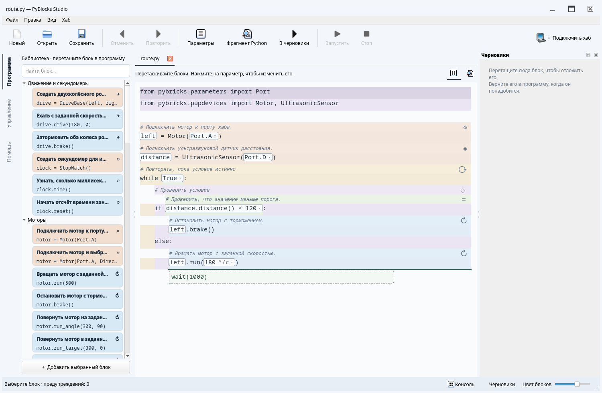
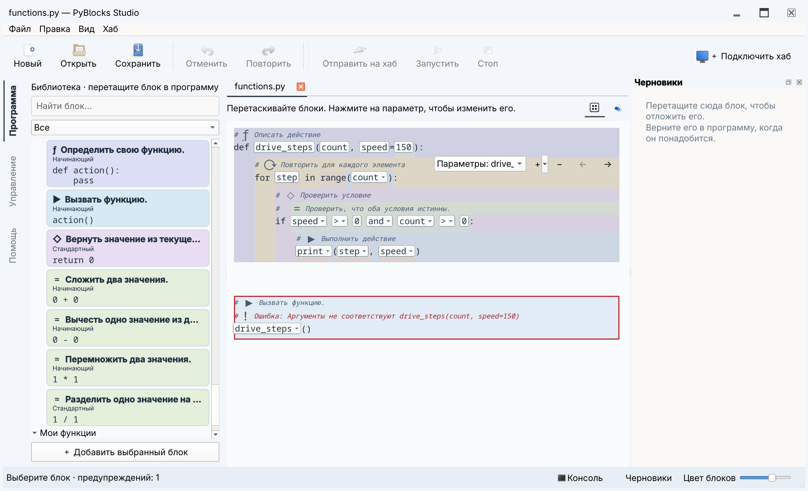

# Работа в редакторе

Здесь описан редактор Qt. [Терминальная среда](tui.md) редактирует исходники
Python напрямую и содержит собственные инструменты работы с хабом.

## Рабочие режимы Qt

Иконки в узкой панели слева переключают **Программа**, **Управление**, **Помощь**,
**Редактор блоков**. Название появляется в подсказке при наведении на иконку.
В проекте урока также доступны
**Урок** и, при наличии модели робота, **Сборка**. При нехватке высоты панель
прокручивается, сохраняя текущий режим. [Редактор блоков](block-editor.md)
(**Ctrl+Alt+3**) показывает предпросмотр над текстом определения.
Активный режим отмечен фоном и линией слева; цвета
сохранены для типов блоков. Две небольшие иконки справа вверху документа
переключают **Блоки / Python**. Те же команды находятся в меню **Вид**
(**Ctrl+Alt+1 / Ctrl+Alt+2**). Подключение хаба
находится справа вверху. Scratch виден справа при открытии программы; панель можно растянуть, закрыть
или снова открыть кнопкой внизу окна. В режиме управления хабом Scratch скрыт.
Консоль открывается кнопкой внизу окна. Сохранить, отменить и запустить можно с тулбара.

Режим **Python** — обычный текстовый редактор с подсветкой, номерами строк,
автоотступами и Tab/Shift+Tab. Дополнение появляется при наборе имени или после
точки; **Ctrl+Space** вызывает его явно. Стрелки выбирают вариант, Enter или Tab
вставляют его, Escape закрывает список. Подсказки учитывают локальную область,
импорты, методы объектов и установленные описания API Pybricks. При вызове функции
показываются сигнатура и текущий параметр; **Ctrl+Shift+Space** вызывает подсказку
или документацию имени под курсором. Jedi анализирует незавершённый код в фоне,
не выполняя его. Для динамических объектов подсказки могут быть неполными;
описания API не проверяют поддержку на подключённом хабе. Ruff форматирует
код при сохранении, запуске, переходе к блокам и по **Ctrl+Alt+L**.
**Ctrl+S** сохраняет и незавершённый Python. Все программы записываются в UTF-8
без BOM. Старые файлы читаются в исходной кодировке; при сохранении объявление
кодировки обновляется и в редакторе. Это изменение можно отменить через Ctrl+Z.
Файл с синтаксической ошибкой сразу открывается в Python. Запуск, отправка на хаб
и переход к блокам требуют корректного синтаксиса. Ошибочная структурная правка
по-прежнему не меняет блоковый документ. При закрытии несохранённого текста предлагается
сохранить, отбросить или отменить закрытие.

В Python работают обычные вырезание, копирование и вставка; Ctrl+X не отправляет
текст в Scratch. Ctrl+Z отменяет текстовые правки, включая автоформатирование.
В режиме блоков Ctrl+Z отменяет структурные операции. **Ctrl+F** ищет текст.

## Документы и язык

**Ctrl+O** позволяет выбрать несколько `.py`-файлов. Они открываются во вкладках
над документом; вкладки можно переставлять. Повторное открытие файла выбирает
его вкладку. У каждого файла собственные черновик, Scratch, выделение и история
отмены. Сохранение и запуск относятся к активному файлу.

**Ctrl+N** открывает пустой документ, **Ctrl+W** закрывает текущий. Несохранённые
изменения отмечены точкой перед именем. Закрытие предлагает сохранить, отбросить
изменения или отменить действие. Сохранить можно и недописанную программу.

При запуске без имени файла и по **Файл → Новый** создаётся документ без выбранного
места сохранения. Первое сохранение, запуск или отправка на хаб предлагают имя
и папку. Отмена оставляет документ открытым и отменяет операцию с хабом.
То же правило действует при сохранении перед закрытием.

**Вид → Язык → Русский / English** переключает подписи, библиотеку и встроенную
помощь без перезапуска. Выбор сохраняется между запусками. Текст программы,
имена файлов, показания устройств и история отмены сохраняются.

Кнопки заголовка позволяют свернуть, развернуть и закрыть окно.
**F11 / Вид → Полный экран** переключает полноэкранный режим.
После обычного закрытия приложение восстанавливает положение, размер и
развёрнутое или полноэкранное состояние окна. Свёрнутое окно при следующем
запуске становится видимым. При смене мониторов Qt возвращает положение окна
в доступную область экрана.

## Выделение и перемещение

В Qt нажмите на блок вне поля параметра. Его фон станет насыщеннее и будет
медленно пульсировать по всей ширине области. В этом режиме нет текстового
курсора; ввод открывается только в выбранном поле.
**Alt+Left** выбирает родительскую конструкцию, **Alt+Right** — дочернюю.
Например, можно перейти от числа к выражению, затем к вызову, затем к циклу.
**Alt+Up / Alt+Down** выбирает соседний узел того же родителя: так можно перейти
к другому аргументу вызова или операнду выражения, не используя мышь.

Распознанный сниппет по умолчанию редактируется целиком. Поля параметров видны
прямо в программе как светлые области. Нажатие открывает поле ввода на месте
значения. Если есть альтернативы, стрелка раскрывает список под полем: можно
выбрать предложенное имя, порт или значение либо ввести Python-выражение.
Имена объявляемых переменных и параметры без вариантов показываются без стрелки.
Имя параметра видно в подсказке при наведении, единица — внутри поля, отдельно
от редактируемого текста. Подсказки учитывают тип: в условии предлагаются
логические значения и показания кнопки, у мотора — переменные моторов.
**Enter** или выбор пункта применяет изменение, **Esc** закрывает поле. Ошибка
оставляет прежний код. **F3** открывает первый параметр выбранного блока;
**F2** позволяет изменить внутренний Python-код. Если изменённая
структура больше не соответствует шаблону, она остаётся обычными Python-блоками.
**Ctrl+E** раскрывает сниппет для структурной работы с его внутренними узлами;
повторное нажатие возвращает составной вид. Это временное состояние отображения:
после изменения исходника распознавание выполняется заново.

Перенос с клавиатуры:

| Действие | Qt |
| --- | --- |
| Начать перенос | Ctrl+M |
| Предыдущая / следующая позиция | Alt+Up / Alt+Down |
| Меньшая / большая вложенность | Ctrl+Alt+Left / Right |
| Применить перенос | Ctrl+Enter |
| Отменить перенос | Esc |
| Свернуть / развернуть выбранную область | Ctrl+Shift+F |

При переносе мышью цветной блок следует за указателем. Предпросмотр содержит
не более четырёх видимых строк. На прежнем месте остаётся янтарная строка
**Прежнее положение**; при переносе выражения метка остаётся в его параметре.
**Esc** отменяет перенос, даже если кнопка мыши ещё нажата. Возврат на янтарную
строку оставляет документ и историю отмены без изменений.

Верхняя половина строки предлагает вставку выше, нижняя — ниже. Нижняя половина
заголовка цикла или `if` предлагает начало его тела. Для вставки после составного
блока наведите на следующий внешний блок или пустую строку после конструкции;
на пустых строках положение по горизонтали выбирает вложенность.
Зелёная строка **Вставить здесь** появляется перед описаниями места назначения.
При её появлении строка под мышью и относительное положение указателя сохраняются.
У краёв работает прокрутка; автоматического сворачивания при переносе нет.

Совместимое выражение можно поместить только в пустой параметр (`...`). Заполненные
поля переносом не заменяются. В недопустимом контексте вставка не предлагается;
отпускание возвращает блок. Один **Undo** восстанавливает обе области после переноса.
Редактор проверяет допустимость Python, но не доказывает правильность алгоритма.

Отдельный комментарий принадлежит следующей команде в той же области
вложенности, в том числе через пустые строки. Строчный комментарий принадлежит
команде на этой строке. Докстринги и конечные комментарии без следующей команды
принадлежат определению или окружающей области. Метаданные файла и маркеры
управляемых разделов остаются у файла. При перемещении команды её комментарии
перемещаются вместе с ней.

Заголовок и символ действия — оформление блока, которое не записывается в `.py`.
Размер текста заголовков и комментариев совпадает с размером кода.
Цветовые полосы вложенности продолжаются на пустых строках.

Кнопка **A / P / D** справа вверху распознанного inline-блока при каждом щелчке
циклически переключает режим:

- **Авто**: комментарии определения, пока у блока нет комментариев
  в программе. Пустые строки на выбор не влияют.
- **Комментарии программы**: собственные комментарии программы.
- **Комментарии определения**: комментарии определения рядом с соответствующим кодом.

Код, имена, аннотации, скобки и оформление строк кода всегда берутся из программы.
Переключение не раскрывает тело функции и не подменяет код текстом определения.

Каждый блок выбирает режим независимо; ручной выбор сохраняется при изменении
параметров в открытом представлении. Переключение не меняет сохранённый Python,
выполнение и Undo. Комментарии программы редактируются в Python, комментарии
определения — в редакторе блоков. Вставка inline-блока не копирует пояснения в
программу. Блок-функция показывает только настоящий вызов Python и комментарии
программы. Действие **Перейти к определению** открывает её тело. Функция сохраняет
имя из определения блока и добавляется один раз, вместе с комментариями, в
управляемый раздел после импортов. Все вызовы используют это определение; после
удаления последнего обращения из программы и Scratch ненужные функции удаляются.
Полный сохранённый файл доступен в Python.

## Поиск и повторное использование блоков

В библиотеке отдельно выбираются уровень и представление. **Начинающий**,
**Средний**, **Продвинутый** и **Эксперт** включают предыдущие уровни; **Все**
показывает все уровни. Обе группы представлены значками: число заполненных
столбиков обозначает уровень, бесконечность — Все. Названия доступны при наведении,
активный выбор подсвечен. Кнопки доступны через Tab и активируются пробелом.
Две кнопки со стрелками рядом с представлениями сворачивают и раскрывают все ветки.

**Каталог** содержит ветки: Программа, Значения и вычисления, Переменные и
коллекции, Функции, Моторы и движение, Датчики и ввод, Свет и звук, Устройства и
связь. Раскройте ветку или ищите по действию, описанию либо имени Python API.
Английские имена участвуют в поиске при любом языке интерфейса. Внутри категории
совпадения в названиях идут перед случайными упоминаниями. Очистка поиска
восстанавливает выделение и раскрытые ветки. Сообщение поясняет, сколько подходящих
семейств скрыто уровнем, палитрой лабораторной или выбранным параметром.
Поиск показывает наиболее подходящий вариант семейства; его можно сменить вручную.

Карточка представляет семейство близких операций. Нажмите на неё правой кнопкой
мыши и выберите **Вариант**: предпросмотр карточки покажет Python для вставки.
Уровень, палитра лабораторной и выбранное поле
ограничивают варианты. Выбор в каталоге не изменяет уже вставленный код.
Перетащите карточку в нужное место. Двойной щелчок также вставляет её в текущую
позицию выбора.

- **Избранное:** нажимайте на звезду самой карточки для добавления или удаления
  ссылки. Заполненная звезда означает, что блок уже в избранном. То же действие
  доступно в контекстном меню. **Переместить выше** и **Переместить ниже** задают
  порядок. Ограничения в двенадцать карточек нет. Недоступные определения
  сохраняются в списке и восстанавливаются при возвращении коллекции или документа.
- **Недавние:** последние двенадцать различных семейств. Вставка другого варианта
  семейства перемещает ту же запись в начало. Значок **Очистить недавние** очищает список.
- **Часто используемые:** до двенадцати семейств по числу успешных вставок за
  текущие и предыдущие 29 календарных суток UTC; при равенстве учитываются
  последнее использование и постоянный идентификатор. Порядок обновляется при
  повторном входе в представление. Значок **Сбросить историю использования** очищает
  недавние и часто используемые, сохраняя избранное.
- **Для этой лабораторной:** блоки текущего этапа независимо от обычного фильтра
  уровня. Если лабораторная не открыта, представление поясняет, как получить
  подборку. **Показать все блоки** по-прежнему разрешает свободные эксперименты.

Личные списки хранятся на этом компьютере и не меняют файлы проекта. Учитываются
только успешные вставки из каталога, в том числе в Scratch. Открытие, запуск,
распознавание и повтор правки не учитываются; отмена сохраняет факт использования.
Списки запоминают семейство, но не прежние параметры и порты. Функции из программы
привязаны к пути её файла: одинаковые имена в разных файлах имеют отдельные ссылки
и статистику. У каждого безымянного черновика также свои записи: они сохраняются
при восстановлении и переносятся к пути файла при первом сохранении. Последующее
**Сохранить как** создаёт отдельную область для функций.


## Изменение варианта вставленного блока

Нажмите правой кнопкой на распознанный блок в программе или Scratch и выберите
**Вариант** для немедленного переключения. Текущая форма отмечена, остальные
учитывают уровень и палитру лабораторной. Совместимые значения полей сохраняются;
переключение отменяется одним Undo и не считается новой вставкой из каталога.

Выберите распознанный блок семейства в программе или Scratch и нажмите **F3**
либо **Варианты и параметры…** в контекстном меню. Выберите операцию и измените
выражения Python. Общие поля сохраняют совместимые значения; вновь открытые
параметры сохраняют прежние фиксированные настройки, например `wait=False`.
Текущая форма доступна и выше выбранного уровня. Остальные варианты учитывают
уровень и палитру лабораторной.

В **Дополнительных настройках** находятся необязательные поля. При отличии от
значений по умолчанию раздел сразу раскрыт; после сворачивания активные отличия
остаются видны в краткой строке. Подсказки используют значения Python, например
`Stop.HOLD` и `False`: выражения не переводятся и не выполняются.

Перед применением прочитайте описание операции и **Изменения Python**: смена
операции может изменить ожидание, единицы, остановку или убрать поле. **OK**
применяет одну правку вместе с нужными импортами; отмена восстанавливает прежний
код. **Отмена** закрывает окно без изменений. Ошибка в выражении, несовместимый
тип результата или невозможность сохранить порядок вычисления аргументов
не позволяют применить правку.

Окно доступно для распознанных шаблонов. После заполнения тела обычного цикла
или условия конструкция может перестать совпадать с исходным шаблоном; её
по-прежнему можно редактировать через структурные поля или представление Python.


## Library и помощь

Вложенность выражений задаётся синтаксисом Python. При наведении и выборе
подвыражения подсвечиваются его точные границы, без дополнительных постоянных рамок.
**Alt+Left / Right** выбирает родителя или дочернее выражение, **Tab / Shift+Tab**
переходит между полями. **Ctrl+Space** или **Enter** открывает локальный поиск
операций, имён и подходящих блоков. **Ctrl+Shift+Space** оборачивает выбранное
выражение. Ввод оператора, например `+`, добавляет операцию и выбирает новый операнд.
**Escape** выбирает содержащую выражение команду и возвращает её контекст библиотеки.

Новое незаполненное поле обозначается Python-маркером `...`; `None` остаётся обычным
значением. Щелчок по пустому полю открывает сборку выражения. Пустые поля сохраняются
при сохранении, восстановлении и отмене; перед запуском или загрузкой их нужно
заполнить. Кнопки списков добавляют, удаляют и переставляют аргументы и элементы
коллекций. Контекстное меню позволяет обернуть выражение или оставить один операнд.
При желании выражение по-прежнему можно ввести текстом Python.

Библиотека учитывает выбранное поле, известные типы и единицы измерения. Выражения
неизвестного типа остаются доступными. Если у выбранного блока подходят несколько
полей, нужно выбрать одно из списка; наведение подсвечивает это поле. Фильтр уровня
продолжает ограничивать каталог.

Поиск учитывает имя, категорию и описание сниппета. В Qt вставка — двойной щелчок
либо перетаскивание в исходник.
Qt сразу вставляет значения по умолчанию, без модального окна. Объектные параметры
предлагают уже объявленные устройства, а новые имена избегают совпадений.
Подсказки имён доступны в полях параметров.
Неизменяемая часть поля показывает единицу: `°/с`, `мс`, `%`.
Это подсказка редактора; программа получает обычные числа.

**F1** открывает раздел выбранного блока на странице его группы или общую справку.
В оглавлении перечислены группы; на каждой странице собраны все блоки группы.
Карточка библиотеки содержит описание и первые строки Python, с тем же цветом
конструкции, что после вставки. Полный код доступен при наведении.
Режим «Помощь» объединяет руководство и извлечённые из сниппетов описания,
параметры и код. Поиск работает по содержимому; внутренние ссылки и «Назад»
позволяют переходить между страницами. Помощь доступна без сети и в установленном
пакете. Внешние ссылки открываются в браузере.

## Scratch

Scratch — вертикальная лента самостоятельных фрагментов. Перетащите действие
из программы в свободное место между ячейками или сразу из библиотеки. Ячейки
показывают код теми же цветами, полями и подсказками, что основной документ.
Ручка ⠿ переносит всю ячейку; выделенный блок внутри неё можно отцепить отдельно.
Перенос в другую ячейку объединяет фрагменты, между ячейками — меняет их порядок.

Для возврата перетащите блок к нужной позиции программы. Недостающие импорты
из библиотеки добавляются при этом; в Scratch они не добавляются. Фрагмент
`break` может лежать отдельно, но вернуться в программу может только внутрь
цикла. Ошибка сохраняет оба места, удачный перенос отменяется одним **Ctrl+Z**.

В каждой ячейке есть **Блоки / Python**. Текстовый режим допускает незаконченные
выражения и произвольный текст; блоковый режим становится доступен после
синтаксического разбора. Python внутри ячейки редактируется на месте. **Ctrl+X**
в блоковом режиме также откладывает выделенное; в текстовом — вырезает текст.

## Диагностика

Редактор показывает предупреждения об очевидно неизвестных именах. В Qt откройте
Вид → Диагностика имён; в CLI используйте `little-tinker-rig diagnose файл.py`.
Предупреждения не запрещают сохранение. Анализ лексический: он не предсказывает
все ветви выполнения, динамические импорты и содержимое сторонних библиотек.

## CLI

Все позиции относятся к отформатированному исходнику из `inspect`:
строки начинаются с 1, столбцы — с 0 и считаются в Unicode-символах.
Команды преобразования печатают результат. Только `--write` сохраняет файл.

```sh
uv run little-tinker-rig inspect examples/first.py
uv run little-tinker-rig diagnose examples/first.py
uv run little-tinker-rig snippets examples/first.py
uv run little-tinker-rig insert main.py python/basics/display --param 'value="Hello!"'
uv run little-tinker-rig replace main.py '4 + 5' --at 1:4
uv run little-tinker-rig move main.py --at 2:0 --to 7:0
uv run little-tinker-rig scratch main.py --at 2:0 --write
uv run little-tinker-rig restore main.py 0 --at 1:0 --write
uv run little-tinker-rig format main.py --write
```

`inspect` выводит JSON с текстом, структурными областями и распознанными шаблонами.
`diagnose` возвращает код 1 при предупреждениях, 0 при их отсутствии.
Ошибки ввода и преобразования дают код 2. Список команд: `little-tinker-rig --help`.

## Библиотеки и версии

Дополнительную библиотеку подключают через общий параметр CLI:

```sh
uv run --extra qt little-tinker-rig --collection ./my_snippets qt main.py
```

После сохранения путь сохраняется в workspace-файле. При распознавании целые
алгоритмы имеют приоритет перед составляющими их маленькими блоками; текущая
форма сниппета заменяет историческую форму того же сниппета в той же области.
**Ctrl+U / Upgrade snippet** обновляет распознанную старую форму с сохранением
параметров. Несовместимая сигнатура или смена основной версии запрещает
автоматическое обновление. Правила для авторов: [библиотеки](snippets.md).




## Недавние файлы, поля и описания блоков

**Файл → Открыть недавние** хранит десять последних открытых или сохранённых
файлов. Уже открытый файл выбирается в своей вкладке с сохранением черновика.
Отсутствующие файлы видны, но недоступны; список можно очистить.

В заголовке всегда видны кнопки сворачивания, разворачивания/восстановления и
закрытия. Двойной щелчок по заголовку разворачивает окно, перетаскивание заголовка
перемещает его, а перетаскивание края меняет размер.

Параметр без вариантов и имя объявляемой переменной редактируются обычным полем
без стрелки. При наличии вариантов стрелка открывает список под полем.
Описание каждого блока занимает отдельную строку своего цвета; вложенные
выражения также получают собственные строки описаний. Линия вставки проходит
перед описаниями целевого блока и его присоединёнными комментариями Python.

## Уровни блоков

Фильтр **Начинающий / Средний / Продвинутый / Эксперт / Все** работает вместе с
поиском и группами. Каждый уровень включает предыдущие. Выше начального группы
сначала свёрнуты, поиск раскрывает подходящие. «Все» — только вариант фильтра.
При первом запуске выбран начальный уровень, затем выбор сохраняется.
См. [учебные уровни](learning.md). F3, отправка в Scratch и редактирование Python-фрагмента (F2)
остаются в меню; тулбар содержит действия с файлами, историей и хабом.

## Выражения и собственные функции

Объект вызова, имя функции, операнды и операторы редактируются прямо в исходнике.
Например, у `left.run(speed + 10)` есть отдельные редактируемые части. Щелчок по
оператору позволяет выбрать другой; группировка операндов сохраняется. Правый
щелчок по выражению позволяет изменить его как Python, очистить до `...` или
обернуть в логическое, арифметическое выражение либо сравнение. В пустые поля
можно перетаскивать совместимые блоки.

Щёлкните внутри вызова, заголовка функции или логического выражения, чтобы увидеть
компактные кнопки списка. Если списки вложены, выберите нужный. **+** вставляет
после выбранного элемента либо в конец; меню кнопки позволяет вставить перед
элементом. **−** удаляет элемент, стрелки меняют порядок. У вызова и определения
список может быть пустым; у `and` и `or` остаётся минимум два операнда. Параметры
поддерживают аннотации, значения по умолчанию и формы Python `/`, `*`, `*args`,
`**kwargs`. Синтаксически неверное изменение не меняет документ. Каждая принятая
операция отменяется одним Undo.

Эти же кнопки редактируют списки, кортежи, множества, словари и цепочки сравнений.
Меню **+** у вызова добавляет именованный аргумент, `*args` или `**kwargs`.
Введённое в локальном поиске число приоритетнее описаний, содержащих такое число.
**Копировать выражение / Вставить выражение** переносят подвыражение;
**Оставить операнд** сохраняет выбранный операнд вместо операции. Цель присваивания
можно составить из атрибута, обращения по индексу или кортежа имён для распаковки.
Щёлкните по `+=`, чтобы выбрать другой оператор изменения значения.

На уровне Expert меню функции добавляет декораторы, аннотацию результата и
объявления `global`/`nonlocal`. **Правка → Импортировать модуль…** добавляет явный
импорт, в том числе классов и функций из других файлов проекта.

Блок **Определить свою функцию** создаёт определение: измените имя и параметры,
вставьте действия в тело. Функции верхнего уровня появляются в группе
**Мои функции**. Их вызовы первоначально содержат обязательные параметры со значениями `...`;
необязательные используют значения по умолчанию самой функции. При необходимости
добавьте необязательные аргументы явно. Переименование функции или параметра
обновляет статически определимые обращения и известные именованные вызовы.
Конфликт имён и захват чужих переменных не допускаются. Изменение сигнатуры
сохраняет существующие вызовы. Известное несоответствие отмечается красной рамкой
и строкой ошибки; неопределённые динамические вызовы не получают ложной ошибки
сигнатуры. Программа остаётся редактируемой. Блок возврата значения вставляется
внутрь функции.

Функция без возвращаемого значения появляется как действие. После изменения
поля нажмите **Escape**, чтобы выбрать команду перед добавлением следующего действия.
Функции с возвращаемым
значением, генераторы и функции с аннотацией результата вставляются как выражения.
Возврат внутри вложенной функции не меняет вид внешней. Результат функции
с декоратором считается неизвестным; её вызов остаётся выражением.

Простой повтор уровня Beginner позволяет менять счётчик и число повторений.
Диапазон уровня Intermediate — счётчик, начало, исключённую конечную границу и шаг.
Раскрытие шаблона позволяет менять фиксированные части Python. Нулевой шаг
диапазона отмечается ошибкой.

Поиск проверяет все введённые слова в имени, коде, группе и полном переводе
подсказки независимо от порядка слов. Заголовок содержит увеличенный символ
блока и пояснение; строки кода сохраняют обычное межстрочное расстояние.
Фон, наведение, выделение и цветовые полосы родителей общие с блоком.



## Контекстное меню блока

Правая кнопка на блоке или его служебном комментарии открывает меню именно этого
блока, независимо от прежнего выделения. **Открыть определение** переключает
редактор определений на точную функцию. Встроенные и исторические определения
доступны для чтения; текущие пользовательские — для редактирования. В меню также
есть справка, раскрытие и сворачивание, дублирование, перенос в черновик и удаление.
Выражения дублируются в черновик. Составная конструкция переносится или удаляется
целиком; отмена восстанавливает программу и черновик вместе. На параметре
сохраняется подменю редактирования выражения.
Удаление выражения с отдельной строки убирает всю инструкцию. Внутри другого
выражения остаётся пустое поле `...`; пустое тело конструкции сохраняет `pass`.

При наведении или редактировании повторяющегося параметра подсвечиваются все его
вхождения в том же блоке; подсказка показывает, например, `speed · вхождений: 3`.
Изменение любого вхождения меняет всю группу одним шагом отмены. Совпадающий текст
другого параметра или другого блока остаётся независимым. Escape отменяет
незавершённую правку. Прямая правка Python может нарушить шаблон: тогда остаётся
обычный код Python.

## Восстановление, примеры и ошибки выполнения

Редактор отдельно хранит снимки открытых документов, несохранённого текста и
Scratch в пользовательском каталоге данных ОС (`little-tinker-rig/recovery`).
Пока интерфейс отвечает, изменения записываются примерно в течение секунды.
После аварийного завершения появляется предложение **Восстановить работу**:
«Да» восстанавливает, «Нет» удаляет этот снимок, «Отмена» оставляет его на потом.
Работающие окна не затрагиваются. Обычное закрытие сохраняет прежний выбор
сохранить или отбросить правки. Восстановление не записывает исходники и сохраняет
проверку внешних изменений при последующем сохранении. Конкурирующая версия
несохранённой вкладки открывается отдельно как `*_recovered_N.py`.
История отмены после аварийного завершения не восстанавливается.

Меню **Файл → Примеры** строится из каталога `examples/`: папки становятся подменю,
а имена файлов `.py` — пунктами. Список обновляется при открытии меню. Пример
открывается как обычный файл; повторный выбор переключает на существующую вкладку,
сохраняя её правки. Для отдельного варианта используйте **Сохранить как**.
Примеры входят в установленное приложение и находятся независимо от рабочей папки.

Ошибка выполнения открывает консоль с коротким объяснением и кнопкой
**Показать блок**. Известное место отмечается красной строкой описания блока
или подсветкой строки Python. Ошибка внутри автоматически добавленной функции
ведёт к вызвавшему её пользовательскому блоку. Полный traceback и неизвестные
сообщения остаются в консоли. Диагностика относится к снимку отправленной
программы, включая локальные модули Python. Если файл уже изменён, кнопка открывает
запущенный текст только для чтения. Новый запуск убирает прежнюю отметку.
Запуск сохранённой программы использует снимок последней успешной отправки в
текущем подключении; для неизвестной программы на хабе привязки к редактору нет.

## Границы блоков

Логические блоки обведены тонким контуром своего смыслового цвета. Соседние блоки
одного цвета разделены видимой границей; описание и код находятся внутри одного
контура. У составных блоков сохраняются внешний контур и границы дочерних блоков.
Наведение и выделение усиливают заливку и границу. Отрисовка общая для программы,
черновика, предпросмотра определения и перетаскиваемого блока. Контуры не увеличивают
межстрочный интервал и не меняют цели вставки. Ошибки и маркеры вставки выделяются
собственным оформлением.
