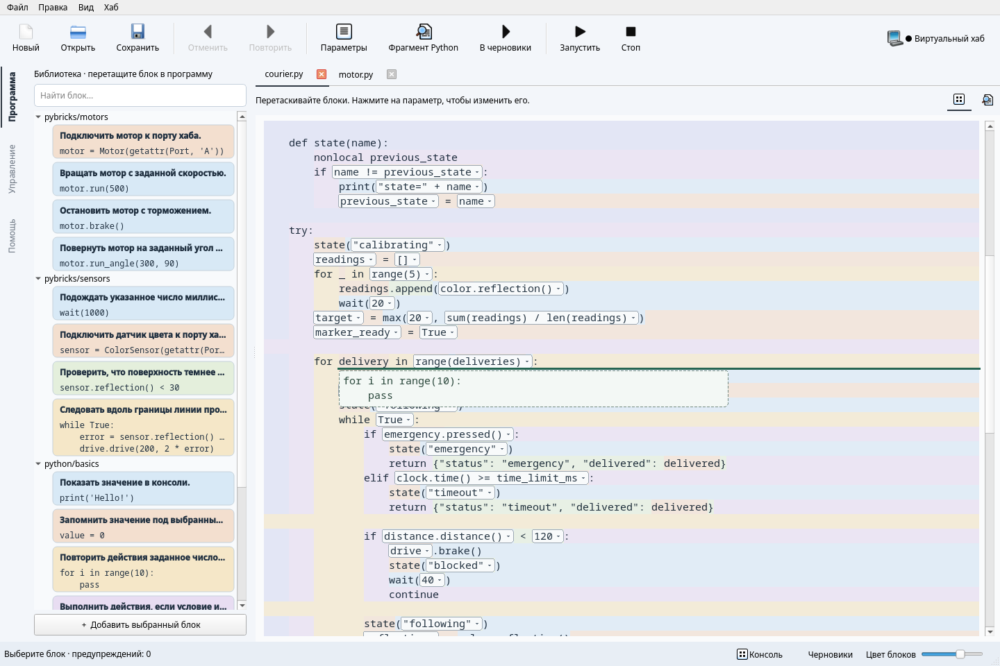

# Работа в редакторе

## Рабочие режимы Qt

В узкой полосе слева вертикальные надписи переключают **Программа**,
**Управление**, **Помощь**. Активный режим отмечен нейтральной линией; цвета
сохранены для типов блоков. Две небольшие иконки справа вверху документа
переключают **Блоки / Python**. Те же команды находятся в меню **Вид**
(**Ctrl+Alt+1 / Ctrl+Alt+2**). Подключение хаба
находится справа вверху. Консоль и Scratch скрыты до обращения к ним; кнопки
внизу окна открывают эти панели. Сохранить, отменить и запустить можно с тулбара.

Режим **Python** — обычный текстовый редактор с подсветкой, номерами строк,
автоотступами, Tab/Shift+Tab и дополнением слов по Ctrl+Space. Black форматирует
код при сохранении, запуске, переходе к блокам и по **Ctrl+Alt+L**.
Незавершённый Python остаётся черновиком: ошибка не меняет основной документ
или файл. Исправьте текст либо отмените правку. Файл с синтаксической ошибкой
сразу открывается в Python. При закрытии несохранённого текста предлагается
сохранить, отбросить или отменить закрытие.

В Python работают обычные вырезание, копирование и вставка; Ctrl+X не отправляет
текст в Scratch. Ctrl+Z отменяет текстовые правки, включая автоформатирование.
В режиме блоков Ctrl+Z отменяет структурные операции. **Ctrl+F** ищет текст.

## Документы и язык

**Ctrl+O** позволяет выбрать несколько `.py`-файлов. Они открываются во вкладках
над документом; вкладки можно переставлять. Повторное открытие файла выбирает
его вкладку. У каждого файла собственные черновик, Scratch, выделение и история
отмены. Сохранение и запуск относятся к активному файлу.

**Ctrl+N** открывает пустой документ, **Ctrl+W** закрывает текущий. Несохранённые
изменения отмечены точкой перед именем. Закрытие предлагает сохранить, отбросить
изменения или отменить действие. Некорректный Python нельзя сохранить поверх
валидного файла; он остаётся в своей вкладке для исправления.

**Вид → Язык → Русский / English** переключает подписи, библиотеку и встроенную
помощь без перезапуска. Выбор сохраняется между запусками. Текст программы,
имена файлов, показания устройств и история отмены сохраняются.

## Выделение и перемещение

В Qt нажмите на блок вне поля параметра. Его фон станет насыщеннее и будет
медленно пульсировать по всей ширине области. В этом режиме нет текстового
курсора; ввод открывается только в выбранном поле. В TUI выберите строку клавишами ↑/↓.
**Alt+Left** выбирает родительскую конструкцию, **Alt+Right** — дочернюю.
Например, можно перейти от числа к выражению, затем к вызову, затем к циклу.
**Alt+Up / Alt+Down** выбирает соседний узел того же родителя: так можно перейти
к другому аргументу вызова или операнду выражения, не используя мышь.

Распознанный сниппет по умолчанию редактируется целиком. Поля параметров видны
прямо в программе как светлые области со стрелкой. Нажатие открывает редактируемый
список: можно выбрать предложенное имя, порт или значение, либо ввести Python-
выражение. **Enter / ✓** применяет изменение, **Esc** закрывает поле. Ошибка
оставляет прежний код. **F3** открывает первый параметр выбранного блока;
**F2** позволяет изменить внутренний Python-код. Если изменённая
структура больше не соответствует шаблону, она остаётся обычными Python-блоками.
**Ctrl+E** раскрывает сниппет для структурной работы с его внутренними узлами;
повторное нажатие возвращает составной вид. Это временное состояние отображения:
после изменения исходника распознавание выполняется заново.

Перенос с клавиатуры:

| Действие | Qt | TUI |
| --- | --- | --- |
| Начать перенос | Ctrl+M | Ctrl+M |
| Предыдущая / следующая позиция | Alt+Up / Alt+Down | Alt+Up / Alt+Down |
| Меньшая / большая вложенность | Ctrl+Alt+Left / Right | Alt+Left / Right |
| Применить перенос | Ctrl+Enter | Ctrl+Enter |
| Отменить перенос | Esc | Esc |
| Свернуть / развернуть выбранную область | Ctrl+Shift+F | Ctrl+F |

Qt также поддерживает перенос мышью: перетащите инструкцию к зелёной линии.
Рядом с линией появляется предварительный код. При отпускании вне редактора
перенос отменяется.
Место назначения должно соответствовать правилам Python. Например, `break`
нельзя вынести из цикла. Перенос может изменить смысл программы: редактор
проверяет допустимость Python, но не доказывает правильность алгоритма.

С блоком перемещаются соседние комментарии перед ним без разделяющей пустой
строки и комментарий справа в его последней строке. Заголовок файла сохраняется.
Пустая строка отделяет комментарий от следующего блока.

## Library и помощь

Поиск учитывает имя, категорию и описание сниппета. В Qt вставка — двойной щелчок
или кнопка «Добавить выбранный блок», а также перетаскивание в исходник; в TUI — Enter.
Qt сразу вставляет значения по умолчанию, без модального окна. Объектные параметры
предлагают уже объявленные устройства, а новые имена избегают совпадений.
Подсказки имён доступны в полях параметров.
Строка рядом с параметром может указывать единицу: `deg/s`, `ms`, `%`.
Это подсказка редактора; программа получает обычные числа.

**F1** открывает полную помощь для выбранного сниппета или общую справку.
Карточка библиотеки содержит описание и первые строки Python, с тем же цветом
конструкции, что после вставки. Полный код доступен при наведении.
Режим «Помощь» объединяет руководство и извлечённые из сниппетов описания,
параметры и код. Поиск работает по содержимому; внутренние ссылки и «Назад»
позволяют переходить между страницами. Помощь доступна без сети и в установленном
пакете. Внешние ссылки открываются в браузере.

## Scratch

**Ctrl+X** переносит выбранную область в Scratch. В Qt фрагмент можно открыть
двойным щелчком. В TUI переключитесь на Scratch клавишей Tab и нажмите F2.
**Ctrl+N** создаёт новый фрагмент в TUI, **Ctrl+R** возвращает выбранный фрагмент.

Scratch допускает незаконченные выражения и произвольный текст. Возврат в
основной документ проверяется до изменения обеих рабочих областей.

## Диагностика

Редактор показывает предупреждения об очевидно неизвестных именах. В Qt откройте
Вид → Диагностика имён; в CLI используйте `pyblocks diagnose файл.py`.
Предупреждения не запрещают сохранение. Анализ лексический: он не предсказывает
все ветви выполнения, динамические импорты и содержимое сторонних библиотек.

## CLI

Все позиции относятся к отформатированному исходнику из `inspect`:
строки начинаются с 1, столбцы — с 0 и считаются в Unicode-символах.
Команды преобразования печатают результат. Только `--write` сохраняет файл.

```sh
uv run pyblocks inspect examples/first.py
uv run pyblocks diagnose examples/first.py
uv run pyblocks snippets examples/first.py
uv run pyblocks insert main.py python/basics/display --param 'value="Hello!"'
uv run pyblocks replace main.py '4 + 5' --at 1:4
uv run pyblocks move main.py --at 2:0 --to 7:0
uv run pyblocks scratch main.py --at 2:0 --write
uv run pyblocks restore main.py 0 --at 1:0 --write
uv run pyblocks format main.py --write
```

`inspect` выводит JSON с текстом, структурными областями и распознанными шаблонами.
`diagnose` возвращает код 1 при предупреждениях, 0 при их отсутствии.
Ошибки ввода и преобразования дают код 2. Список команд: `pyblocks --help`.

## Библиотеки и версии

Дополнительную библиотеку подключают через общий параметр CLI:

```sh
uv run --extra qt pyblocks --collection ./my_snippets qt main.py
```

После сохранения путь сохраняется в workspace-файле. При распознавании целые
алгоритмы имеют приоритет перед составляющими их маленькими блоками; текущая
форма сниппета заменяет историческую форму того же сниппета в той же области.
**Ctrl+U / Upgrade snippet** обновляет распознанную старую форму с сохранением
параметров. Несовместимая сигнатура или смена основной версии запрещает
автоматическое обновление. Правила для авторов: [библиотеки](snippets.md).


