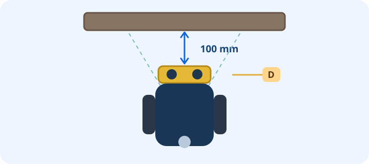

Make the robot stop about **100 mm** before a large upright object. Use the drive base and an ultrasonic sensor on **D**; test at a slow speed and keep **Stop** nearby.

Save your project when you finish. Reopening the lesson resumes this attempt.
