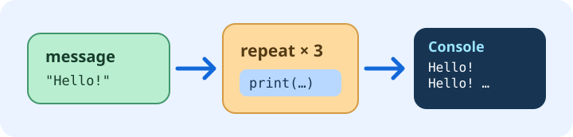

# First Python program

You can do this activity without LEGO or a physical hub. The program is a real Python file. Its colored blocks and Python text are two views of the same work.

## Make the message yours

[Open your program](program:main.py). Find `message = "Hello from LittleTinker Rig!"` and change only the text inside the quotes. Keep the quotes: they tell Python that the value is text. Press Enter to finish a block edit. Use the **Python** icon above the program to see the same instruction as source code, then return to **Blocks**.

The name `message` stores your text. The later `print(message)` reads that same value; you do not need to type the message a second time. Mark this task complete after your new text appears in both views.

## Choose how many times

The `for` loop repeats its indented body. In `range(3)`, change `3` to `5`. Before running, guess how many lines the Console will show. The indentation tells Python that `print(message)` belongs inside the loop.

Try moving the print block after the loop to compare the result. **Undo** restores it. Mark the task complete when you can explain the difference between printing inside and after a loop.

## Run and inspect

Choose [Connect hub](connect:), select **Virtual hub**, choose **Robot Inventor / SPIKE Prime**, and connect. A physical robot is not needed. Press **Run** in the top bar, then open **Console** at the bottom. The message should appear as many times as you predicted.

If you see fewer lines, check the loop count and indentation. If the Console is closed, open it; your program can still run. Change the message once more and run again. Mark the task complete after the output matches your prediction.

Your work is saved as your own lesson attempt. Opening this lesson again continues that attempt. **File → Lessons → Start new attempt** is the explicit way to make another one.
