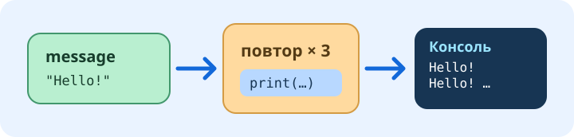

# Первая программа на Python

Для этого занятия не нужны LEGO и настоящий хаб. Программа хранится в обычном файле Python. Цветные блоки и исходный код показывают одну и ту же работу.

## Придумай своё сообщение

[Открой программу](program:main.py). Найди `message = "Hello from LittleTinker Rig!"` и измени только текст внутри кавычек. Сохрани кавычки: они сообщают Python, что это текст. Нажми Enter, чтобы завершить редактирование блока. Значок **Python** над программой покажет ту же команду в исходном коде; затем вернись к **Блокам**.

Имя `message` хранит твой текст. Ниже `print(message)` читает то же значение; вводить сообщение второй раз не нужно. Отметь задание выполненным, когда новый текст появится в обоих представлениях.

## Выбери число повторов

Цикл `for` повторяет команды с отступом внутри него. В `range(3)` измени `3` на `5`. До запуска предположи, сколько строк появится в консоли. Отступ показывает Python, что `print(message)` находится внутри цикла.

Попробуй переместить блок вывода после цикла и сравнить результат. **Отменить** вернёт блок на место. Отметь задание выполненным, когда сможешь объяснить разницу между выводом внутри цикла и после него.

## Запусти и проверь

Выбери [Подключить хаб](connect:), затем **Виртуальный хаб**, **Robot Inventor / SPIKE Prime** и подключись. Настоящий робот не нужен. Нажми **Запуск** в верхней панели, затем открой **Консоль** внизу. Сообщение должно появиться столько раз, сколько ты предсказал.

Если строк меньше, проверь число повторов и отступ. Если консоль закрыта, открой её: программа могла выполниться. Ещё раз измени сообщение и запусти программу. Отметь задание выполненным, когда результат совпадёт с прогнозом.

Твоя работа хранится как отдельная попытка урока. Повторное открытие этого урока продолжит её. **Файл → Уроки → Начать новую попытку** создаёт ещё одну попытку явно.
